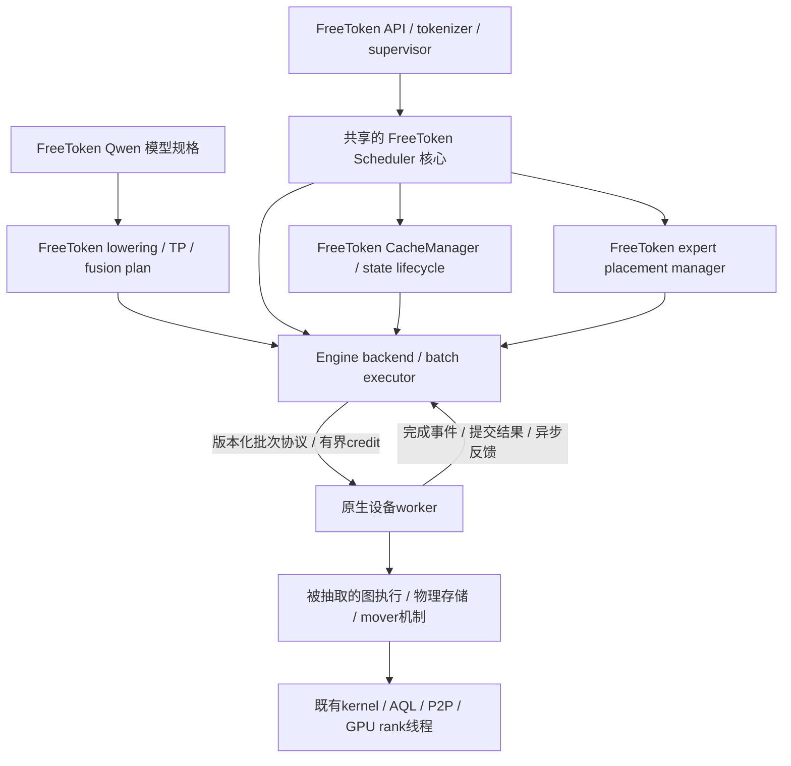

# Qwen3.8 TP2 v2：FreeToken 框架内的原生执行设计

日期：2026-11-17。状态：**实现与TP2正式验收完成。P0–P8完成。MTP0 2K/32K为123.02/120.45 tok/s；MTP3为210.97/197.94 tok/s，均通过原95%保速、TTFT/wall和100 tok/s门。实际实现/验收汇总见第16节。**

第1–14节保留本轮设计合同；已落地类型、入口及源码见第15节，最终验收与使用见第16节。部分设计名对应实际adapter，不能将逻辑接口表直接当成同名可调用API。历史约200 tok/s属于v1整引擎后端；本轮v2独立正式成绩以第16节为准。

## 0. 基线、工作位置与本次交付

| 项目 | 固定值 |
|---|---|
| base提交 | `206a2060ac6257cbf5a530143df95bb1df19906a` |
| base分支 | `feat/qwen38-r9700-radiance-native-tp2-20261117` |
| base worktree | `/home/zihaomu/zihaomu_workspace/freetoken_workspace/worktrees/qwen38-tp2-20261106` |
| v2分支 | `feat/qwen38-r9700-tp2-v2-20261117` |
| v2 worktree | `/home/zihaomu/zihaomu_workspace/freetoken_workspace/worktrees/qwen38-tp2-v2-20261117` |
| v2设计主文档 | `docs/design/qwen38-tp2-v2.md`，位于v2 worktree |
| 工作区文档入口 | `/home/zihaomu/zihaomu_workspace/freetoken_workspace/doc/qwen38_tp2_v2_freetoken_framework_design_20261117.md`，链接到本文件 |
| 本轮artifact | `/home/zihaomu/zihaomu_workspace/freetoken_workspace/.freetoken-zihao/qwen38-tp2-v2-20261117` |
| 最新构建/暂存 | `p6-build-13` / `p6-stage-08`；QkKvStore padding、初始位置发布及取消defer修正 |
| 最新验证镜像 | `sha256:3d9473c27363d64f7bb4f9e90b99fef66cab0901798e2270cc664c95a25faedc`（image15） |
| 当前资格 | 971 CPU通过；image15 TP2 MTP0/3功能/状态/prefix/包内API/rank1通过；各三A/A与八启动四对正式性能通过 |
| 隔离记录 | artifact下`initialization.json` |

设计创建时只建立worktree和交接记录；用户现已授权按本计划持续实施，当前执行状态见第15节。Git对象库共享，模型只读复用，base工作树保持原状。

v1保留为正确性/速度参考和独立回退入口。v2每阶段在自己的worktree、构建目录、runtime prefix、镜像与JIT缓存中验证，禁止覆盖v1的可执行文件。

## 1. v2必须解决的问题

v1的FreeToken保留HTTP、tokenizer、SSE及supervisor；GPU计算由独立`rad::Engine`、`rad::Scheduler`、架构plugin和内存/驻留运行时掌握。它是完整原生引擎接入，不是FreeToken原推理框架完成融合。

v2要求把以下权力实际迁回FreeToken：

1. **模型定义与构图**：层次、权重命名、算子依赖、TP分片、KV/state声明由FreeToken模型层生成。
2. **请求及批次**：FreeToken Scheduler决定准入、prefill chunk、decode/verify批次、结束、取消、资源回收和MTP策略。
3. **KV/GDN生命周期**：FreeToken管理页/slot引用、prefix匹配与发布、快照绑定及已提交位置。
4. **专家驻留管理**：FreeToken管理预算、位置目录、热度策略和迁移意图；原生组件执行搬运、发布与延迟回收。

底层继续复用已有RDNA4 kernel、量化/旋转编码、融合通信、AQL/recorded执行和安全内存机制。删除多少donor文件、类名是否包含FreeToken，不是验收依据。

最终v2生产调用链不得使用`rad::Engine`作为模型/请求所有者，不得把请求交给`rad::Scheduler`，也不得调用原Qwen架构plugin另行生成整张模型图。v1参考程序可以继续保留这些依赖。

## 2. 首阶段工作负载与保持不变的合同

| 项目 | v2范围 |
|---|---|
| 硬件 | Radeon AI PRO R9700 / gfx1201，TP2，batch/concurrency=1 |
| 软件 | 锁定ROCm10.1 foundation及项目Torch/Triton配对；HIP组件版本不要求以10开头 |
| 权重 | 继续读取现有IQR-V4 `.rad`，不在框架迁移中改量化配方 |
| 模型路径 | `/models/qwen3.8-next-flash-iqr-v4.rad`，以实际挂载/别名解析结果为准 |
| 权重身份 | 121678372864字节；已验证SHA256 `25aff8c950f4b823bc8b77c8184ed48827cb47058ffce08ae2c83b12e021fea0` |
| tokenizer | 原`models/Qwen3.8-Flash-Next-NVFP4`目录，仅作匹配tokenizer |
| 计算/通信 | IQR混合配方、FP8 KV、exact wire；MTP0和MTP3分别验收 |
| 上下文/预填充 | context34816；prefill chunk2048；输入512/2048/8192/32768 |
| 公平性能预算 | 显式32000MiB/卡；host pool12288MiB总量；与CLI默认auto分开 |
| 首次性能对照 | prefix关闭，temperature0，thinking关闭，256个最终输出token |
| prefix最终资格 | 单独覆盖开启、截断恢复、32K和host tier |

该IQR文件来自BF16配方，不是原NVFP4 bank的无损封装。沿用FreeToken框架与恢复NVFP4算术是两项任务；v2首阶段不混入新的权重转换。TP1保留控制用途；旧CPU expert hybrid、多模态、TP4和并发扩展另行立项。

v1独立安装态参考镜像为`sha256:7b13fbfcc5e34db3dcef739db9deb6c82e0c9eef56036eb450893bc9db3921bb`。新实验必须重新核对镜像/源码/插件与挂载，不把历史可用卡或镜像标签当当前资格。

## 3. 架构与进程选择

首选保留一个设备worker拥有两张GPU、内部两个rank线程，避免同时改动已验证P2P拓扑及HIP/AQL符号隔离。FreeToken控制进程负责CPU侧模型规格、调度和元数据。

**独立进程仍可属于FreeToken框架内执行。** 区别在于worker接收已规划的批次/图/状态操作，不再接收完整prompt后自主决定整段生成。

现有Scheduler在构造时直接创建Torch Engine、CUDA stream、GPU table和tp_cpu_group，不能仅替换一个构造参数就声称复用完成。需抽取共享调度核心与backend接口，保留原Torch adapter，新增CPU控制的native adapter；不能复制一份独立NativeScheduler，造成长期两套请求语义。

### 3.1 管理与执行的唯一所有者

| 对象 | 权威决策/生命周期 | 原生执行职责 | 禁止出现的第二管理者 |
|---|---|---|---|
| Req、准入、请求终态 | FreeToken Scheduler核心 | 核验epoch并执行授权批次 | rad::Scheduler请求队列 |
| 模型拓扑/TP span/融合段 | FreeToken Qwen模型层与lowering | 校验、解析kernel、编译/记录计划 | qwen4exp plugin重新declare整图 |
| 采样与MTP策略 | FreeToken SpecController给出规则和预算 | GPU计算候选、验证、执行提交规则 | worker自主选择下一请求/无限生成 |
| 页/slot所有权 | FreeToken CacheManager/StateDirectory | 分配/绑定/读写具体backing | 另一套原生序列引用计数 |
| prefix匹配/发布/淘汰 | FreeToken radix/cache逻辑 | 执行快照读写和tier搬运 | 原生prefix策略自行发布分支 |
| 专家目标位置/预算/热度策略 | FreeToken PlacementManager | 复制、事件、原子发布、quarantine | worker自己选受害者/重算预算 |
| GPU内存及事件句柄 | FreeToken资源管理器授权，worker物理持有 | 句柄实现、事件排序、实际释放 | 两份同内容活跃pool |

worker的就绪表/epoch是物理完成事实；FreeToken的desired状态是决策。只有完成后才成为committed状态，不能让两份目录各自宣称物理已生效。

## 4. 模型与执行计划接口

本节为设计逻辑接口；实际实现及命名映射见第15节。通过编译/单卡功能不等于TP2正式验收。

### 4.1 FreeToken模型是唯一图来源

在FreeToken Qwen模块中增加不分配GPU权重的模型规格/构图路径，产出逻辑layer、weight、state和op声明。传统Torch模型和v2 lowering共用层序、几何和权重规格；v2不能先构造完整Torch模型，再在worker加载第二份权重。

初步类型：

| 类型 | 必须携带的信息 |
|---|---|
| ModelSpec | 架构、layer顺序、HC/GDN/QSA/MoE/PLE/head/MTP几何、weight与state引用 |
| WeightRef | canonical name、文件/plane/offset、编码/scale/旋转、逻辑shape、TP span、expert class |
| TensorSpec | 逻辑/物理shape、stride、encoding、scale域、device domain、生命周期 |
| ModelPlan | 输入/输出、op依赖、融合组、每rank权重span、shape band、state groups、scratch及预算 |
| ExecutablePlan | 已解析kernel/HSACO、重放入口、实例/arena、输入patch点和版本hash |

`ModelSpec -> ModelPlan`属于FreeToken。原生编译器负责校验/解析/记录，不得自行添加另一套模型拓扑。可复用donor的数学block和runtime代码，但必须保留调用来源及变换清单。

首版支持prefill完整chunk及尾块、decode1行、verify多行和MTP head所需形状。缺失shape/encoding应在构建或准入时明确失败，不悄悄切到旧慢引擎。inactive/padded行的状态写入必须受mask保护。

### 4.2 Engine backend边界

建议接口形态：

    describe_model(weight_source) -> ModelDescriptor
    compile(model_plan, runtime_caps) -> ExecutablePlanHandle
    reserve(resource_plan) -> ResourceLeases
    submit(step_plan) -> StepTicket
    poll(ticket) -> Completion | Pending
    cancel(request_epoch, credit_epoch) -> FenceTicket
    release(handles, after=fence) -> ReleaseTicket
    inspect(scope) -> BoundedSnapshot

现有ForwardOutput、SpecRuntime与Scheduler事件处理需要经adapter扩展：native结果是token/计数/句柄/完成事件，不能要求所有backend都返回GPU Torch logits和torch.cuda.Event。

只对真正需要logits的独立诊断开放受限导出。正常采样保留紧凑候选路径，不恢复完整vocab跨rank汇总和CPU传输。

### 4.3 StepPlan和结果合同

StepPlan至少包含：

- plan/model/runtime generation；request UID、request epoch、step ID、credit epoch。
- phase、query形状、输入token buffer或前序结果引用、position/frontier引用。
- KV/GDN/conv/PLE/MTP state handle及版本、页表delta、已预留容量和rank映射。
- 本步采样参数、EOG规则、MTP深度、最大可提交token数、提交/回滚规则。
- 显式依赖ticket、可执行的图入口和本次允许的有界执行范围。

Completion至少区分：issued/completed/cancelled、候选/接受/实际提交token、逻辑frontier、state版本、资源最终fence及错误码。采样器接受数不能直接作为最终输出数。

禁止跨进程传裸GPU指针。资源通过受校验handle或合法IPC映射表示；未知、过期、跨model/epoch的引用在提交前拒绝。故障后全部旧generation失效。

## 5. 保住流水的关键：有界预提交

### 5.1 不能强制每一轮等待CPU重新提交

v1可连续issue/重放。若v2每个decode/MTP round都执行“完成D2H -> Python处理 -> IPC -> 下一轮启动”，即使kernel不变，也可能暴露足以超过5%预算的GPU gap。

先实现单credit完成语义，再把有界预提交作为独立单因素：

- W=1：一次授权一个明确step，用于正确性和接口开销测量。
- W=2：最多两个在途step，后一个输入允许引用前一个的GPU采样结果及提交frontier，避免强制token经CPU往返。
- 窗口由FreeToken发出、补充和撤销；worker只消费描述符，不选择请求、不自增无限credit。
- 每个credit都有最大round数、最大写入/提交范围及取消epoch。B1仍只对应一个活跃请求。

后续要扩大W必须单独记录原因和预算，不能通过授权“直到EOS/max_tokens”为worker恢复完整请求循环。W=2也不是预先承诺足够隐藏开销，P2先回答这一点。

### 5.2 资源和取消

CacheManager为窗口预留最坏情况下的页与state scratch，实际提交后再回收多余预留。MTP3窗口可按每step最多4个候选位置规划容量，但不能假设每step实际输出4token。

FreeToken可允许GPU根据前序结果更新已授权范围内的position/shape；这只是描述符求值，不授予资源分配、准入和prefix发布权。

取消先递增credit/request epoch，停止新授权，再等已有写入fence。已发出但未对外提交的尾部丢弃；物理状态仍被引用时不得回收。worker失联/任一rank故障后服务失败，不自动接旧backend继续同一请求。

### 5.3 MTP与stop语义

MTP策略由FreeToken决定，GPU执行已给定的draft/verify、采样及状态提交规则。为避免增加一次提交往返，长度/EOG等可在已授权规则中由GPU直接执行，返回实际提交结果；FreeToken同步逻辑账本。

stop string仍由FreeToken文本路径处理。若发现stop位于已返回批次中间，停止授权并丢弃未对外生效的尾部；这些尾部不得发布到prefix。终止请求的私有状态可在fence后整体释放，不能把GPU多执行的token包装成用户输出。

若需要继续复用终止前状态，只能恢复到已确认的一致快照/提交边界；不以“推理精度允许变化”掩盖KV/GDN状态不一致。

## 6. Forward、TP和融合的不变量

1. 不回接旧`_ColumnSlice/_RowGather`作为v2快速路径；每rank从WeightRef载入实际本地span。
2. intermediate640的128维旋转块使用当前互补3/2块布局，包含保护专家和相关scale。不能以统一320切片替代。
3. 保留HC读/写、量化、MoE汇总及P2P融合点。`ar_gather_hc_write`中的gather不能被误解为跨rankall_gather。
4. 中间旋转/量化结果在融合计划中保持，不在每个BaseOP边界恢复BF16再重复量化。
5. decode、prefill和verify分别匹配shape band；小M算子快不代表prefill也快。
6. 保留GDN F32 recurrent状态及当前kernel所需conv布局；HC等敏感路径精度按已测配方。
7. 原生AQL/HIP符号隔离首版不改。v2从组件库链接，不把whole rad_core直接导入Torch GPU进程。

验收导出每rank op序列、真实shape、TP span、encoding、kernel/code-object SHA、fusion group及通信依赖。地址、tier/site等动态位置差异与数学/分片声明差异分列，避免把整个JSON不相等当作算术变化。

## 7. KV/GDN与prefix设计

### 7.1 逻辑所有权与物理存储

FreeToken CacheManager、LinearStatePool和radix树扩展存储接口；TorchStorage服务原路径，NativeStateStorage服务v2。共享的是引用、分配、提交和快照语义，物理布局由编译计划描述。

NativeStateStorage至少支持：

    allocate_pages / bind_page_delta / release_after
    allocate_state_bundle / snapshot / restore / commit_verified_prefix
    query_layout / query_budget / export_state_fingerprint

worker的state bundle聚合QSA KV/index、GDN recurrent、conv、PLE history与MTP相关临时状态。GPU backing只有一份；CPU镜像只保存必要元数据。

### 7.2 布局与粒度

当前FreeToken QSACache将index dtype与传入dtype绑定，且index要求2字节；v2必须分别声明FP8 KV、QSA index与recurrent/conv精度。

保留当前已测Qwen FP8 page4的reader/store布局。FreeToken可使用对应page粒度或明确的虚拟到物理映射，不能在每层做KV重排。index压缩比例、pending ring、每rankhead和逻辑position全部进入layout合同。

GDN默认F32在FreeToken已有基础；slot分配之外，还要处理conv历史、PLE状态和verify scratch。状态bundle释放/复用以generation和完成事件保护。

### 7.3 快照一致性

prefix key包括token链及必要的compute signature：权重身份、数学计划/布局、KV编码、当前cold chunk namespace等。专家物理地址变化本身不应导致无意义的key变化。

沿用v1修复后的完整cold chunk键链和发布边界；KV、GDN、PLE必须来自相同执行上下文及位置。不得只迁移radix树而恢复到曾失败的前缀共享规则。

首轮性能prefix关闭；最终功能必须覆盖prefix开启、不同chunk历史、host tier实际恢复、非连续页、截断携带续写和32K。MTP拒绝尾部及stop后的尾部不发布。

## 8. 专家驻留设计

### 8.1 FreeToken管理策略，worker执行机制

新增或扩展FreeToken专家管理组件，使其接受IQR/保护BF16专家的class/plane描述，管理字节预算、热度状态、desired位置及迁移命令。

先复用当前heat/LFU衰减、滞后与迁移预算的算法，必要时通过无GPU依赖的CPU组件执行；不是要求Python逐expert循环。随后才将旧LRU作为独立策略候选。

GPU routing反馈异步回到FreeToken。反馈包含step/generation、rank、class和有效观测范围；允许有界滞后，不为每层D2H同步。滞后超过预设范围、反馈缺失及移动失败必须可观察。

### 8.2 位置和迁移协议

    ExpertLocation:
        expert/class/rank, tier, slot, generation, ready_fence
    MoveIntent:
        expected_location_generation, destination_lease,
        source, bytes/planes, publish_after, retire_after

FreeToken选promotion/victim及目标；worker校验、复制到shadow slot、等待必要事件、发布新位置、旧位置进入quarantine，再反馈实际状态。过期MoveIntent拒绝或明确作废，不能覆盖已被新代占用的slot。

首阶段保留可从pinned host直接读取非驻留专家的kernel合同；文件tier或某些pass仍可staging。不能默认把所有miss重新变成当前GEMM之前的同步晋级。

FT框架的bank/schema按编码及class扩展，不能强制IQR trellis、codebook down及保护BF16专家使用一个NVFP4 schema。冷启动、prefill、decode和verify的消费路径分开声明。

### 8.3 预算和容量

沿用FreeToken联合预算思想，补充当前arena、code object、通信scratch、KV/state fixed、expert class以及安全余量的实际字节。

当前原生动态借用等机制可作为BackingProvider组件接入，但可借范围由FreeToken资源管理器掌握。先匹配v1同预算下可用容量；禁用借用导致显著减少expert驻留时，必须作为独立机制差异解释，不能算纯接口迁移。

统计区分真实resident unit/byte、累计weighted route、实际staging/H2D、迁移、直接host读及等待。没有准确计数的字段留unknown，不从metadata hit推导PCIe流量。v1预测prefetch copied bytes为0的控制，不作为已获收益迁移。

## 9. 代码落点及依赖收敛

下表为计划位置；允许实施时按既有模块边界小幅调整，但需更新本文。

| 落点 | 变更 |
|---|---|
| `models/qwen4_exp/model.py`及拟新增`plan.py` | 共享模型规格、FreeToken lowering、TP/fusion/state声明 |
| `checkpoint/`或拟新增WeightProvider模块 | .rad metadata/plane读取，保留编码和来源，不实例化第二份Torch权重 |
| `engine/engine.py`、拟新增`backend.py/native_executor.py` | 共享backend合同、批次提交及结果adapter |
| `engine/graph.py` | Torch GraphRunner保留，native executable plan走可替换执行接口 |
| `scheduler/scheduler.py/io.py/table.py` | 共享Scheduler核心，去除核心对Torch GPU stream/group的强绑定 |
| `scheduler/cache.py`、`kvcache/*` | 存储provider、页/状态bundle、prefix和verify提交 |
| `engine/spec_protocol.py`及现有spec实现 | MTP策略、bounded step/window、实际提交计数 |
| `moe/offload_cache.py`及拟新增`residency.py` | 编码/class/位置接口，复用策略和生命周期，保留legacy路径 |
| `native/`拟新增executor client/protocol模块 | 批次协议、资源/事件handle、generation、credit及失败处理 |
| `kernel/csrc/native_executor/`（拟新增） | v2 worker及显式runtime/storage组件链接 |
| `kernel/csrc/radiance_native/` | 复用已验证kernel和必要组件；保留v1参考来源与许可，不复制第二份闭包 |
| `server/launch.py`与配置 | v2进入共享FreeToken调度核心，原v1入口保留 |
| 已有`tests/server`、`tests/models/qwen4_exp`等 | 优先扩展现有用例，artifact级验证独立保存 |

拟新增CLI backend名称为`freetoken-native-v2`，目前不可用。旧`radiance-native`标为v1参考，Torch backend行为保持其原合同。v2不得静默回退v1/Torch并继续报告v2结果。

v2 CMake最终只链接列出的执行、格式、分配及搬运组件，不`WHOLE_ARCHIVE rad_core`。安装态证明：无开发机donor源码依赖、生产plugin路径不加载原Qwen整图架构plugin，link map及运行调用链可核查。

## 10. 协议、资源与可观测性

v2使用独立的executor协议主版本，与v1 token-generation协议区分；版本号在P1锁定，不能把“v2产品”误当现有协议version2即可兼容。

复用现有有界帧/长度检查思想。大graph/catalog在初始化期分块传输或用受校验只读FD载入；单帧上限先保持8MiB，整体长度和资源预算在接受前校验。热路径只传有界descriptor和必要反馈。

最少保留以下账本：

- 模型/权重/源码/编译器/镜像/kernel身份及两rank计划。
- Req、batch、ticket、credit、state、placement generation关联。
- CPU提交、worker入队、实际完成、token提交的时钟域及定义。
- issued/completed/draft-verified/accepted/committed/sent/displayed分别计数。
- owner分配峰值、驱动采样VRAM、RSS/cgroup及host registration范围分列。
- cancel/fault后的在途、资源引用及清理证明。

普通速度测试关闭逐步详细诊断。探针先做no-hook、A/A、扰动和AQL/replay覆盖资格；缺失GPU段是unknown。不能将两个rank、重叠stream或嵌套事件相加当wall，也不能扣KFD累计值修正吞吐。

## 11. 分阶段执行与退出条件

| 阶段 | 交付及允许的中间态 | 完成证据 | 当前 |
|---|---|---|---|
| P0 基线隔离/设计 | 新worktree、身份记录、本设计、入口交接 | base未变，v2 HEAD=206a206，仅设计文件 | 完成 |
| P1 共享合同 | backend/storage/model plan及epoch/credit/commit协议；梳理Torch强绑定 | CPU契约与现有调用点清单、协议负例；未声称GPU可用 | 完成：CPU合同，实际调度/存储接入在P2/P4 |
| P2 有界批次桥 | FreeToken控制批次，临时复用v1图/资源；W1正确性，W1/W2开销比较 | 没有自主完整生成循环；pause/cancel/fault正确，边界成本在预算内 | 完成：最终TP2 W1/W2功能/筛查与P7正式保速通过，采用W2 |
| P3 FreeToken构图 | 由FreeToken生成IQR Qwen/TP/fusion计划，替换架构plugin构图 | 每rank数学/分片/执行计划对照；MTP0/3及prefill形状可执行 | 完成：TP2 MTP0/3最终program/arena/权重账本逐rank对齐 |
| P4 KV/GDN归属 | 共享CacheManager/state逻辑，单份native backing | 冷热/prefix/32K/快照/拒绝尾部/abort一致性和无重复pool | 完成：image15 TP2 MTP0/3 W1/W2、32K prefix/取消复用与context末端通过 |
| P5 专家框架归属 | FreeToken placement/预算/位置API，复用heat/mover机制 | 同预算驻留/搬运与生命周期控制、直接host消费可用 | 完成：CPU策略oracle、TP2真实初始目录/6GiB每rank专家预算与P7同预算运行通过 |
| P6 依赖与安装态 | 无Engine/Scheduler整引擎所有权，最小组件链接 | link map、实际maps/call链、隐藏开发目录后的服务资格 | 完成：最小链接与code-object审计；image15 TP2 MTP0/3隐藏开发目录/API/rank1通过 |
| P7 正式质量/速度 | v1/v2同条件MTP0、MTP3及功能合同 | 新鲜A/A及配对性能，输出/状态/API/prefix/故障证据 | 完成：两个独立cohort全部通过，528 HTTP请求含A/A及预热 |
| P8 本地交付 | 文档、可复现构建/命令、资源清理与范围说明 | 最终manifest、失败样本和限制、worktree状态 | 完成：1018证据SHA、源码一致、KB109条校验、自有进程/容器/租约清理 |

P2仍可临时使用原生模型图/内存组件，仅证明批次边界，不能标为v2融合完成。P3–P5可以继续拆小patch；每次记录从v1移交了哪一项权力。

P2若仅接口变化就持续超过性能预算，优先解释CPU gap/credit/同步，不进入大规模模型改造。某阶段存在状态错误，先修当前层；不能通过减小输入或换权重绕过。

后续每完成一个子步骤，在第15节追加：时间、源码/patch、命令、结果、失败、下一项；表格状态只在证据成立后修改。

## 12. 质量、功能与框架归属验收

### 12.1 用户质量合同

沿用用户“输出可用、无明显故障”的合同，不恢复旧全模型KL硬门。阶段性固定算术/kernel时，token和局部状态对照用于定位适配错误；数值差异要区分合法舍入变化与缓存/提交错误。

metadata/位置管理变化不应造成同一快照恢复后读到别的计算上下文。此类错误不能以允许精度损失放行。

优先复用已有14个不同正常任务、21次API及32K/长检索/代码/数学/JSON/tool/reasoning输入，覆盖流式、max_tokens=1/2/3/4/5/7/17、stop、断连取消和恢复。prefix使用已有84请求/28独立cold参考合同作为复现起点；实际v2结果另存。

局部FP8 reader/store、非连续页、32K尾页、GDN/PLE回滚与搬运生命周期用独立参考验证；v1已有194局部检查和207内存检查是参考，不能继承成v2已通过。

### 12.2 框架归属必须有行为证据

- 只发一个有界step/window，worker完成后不能继续生成；暂停FreeToken授权后没有新的未授权pass。
- 请求顺序、结束/取消、prefix匹配发布、资源分配的决策轨迹来自共享FreeToken组件。
- 改动FreeToken ModelSpec/TP声明会改变实际执行计划，不能被另一架构plugin覆盖。
- 实际调用链无生产`rad::Engine`/`rad::Scheduler`整请求所有权；不只检查进程名或配置标签。
- 序列状态只有一份有效物理存储，物理完成和逻辑提交有明确关联。

永久测试优先扩展已有文件；普通验证和临时控制保留在artifact，避免为每个实验新增永久测试模块。实际操作遵循worktree的AGENTS/CONTRIBUTING及tests/README。

## 13. 性能验收与预算

历史参考仅用于规划：

| 配置 | v1 2K / 32K decode tok/s | 若保留95%的参考值 |
|---|---|---|
| MTP0，独立控制 | 124.88 / 121.55 | 118.64 / 115.47 |
| MTP3，最终代码单启动控制 | 210.07 / 198.84 | 199.57 / 188.90 |

v2采用以**新鲜匹配v1**为对照，不能拿历史中位数直接判赢。上述MTP0及最终代码控制不是四套独立正式cohort。v1主正式资格属于native28/29，版本范围保持原记录。

拟定最终门：

1. 同模型/卡对/预算/工作负载下，各输入case的v2/v1配对几何速度保留率不低于95%，MTP0/3分开。
2. 各case TTFT与完整wall中位回退不超过10%；不以decode达标替代整请求。
3. 2K和32K下，MTP0和MTP3的最终decode中位均达到100 tok/s。
4. 每组身份/独占/输出/计时完整，异常、慢样本、预热与首请求均保留。

建议正式流程预登记为：三次v1 A/A；小范围A/B/A用于阶段筛查；最终按A/B/B/A/B/A/A/B八启动确认（A=v1，B=v2）。各启动四输入，每case3次预热+3次计量，256个最终输出token；MTP0/3为独立配置，不混合统计。

为分辨5%目标，预登记v1 A/A各case启动中位max/min不超过1.02；失败则本轮没有稳定性能资格，先查资源/扰动，不挑最好样本。不通过重复启动删除原慢样本；新尝试要有新ID和明确的条件变化。

可先在P2做2K/32K有界小筛查，但不赋予正式采用结论。完整配对规则、时钟和判定脚本在实验开始前冻结；后续改变门限必须保留原判定。

以最终提交token计，MTP3约4.760/5.029ms每token。95%保留只容许额外约0.251/0.265ms不可隐藏成本；MTP0约0.421/0.433ms。MTP round预算按实际提交数归一化，不能将depth3当固定4token。

decode沿用明确的first-to-last committed窗口；完整HTTP wall与首个非空SSE的TTFT单列。32K的历史完整HTTP约45–46 tok/s，不作为100tok/s的已达成绩。

完整新AQL层级关键路径尚待合格测量，本设计不虚构每层耗时或将框架差距全部归因Python、LRU或驱动。

## 14. 风险、停止条件与资源规则

| 风险 | 识别方法 | 处理 |
|---|---|---|
| 批次IPC打断issue-ahead | 固定图，比较W1/W2和新增GPU gap | 先收敛有界预提交，超预算不继续扩大改动 |
| Scheduler抽象仍隐含Torch GPU对象 | CPU-only构造/契约检查及实际初始化轨迹 | 抽取adapter，共享调度核心，不复制Scheduler |
| 表面FreeToken构图，实则plugin二次declare | 图来源、link map、加载plugin和执行计划 | P3/P6不通过 |
| KV/conv/PLE状态来自不同位置 | 快照/恢复、截断和carry续写控制 | 修bundle/namespace/提交边界 |
| 热度移回控制进程后反馈滞后 | 带step ID的反馈、驻留与搬运轨迹 | 保持策略，先解释传输/调度延迟 |
| 缓存预算减少或多一份pool | 所有者分配账本和物理VRAM分列 | 去重并匹配字节预算，单列机制变化 |
| P2P跨进程或Torch混合破坏AQL | SDK/映射/事件身份和有界rank故障 | 首版保留设备worker拓扑 |
| MTP边界正确但接受/提交计数混淆 | proposed/verified/accepted/committed/sent分列 | 不签速度和状态资格 |
| 新trace漏掉recorded/chained GPU工作 | replay覆盖与扰动控制 | 缺口标unknown，不能据此选优化 |

新GPU工作通过项目rocm10-launch和锁定foundation建立独立环境；核查Torch/Triton/HIP/HSACO身份。任何GPU实验先检查占用和预约，按UUID/PCI/KFD验证实际映射，遵守物理GPU3及项目unfiltered HIP3排除。历史GPU5/7不是当前可用性承诺。

不停止其他任务、不修改driver/sysfs/sysctl；资源被外部进入时保留并中止受影响窗口，只清理本任务PID/container/lease。模型只读复用，不建立大权重/环境备份。

本设计和worktree创建不需要GPU。当前没有取得任何GPU预约或启动实验。

## 15. 执行记录与下一会话入口

### P0：设计和隔离完成

- 新worktree及分支已从206a206建立；初始HEAD/tree与base一致。
- 主设计在v2的docs/design，workspace/doc提供单文件链接；交接入口为v2根目录TP2_V2_HANDOFF.md。
- 模型、环境和runtime未复制；v2不含Git忽略的已编译runtime，不能直接声称可运行。
- 原始初始化、文档/链接验证和KB登记记录存入本轮artifact；尚无P1运行时实现或GPU结果。

下一步是P1：先审计Scheduler/Engine/CacheManager/SpecRuntime的Torch强绑定，冻结ModelPlan/StateBundle/StepPlan/Completion及credit协议；利用已有测试和artifact CPU契约验证。完成后更新本节，再进入P2。

    cd /home/zihaomu/zihaomu_workspace/freetoken_workspace/worktrees/qwen38-tp2-v2-20261117
    git status --short
    git rev-parse HEAD
    cat TP2_V2_HANDOFF.md

参考：已提交的v1使用说明`docs/radiance-native.md`、v1完整报告`docs/performance/qwen38_tp2_radiance_full_stack_speed_report_20261117.md`；workspace/doc中的边界审计与框架回归理论，以及知识库MG064/065/070/071/072/081/083/084。

**最终声明模板**：分别报告FreeToken框架归属、功能/状态、MTP0/3性能、安装/依赖、未知项。P0完成不等于v2完成；约200tok/s仍归v1，直到v2独立证据成立。

### P1开始：共享合同与绑定审计

用户授权持续实施并逐步记录。已核查base206a206与v2初始状态，v1工作树未改。Scheduler构造直接依赖Engine/CUDA stream/page table/tp_cpu_group；engine包顶层导入也会加载Torch。第一步为CPU可导入的backend/step/state/credit合同、独立executor协议及取消/完成fence规则。尚未运行v2 GPU实验，不将v1速度作为v2结果。

### P1.1完成：CPU批次/状态合同与协议

新增engine/backend.py的RequestKey、ResourceHandle、StateCursor、StepPlan、Completion、ExecutionWindow及BatchExecutor合同；engine包导出改为lazy，合同可在不导入Torch时使用。新增executor_protocol.py（独立magic、协议major3、8MiB界限、重复字段/非有限值拒绝），现有message wire文件扩展9个用例，保护UID0、独立header、乱序排空、取消fence与sampled/computed frontier。

实际CPU容器未挂GPU设备，tests/server为686 passed、1项上游Starlette警告；命令、stdout/stderr/exit/result保存在artifact/p1-cpu-01。另完成host无Torch导入、协议往返和状态链直接检查。这里只完成P1.1，尚未有GPU执行器或v2速度。下一项补ModelPlan/存储合同和绑定清单，再进入P2。

### P1完成：模型计划、WeightProvider与CPU证据

新增ModelPlan/TensorSpec/WeightSlice/StateGroupSpec/OpSpec及StateStorage接口，校验数据依赖、权重binding、rank、参数唯一性并生成稳定hash。原Scheduler尚未接新executor，物理存储实现留在P4，接口完成不冒称引擎完成。FreeToken的RadWeightSource以pread读取约15.47MB元数据，解析51489个weight、14种encoding、49个expert group；完整metadata与旧C++ inspector相同，未载入模型权重或Torch/GPU。

首次typed head_dim重复拒绝已保留p1-weight-source-01；修正为按类型保存、展示值对齐inspector。新p1-weight-source-02通过；独立host C++ ABI按实际header验证52个weight的shape/planes及全部14种encoding，p1-abi-reference-01通过。另6项计划负例、200组固定seed乱序/取消credit独立参考通过。汇总和Torch绑定清单在p1-complete。

下一项P2：实现外部有界step/issue-ahead credit桥；该阶段允许复用v1图/物理资源但明确标作中间态，不把rad::Engine/rad::Scheduler依赖的临时桥当最终v2。

### P2.1完成：原生逐step授权钩子构建

新增ExternalStepControl接口，在普通step及issue-ahead两处获取外部许可，完成后回传事件；未授予credit不执行新的模型pass。v1默认没有controller，原路径保留。临时桥仍依赖rad::Engine/Scheduler，属于P2中间态。独立p2-build-01在锁定ROCm10.1构建image中完成rad_core编译（无GPU设备），日志及原有编译unroll警告完整保留；尚无实际GPU资格。

MTP终止时原生n_computed可能超过被长度/EOG截断后的输出frontier；Completion新增显式终止/退休物理状态字段，不把它伪装成可复用StateCursor。已在现有wire文件补对应退休禁止再grant用例，实际新增回归待下一轮CPU执行。下一项接通桥接worker与控制端后进行pause/credit/取消验证。

### P2.2完成：桥接worker、控制端与终止合同CPU回归

新增临时freetoken-executor-bridge和ExecutorBridgeClient，使用独立executor协议；worker明确返回bridge_only/architecture_owner=v1。每个step及issue-ahead都需要外部credit，eventfd回传完成，状态不可在尚有credit引用时释放；正常/取消和resource epoch分开检查。新增独立构建p2-build-02/03/04均完成，最终04源码稳定，保留原有上游comment/occupancy编译警告；GPU资格尚未运行。

终止状态显式退休，保留真实retired_computed_tokens；MTP物理预留按最多4行而非最终输出上限。现有server回归更新为687 passed、1项上游警告，见p2-cpu-02。下一项p2-gpu-mtp0-w1-01仅验证真实模型步进、无credit暂停、取消和v1逐ID对照，不作正式性能结论。

### P2首次GPU job的准备期失败与修正

p2-gpu-mtp0-w1-01在任何模型启动/请求前失败：当前Transformers的apply_chat_template(tokenize=True)返回BatchEncoding，fixture直接JSON序列化报错。不是候选数值或性能失败，0模型请求；foundation/clock与独占检查记录保留，自有container已清理。改为先渲染文本再显式取input_ids，独立无GPU输入preflight通过。以新ID继续原MTP0/W1合同，不覆盖旧失败。

### P2.3完成：MTP0/W1真实GPU合同

p2-gpu-mtp0-w1-02通过：math/chinese/code/limit四请求分别3/15/17/2个输出token，全部逐ID匹配独立v1 oracle。无credit暂停检查、未执行请求取消、EOS/长度终止与状态退休通过；post-cleanup-proof确认无本任务残留container。该结果只确认临时桥的MTP0/W1语义，不是最终v2或性能结果。

补充CPU wire回归为39 passed；修正低MTP接受数后reservation floor按仍在途step重算，避免把已经释放的最坏容量累加。MTP3/W1与W2使用新job p2-gpu-mtp3-w12-01验证中，保留MTP0失败准备记录。

### P2.4完成：MTP3/W1与W2真实GPU合同

p2-gpu-mtp3-w12-01通过：W1/W2各四请求，共8次生成全部逐ID匹配同job独立v1 oracle，暂停、取消、终止退休通过，清理证明通过。P2功能合同已覆盖MTP0/W1、MTP3/W1/W2；W1/W2吞吐与CPU往返代价尚未测，P2性能门继续挂起，不扩大全请求授权。

### P3开始：FreeToken构图与组件降低

正在增加CPU-only QwenComposition：共享Torch模型的hybrid层序解析，显式发出HC/GDN/QSA/MoE/PLE/head顺序、每rank vocab/attention/GDN头范围、128维expert parity和shared span。原生端将识别并降低该图的融合模式，抽取已有数学block；不通过原qwen4exp plugin再生成完整图。计划层的接通和数学等价仍须编译、实际GPU与op/span对照后才可验收。

### P3.1构建/回归完成及独立TP审计发现

p3-build-01无GPU构建完成，现有server套件p3-cpu-01为688 passed、1项上游警告。模型层可不加载Torch生成295条block指令，直接lowerer路径不加载原架构plugin；P3实际GPU对照p3-gpu-mtp3-w2-01运行中。

独立CPU审计没有放行原始expert ID parity假设：v1实际blk.34的407和496为保护BF16专家，移除保护专家后，409是regular列表的偶数ordinal，实际span为[0,384)，而按409原始ID会错误预测[384,640)。p3-composition-cpu-01保留失败脚本与failure.json。现有共享数学block仍按正确regular列表执行；FreeToken规格必须显式携带每层regular/protected顺序和保护专家的64维tile span，修正前P3不能完成。

### P3.2阶段结果：FreeToken图GPU通过，expert顺序修正CPU通过

p3-gpu-mtp3-w2-01使用FreeToken发出的composition和直接ProgramLowerer，跳过架构plugin加载；MTP3/W2四请求逐ID匹配v1，暂停、取消及source-final冻结检查通过。这里仍使用v1 Scheduler/storage，尚非最终v2。

规格现已显式列出每层regular/protected expert顺序，以及128维regular class span和64维保护expert span；数学block接收并核验该声明，不按原始ID重新猜class。p3-composition-cpu-02对HF配置及v1实际权重导出独立检查：TP1/TP2、MTP0/3四组合通过，98264项量化expert权重span与40项保护expert权重shape通过。旧p3-composition-cpu-01失败不覆盖。p3-build-02已无GPU构建成功；补充的MTP0/W2与512/2K/8K/32K输入验证在p3-gpu-mtp0-w2-02运行中，状态schema等P3余项仍待接通。

### P3.3长输入与状态规格进展

p3-gpu-mtp0-w2-02完成四短请求及512/2048/8192/32768输入，共8请求逐ID匹配v1，冻结检查与清理通过。p3-gpu-mtp3-w2-03在独立不可变image03中也产出8请求逐ID通过；但runner在尾部docker top遭遇5秒超时，因此该job标记为**observer不完整**，不认定整体资源资格通过，也不作性能依据，原passed.json只代表workload内部语义。清理证明无本任务残留。后续GPU job避免与Docker image build/commit重叠。

不可变image03实际校验516个文件，identity为sha256:dd918982ddcf09fdb536c09a9b94dadf21b8d783b654dd85993f6a014a1a521a，控制端实际import来自/opt/freetoken-v2，允许主worktree继续CPU研发。image01/02的打包/基础image解析准备失败均保留，image03使用本地锁定base构建完成，未回退ROCm版本。

已增加7类FreeToken StateGroupSpec（FP8 KV、F32 GDN、BF16 GDN conv、QSA tail/index、PLE token/conv），Builder从lowerer接收并校验物理声明，finish核验layer和page绑定。p3-state-cpu-01独立对照实际resolved graph的28项layer/page/字节检查通过；p3-build-03无GPU构建完成，新增ABI状态强校验尚待实际GPU资格。

P4.1开始抽离BatchState设备接口：运行时可注入批次状态实现，原Scheduler作为reference adapter保留。此接口本身不代表已经替换原Scheduler；显式batch/状态生命周期接入和最终组件化仍待完成。

### P3.4状态强校验GPU通过；P4显式批次实施

p3-gpu-state-mtp3-w2-04使用已冻结image04，模型与7类状态声明来自FreeToken；MTP3/W2四短请求及512/2048/8192/32768输入共8请求逐ID匹配v1，516文件独立校验、observer、source-final和清理均通过。两个rank的state group/page/bytes与参考相同。初步导出对照显示op order和229个op分组几何相同；arena_bytes有差异（rank0参考669872128、候选558932480），尚未归因，不能称为已验证内存优化，也暂不作为纯接口性能对照。

P4.1 BatchState抽象与reference adapter的p4-build-01构建完成。新增FreeToken自己的ExplicitBatchState物理adapter，只消费显式phase/input/reserved frontier/commit credit；没有原Scheduler准入队列或prefix选择，状态仅在FreeToken release后回收。新freetoken-batch-worker在构造时注入该adapter。当前仍复用Engine资源/步进部分，prefix和W2 issue-ahead尚未实现，不是P4/P6完成。

p4-build-02因新增返回值/namespace限定两处编译错误失败，修正后的p4-build-03构建通过；失败完整保留。p4-cpu-01 wire回归39 passed。新增MTP状态边界审计：head可在trunk verify最后位置后再写D-1位置；reservation_tokens已纳入该范围，prefill允许显式授权head深度。旧P2仅验证trunk边界，不能追溯声称已覆盖整个state bundle。新adapter检查head最大位置，p4-gpu-mtp0-w1-01开始实际验证。

### P4.2首次显式批次GPU通过

p4-gpu-mtp0-w1-01完成：新freetoken-batch-worker注入ExplicitBatchState、没有创建rad::Scheduler对象，四请求逐ID匹配v1；无credit暂停、无执行取消与终止退休通过。这里还没有prefix、W2 issue-ahead或FreeToken共享Scheduler核心的最终接入，Engine/placement仍为中间态。MTP3/W1/W2以新job p4-gpu-mtp3-w12-01继续；W2当前仅支持两个排队credit，尚不声称隐藏CPU间隙。

### P4.3显式MTP步进通过；共享调度核心抽取中

p4-gpu-mtp3-w12-01完成W1/W2各四请求逐ID对照，共8请求通过，source-final、observer和自有资源清理通过。新adapter为显式step分配最坏state lease，并检查MTP head末端；W2此处仍为两个排队credit，不是已实现issue-ahead的速度结果。

P3的p3-plan-audit-01完成两个rank各229个op分组及101871项权重行对照：除动态tier/site外op几何、kernel候选、schema、order、KV和drafter完全相同；每rank20项保护BF16权重由隐式320 span变为显式同范围，逐行归一化后其余权重shape/存储/编码相同。arena差异仍独立挂起，不解释为token精度或性能收益。

开始抽取SchedulerCore：现有Torch Scheduler共享原有token提交/EOS/stop-string/长度优先级逻辑，以及prefill-first、chunk对齐和page预留策略。后端adapter负责物理批次/事件，不重新定义一套native生成语义。当前只完成抽取，新的CPU native adapter和存储目录还未接通；既有server+scheduler套件p4-shared-core-cpu-01验证中。

### P4.4共享Core回归完成及实际adapter接通

p4-shared-core-cpu-01：现有server+scheduler共829 passed、2项CPU平台/Starlette警告。新增BatchSchedulerAdapter实际使用FreeToken Req、DecodeManager、共享SchedulerCore提交/EOS/stop/长度逻辑，通过BatchStateStorage/StorageCacheHandle维护opaque lease和最终完成fence；不建立另一份Torch GPU KV。新native-kernels开发入口接到既有API/supervisor/tokenizer，仍待端到端服务资格，默认安装runtime-v2尚未构建。

p4-build-04构建通过，补充普通采样penalty参数和输入chunk上限。独立image05 sha256:520bbbf717b1fbcd906faefd9703cb67b8ac782743d2cc7ccaaa4c5e07ad6b42冻结共享Core/状态adapter与batch-worker；p4-gpu-shared-core-mtp3-01正在对10种请求/输出上限、stop中途退休和abort-drain做实际GPU验证。不把新入口或此阶段桥接性能当作P6/P7验收完成。

### P4.5准备期失败修正与W2实现待资格

p4-gpu-shared-core-mtp3-01在任何模型启动前因StorageCacheHandle的frozen dataclass继承报错，0模型请求；image/基础环境及失败记录保留，自有资源已清理。p4-import-cli-cpu-01进一步发现继承字段默认值顺序，修正为继承父cached_len并用关键字构造，句柄通过replace更新。p4-import-cli-cpu-02实际导入所有新adapter、构造真实ResourceHandle/StorageCacheHandle并运行native-kernels --help，退出0，无GPU设备。

显式batch物理adapter现已实现W2的prepare-ahead/step_next/promote：后续批次只来自FreeToken credit，输入位置/token引用前序GPU状态；拒绝尾部在已有下一步写入时延迟rollback，终止/取消仍等所有已授权写入fence。p4-build-05构建完成，W2新路径尚待GPU资格，不能仅凭编译称其保速。准备image06冻结修正后的共享Core和新W2路径，以新job继续，不覆盖image05/失败01。

### P4.6共享调度器W1/W2 GPU资格通过

p4-gpu-shared-core-mtp3-02使用独立image06（sha256:6b1a95d6cf9ee2b95b924deaf2f6146172f181e77aa11bfc9111f5ae136c82e0），实际FreeToken Req/DecodeManager/SchedulerCore/StorageHandle完成W1/W2各10请求逐ID对照v1，另各一项stop和abort-drain通过。包括1/3/4/5/7/17输出上限，结束只发一次、最终lease清空；observer、冻结和自有资源清理通过。此镜像含支持issue-ahead的新物理adapter；是否实际命中、多少round及性能收益需计数与独立速度验证，不仅凭READY字段认定。

继续实现prefix的单份backing provider：FreeToken HybridRadixCache负责匹配/发布/淘汰，设备端仅按命令保存和恢复完整bundle；原生prefix策略关闭。prefix性能与开关状态分列，尚无v2速度验收。

### P4.7 prefix单一所有者实现与CPU前置检查

新增native_executor/StateStorage，按FreeToken命令保存页表所指的非连续FP8/QSA页，以及全rank GDN/conv/PLE checkpoint；host块以共享链复用，bundle完成fence后才发布，restore后移除fresh-slot清零任务。FreeToken BatchStateStorage实际接HybridRadixCache的匹配/锁/双币LRU，键含token、MTP next-token、cold chunk起止，只有非终态prefill边界可发布。设备原生PrefixCache策略关闭，不建立第二索引。当前只有整页prefill快照，不发布MTP验证/stop尾部。

p4-prefix-cpu-01在无GPU容器中实际执行HybridRadixCache insert/match和integrity检查通过；p4-build-06因调用了不存在的KVManager::ensure_from失败，改用其实际ensure(seq,n,keep_from)，新p4-build-07退出0。image07冻结该阶段，下一项真实host恢复、截断携带及32K逐ID对照；尚未声称prefix功能验收通过。

### P4资源中断与P5组件迁移进展

p4-gpu-prefix-mtp3-01在候选模型load期间被外部PID2546638进入GPU5打断（尚无候选prefix请求），runner按规则停止，记录resource-violation与clean=true；v1参考输出已保留，此job不作数值/性能判定。随后检查5/6均被其他任务占用约17GiB，0/2/4仍有任务，仅7可用；已询问空闲窗口，并继续CPU工作。单卡状态控制首个job因artifact runner缺少single_device_runtime模块在预约前失败，补充复用既有guard adapter后以新ID02执行TP1短prefix控制；这不能替代TP2资格。

P5实现FreeToken ExpertPlacementPlan及worker内CPU ExpertPlacement实例。共享HeatEngine仅提供原LFU/衰减数学；实际factory、热度状态、desired/committed目录、候选排序、fill顺序、generation检查移交FreeToken组件。Mover保留物理slot、复制、就绪事件和quarantine。p5-build-01/02编译退出0；原生mover各条隐含受害者选择与发布回调仍在审计接通，P5尚未完成，也尚无新GPU结果。

### CPU共享回归与单卡控制范围

p5-shared-core-cpu-01：现有server+scheduler+radix套件实际971 passed、1 skipped、2 warnings，无GPU挂载。包含共享stop/abort和HybridRadixCache既有参考模型回归，不能替代实际GPU snapshot/restore。p5-build-03退出0。

TP1 prefix控制02的独立v1在启动时明确拒绝：12GiB host预算加单卡不足以容纳专家，且没有授权文件tier；未执行候选请求，不是v2状态失败。新03仅为TP1功能控制将host增至48GiB，双方同配置；这一不同容量的单卡控制不用于TP2公平速度/驻留结论。TP2正式预算仍32000MiB/卡、host12288MiB。

### P5 CPU策略参考通过；P6最小链接审计

p5-policy-cpu-01仅artifact fixture少algorithm头文件而编译失败；新02独立编译冻结v1的原heat.cpp为opaque oracle，与实际FreeToken ExpertPlacement作1000轮固定seed对照：128000项热度逐bit一致、2287对swap选择一致，1000项fill排序对独立逐项最优参考通过，并检查过期generation拒绝和重复publication拒绝。policy目录的desired可以先于实际移动，CPU结果unsettled_targets不代表完成搬运；真实same-budget驻留和GPU搬运仍待资格。

P6组件链接去掉WHOLE_ARCHIVE，限制导出C ABI/HIP拦截符号，启用未使用section裁剪。执行公共资源/step部分改为DeviceRuntime，legacy构造Scheduler的入口独立archive成员；此改名本身不算完成归属，实际归属依据前述FreeToken graph/批次/目录/策略与下一步服务行为。p6-build-01退出0；首个link审计仍发现engine_draft.cpp因保留Scheduler头产生两项编译器推测去虚拟化helper，移除这两个公共执行单元的具体Scheduler头后，p6-build-02退出0。最终审计结果见p6-link-audit-02；安装态和GPU资格仍待完成。

### P4 CPU导入隔离修正待GPU验证

单卡prefix03在完成v1请求、候选模型启动后，控制进程因HybridRadixCache构造隐式导入FLA而触发ROCm探测并退出139；还没有执行候选prefix请求。该缺陷不是量化精度。HybridRadixCache现支持显式snapshot_alignment/key_compare，native使用纯CPU tensor key比较，不加载FLA或kernel JIT。p4-prefix-cpu-02用实际storage/cache插入匹配，并把GPU探测函数替换为必报错检查，退出0；无GPU路径不触发探测。

为单因素复验，image08只覆盖image07的storage/hybrid_radix/radix三个Python文件，其余Python和设备二进制保持07（manifest逐文件记录混合来源），不混入P5/P6。单卡prefix04验证中；TP2仍等待卡对。

### P4 warm严格对照失败，进入状态诊断；P6链接修正完成

p4-gpu-prefix-tp1-mtp3-04：image08导入隔离修正有效，真实cold4K请求逐ID匹配v1，生成5token；第2个warm请求从2048位置恢复后生成4token，比参考少一个空白token（参考6009/28109/13/220/248046，候选6009/28109/13/248046）。**严格合同失败，未完成后续carry/32K，不放行为prefix通过**。故障日志、cold结果与clean清理完整保留。尚未确认是存储遗漏、MTP carry还是合法执行分组差异；不以用户允许精度损失提前盖过状态问题。新增仅诊断的FULL_STATE与独立页/状态读回检查，下一轮需区分这些假设，不能反复重测直到通过。

P6 link-audit-02仍有两个Scheduler helper，进一步查到mtp_couple_plan.h间接包含具体Scheduler；改为BatchState后，p6-build-03及p6-link-audit-03实际确认rad::Engine=0、rad::Scheduler=0，包含FreeToken ExplicitBatchState/ExpertPlacement；worker约17.50MB。随后源实现移到native_executor/worker_main.cpp与qwen_plan.cpp，bridge仅为reference编译选择，生产READY明确batch_executor=true/bridge_only=false；p6-build-04构建通过。安装构建器增加--backend native-kernels、独立runtime-v2、不打包架构plugin、归属/source/binary manifest，尚未运行安装态GPU服务。

p6-shared-core-cpu-01为968 passed、3 failed、1 skipped；3个失败均因保留的既有测试要求默认构造错误信息含CHUNK_SIZE，本轮错误消息改名破坏合同。已恢复默认错误消息，显式native alignment保留新描述，focused CPU复验中。Completion增加实际proposed/verified/accepted计数（旧记录缺失标unknown），共享统计不再用配置depth猜验证数；详细计数不打开逐step日志。

### P4 MTP0实际恢复通过；MTP3遗漏清零的可检验假设

p4-gpu-prefix-tp1-mtp0-01：独立image08/TP1/48GiB host功能控制通过全部6请求，cold、warm、carry、truncate和8K逐ID匹配独立v1；实际命中2048/4096/6144位置，host入站字节非零、flush后snapshot=0、树integrity及observer/frozen/cleanup通过。只赋予TP1/MTP0及4K/8K范围，不能继承为TP2/32K/MTP3。

MTP3恢复源代码发现具体生命周期缺口：checkpoint只覆盖committed copy，restore却直接clear_state_clears，跳过新lease的其他物理副本初始化。MTP0只有一份主状态，MTP3还保留replay副本，旧租户scratch可能跨请求残留。现改为先按原清零列表初始化全rank所有新slot，再覆盖committed snapshot，最终完成fence后清空任务列表。该修正尚待实际MTP3；诊断另可保留全副本快照及独立页/状态读回，不默认扩大快照容量，也不把尚未验证的假设写为根因已确认。

p6-focused-cpu-01复验61 passed、1条既有CPU平台警告；此前3个错误消息回归已修复。p6-stage-01以实际build命令暂存独立runtime-v2，13项payload SHA通过、无architecture plugin，4项kernel/quantizer插件SHA与image07相同。后续源变更须重新stage，不能用此旧manifest代表最终版本。

### P5预算账本修正；保留未进入请求的失败

p4-gpu-prefix-tp1-mtp3-05使用image09的新组件二进制，在cold控制模型load阶段被FreeToken host预算校验拒绝，未执行cold/prefix请求。原因已定位：原Plan::host_budget包含额外的embedding/tower host pool，而新校验把它全部对比expert host预算。该拒绝不提供MTP清零修正的有效验证。

修正为FreeToken plan_initial明确接收并分别记录每rank expert host、embedding/tower辅助host预算，expert之和不得超过用户总预算；init比较完整分项合计，未放宽expert预算，也不把n-gram映射/驻留量混进expert pool。p5-policy-cpu-03额外验证loan授权拒绝、初始rank校验、moves/shadow预算一致性，并保留1000轮冻结oracle对照，退出0。p6-build-08验证修正中，随后新stage/image/job，不覆盖05。

### P4单卡MTP3恢复修复闭合；P5/P6首次实际组件控制通过

p4-gpu-prefix-tp1-mtp3-06使用独立image10：先执行4个prefix-off cold请求，全部逐ID匹配冻结的独立v1 oracle；再执行6个prefix-on请求（4K cold/warm、carry、truncate、8K cold/warm），全部逐ID一致，之前缺空白token的原始warm case修复。MTP3 key在next-token不同的truncate处正确回到cold；有效命中2048/6144。每次实际restore清理7个fresh物理slot，累计21；未开启FULL_STATE，也未改变kernel插件SHA或放宽输出合同。

诊断对GDN F32、GDN conv、QSA tail、PLE token/conv使用独立线性读回验证，restore逐项exact=1；额外KV页检查例如6144位置86900736字节exact=1。树integrity、flush后snapshot=0、observer/frozen/source-final与自有container清理通过。结合MTP0通过、MTP3原case失败、代码遗漏和修复闭合，缺失fresh副本初始化已定位；资格仍限TP1/48GiB host/4K–8K，TP2/32K未继承。

同job实际运行的是约17.5MB最小组件worker，READY为batch_executor=true/bridge_only=false，FreeToken ExpertPlacement完成初始plan、热度/移动与generation路径；cold4请求和prefix6请求不再依赖原Scheduler/原架构plugin。最终manifest中的placement_control及原生prefix零lookup索引为归属证据。P5/P6还需TP2同预算、搬运/故障/安装态maps与API资格，不能因此判整体完成。

### P3 arena未闭合项获得具体线索

对P3已有日志逐行复核：v1成功构建256/1024行arena level，原始buffer arena533.04MiB之上再配置stage区，总arena638.84MiB；v2 sizing declare两档均失败，因此没有相应stage/借用level。110939648字节差异与额外staging区域相关，而非已验证节省；decode可借专家容量也因此不同。正在检查shape_probe状态校验，修正后必须重新对齐arena、驻留与速度预算。

### P3 sizing失败根因与修正

原Builder::finish在reference sizing declare中只做buffer liveness，明确不构建真实KV layers/page绑定；新增FreeToken validator却无条件要求完整KV绑定，因此全部小形状level被拒。已将validate目的显式传入sizing标记：所有state声明的kind/dtype/shape仍逐项强校验，真实模型保留layer/page强校验；sizing跳过尚未产生且不会用于执行的KV绑定，后续plan_level继续独立核对buffer/固定区。CPU独立实际v1状态manifest正反例验证及新的GPU arena检查待完成。该修正恢复资源机制，不改变算术/权重/FP8布局，需重新对齐容量后才进入P7。

### P3 sizing CPU正反例通过；P6 API收尾准备

p3-sizing-contract-cpu-01的fixture误读冻结v1 manifest中不存在的state_groups而退出，保留；改用P3已对v1逐尺寸校验的实际候选状态manifest，新02在无GPU容器中完成8项正反例：真实模型layer/page校验通过；只含声明、无KV绑定的sizing通过；同一sizing误当真实模型被拒；错误head声明在sizing中仍被拒。p6-build-09退出0，新的GPU arena/借用资格待下一image。

开始安装态HTTP资格准备：worker inspect补充已有线程安全的原生分配/atomic heat统计（每请求终止后一次，不逐token采集），并返回实际worker PID供maps/own-fault检查。共享adapter将终态回复保留到已授权credit全部退休并release，避免HTTP结束后立即下一请求遇到仍在途的上一请求；计数区分授权/退休/已提交step及proposed/verified/sampler-accepted/committed，行为待GPU/API验证。没有重启或停止任何外部服务。

知识库已登记MG086–MG090的阶段范围和失败；CPU verify90 records/411 checks通过。后来修复需另记新证据，历史MTP3失败与P0-only记录不重写为成功。

### P6 code-object与安装态验证执行中

p6-codeobject-audit-01对比冻结v1和v2 libr4d：完整.so SHA不同，但100032624字节.hip_fatbin与2688字节.hipFatBinSegment的SHA逐项相同。GPU code-object区确认未变，不能把整体.so不同误写成kernel算术变更；host包装身份仍分别记录。

p6-import-cli-cpu-01退出0。p6-stage-04/image11冻结shape-probe修正、终态fence顺序与原子runtime统计，实际单份runtime位于包内native/runtime-v2，/opt/freetoken-v2/runtime仅为链接；无架构plugin。p6-gpu-installed-api-tp1-mtp3-01已在隐藏v1/v2 worktree、build和Radiance目录后用CLI默认worker启动，正在执行21项质量输入及API/own-fault检查，结果未完成不预写通过。原native stats scope沿用明确区分owner分配、SMI VRAM及加权routing，不把metadata hit换算成实际PCIe流量。

### P6 单卡安装态/API/故障资格通过

p6-gpu-installed-api-tp1-mtp3-01使用image11与CLI默认包内worker，隐藏v1/v2 worktree、build及原Radiance目录；13项包内payload SHA及实际maps通过，无architecture plugin。21项质量输入包含32K，另验证流式结束一次、stop、断连取消后再次请求、tool/reasoning、输出上限1/2/3/4/5/7/17。终态统计验证授权=退休、接受/提交边界、live lease=0和最终fence；故障检查只杀本job自有worker，等待请求在5秒内503且API退出。整job退出0，source/observer/资源清理与租约释放通过。

修复后的arena成功生成256/1024行level，activation loan重新启用。单卡48GiB host为功能控制，日志812.14MiB activation与2.04GiB可借用量不用于TP2容量对照。该结果不是TP2性能结果，也只证明whole-worker故障；内部单rank异常仍需独立资格。12:37 UTC重新检查，0/2/4/5/6仍被其他任务占用，只有7可用，未停止任何外部任务。下一项在单卡补齐32K cold/warm/carry/truncate，另准备固定TP2速度脚本。

### P4 32K控制的fixture超时修正

p4-gpu-prefix-long-tp1-mtp3-01在预约前因artifact脚本路径重复根前缀失败，未用GPU；新02执行了独立v1控制，但长输入接收沿用NativeClient默认短socket timeout（复核源码为5秒）而退出。控制worker正常退出0、observer/清理通过，候选尚未启动，不能判v2状态失败。新fixture对长输入显式使用300秒接收上限并逐请求保存参考进度，原失败02完整保留。

### P6 最终共享回归与P7脚本准备

p6-final-shared-cpu-01对当前源实际执行server、scheduler、radix既有套件：971 passed、1 skipped、2条既有CPU平台/Starlette警告，退出0且无GPU挂载。安装态通过后的终态fence修正已进入这份源。知识库追加MG091（MTP3清零根因/修复）和MG092（单卡安装态与code-object资格），历史失败不改写；verify92 records/418 evidence checks通过。

已准备gpu_perf_v1_v2.py和run_perf_cohort_v2.py，正式使用同一基础镜像/卡对/预算、冻结v1源和runtime与v2镜像manifest，A为原v1接口、B为native-kernels接口，逐请求保留SSE与HTTP TTFT/wall。沿用第13节和p7-protocol-01：每MTP先3次A/A（2%漂移门），再8次ABBA/BAAB四对确认，四种输入各3预热/3计量；任何失败保留且停止升级，不重跑挑样。脚本准备不是速度结果；当前尚未测得v2 TP2正式速度。

P4 long控制03完整完成独立v1的8K/carry/truncate/32K四请求，worker正常退出0；候选构造前fixture的QwenComposition仍默认world=2，被TP1配置强校验正确拒绝。候选未启动/未执行，不是模型状态失败。已把composition world显式绑定实际卡数；新04按完全相同inputs hash复用03已完成的独立v1参考，不重复生成参考、不覆盖失败记录。

### P4 单卡MTP3的32K host恢复闭合

p4-gpu-prefix-long-tp1-mtp3-04使用image11，按相同inputs hash读取03已完成的独立v1四请求参考，实际候选6请求全部逐ID一致：8K cold/warm、carry、truncate、32K cold/warm。缓存命中依次0/6144/6144/0/2048/30720 token；32K最后一次实际host KV入站非零，flush后snapshot=0，树integrity、observer、冻结/source-final和清理通过，整job退出0。truncate因MTP next-token键不同而正确cold fallback。此项关闭额外FULL_STATE/读回诊断，验证正常路径；范围仍是TP1/48GiB host，TP2不自动继承。

### 当前实现落点与部署边界（随验收更新）

设计节使用的拟议名称以此实际源码为准：

| 权威对象 | 实际实现 | 设备侧保留机制 |
|---|---|---|
| 图、层序、TP与state声明 | `models/qwen4_exp/composition.py`；共享`config.layer_schedule`；`native_executor/qwen_plan.cpp`降低 | 共享数学block、kernel解析与recorded执行 |
| 请求、batch、MTP额度、stop/EOS/长度/取消 | `scheduler/core.py`共享提交语义；`scheduler/batch_executor.py`实际adapter；`engine/backend.py`有界W1/W2合同 | `native_executor/ExplicitBatchState`消费已授权batch；不准入/选择下一请求 |
| 页/state lease、prefix发布与淘汰 | `kvcache/storage.py`；实际`HybridRadixCache` | `native_executor/StateStorage`执行全bundle快照、host页搬运及fence |
| expert预算、LFU、目标/已提交位置、generation | `moe/residency.py`生成配置；`native_executor/ExpertPlacement`实例掌握策略和目录 | 共享Mover执行slot、复制、ready及quarantine，政策回调授权 |
| API、tokenizer与监督 | 既有server/supervisor；`engine/batch_backend.py`接入 | `native/executor_client.py`版本化协议、包内batch-worker |

专家策略是FreeToken自有C++ CPU组件，与设备worker同进程，避免按层GPU反馈额外跨Python IPC；它不是保留原Scheduler的另一条自主生成路径。`DeviceRuntime`仍拥有物理资源、rank线程和执行机制；仅重命名不算迁移，实际依据上表决策来源、回调、协议、link/maps及行为证据。`Engine`旧别名和原Scheduler源保留给v1参考target，最小生产target不包含其符号。

当前安装交付是包内独立`native/runtime-v2`前缀与不可变验证镜像，尚未宣称独立wheel安装资格。Python native控制进程只用CPU tensor/键比较，不导入FLA做GPU探测，不建立Torch GPU权重/KV池。旧Torch backend和v1 `radiance-native`入口保留；`native-kernels`明确只接受FP8 KV/exact、TP1/2、MTP0/3与batch1文字请求；旧CPU expert hybrid、多模态和cache rebuild未移植。

P6最终暂存worker独立静态审计p6-link-audit-04通过：17,509,680字节，SHA256 `0ce91a041054d8c4274a04ed17d4e3f62e1ad5c7fa69d81bafaae993e8fd410a`，0个rad::Engine、0个rad::Scheduler符号，FreeToken ExplicitBatchState/ExpertPlacement存在。CPU性能harness preflight01发现容器Git safe.directory限制，改为每条git命令局部`-c safe.directory=具体base路径`，没有写全局配置；02对实际v1/v2 parser及MTP0/3四配置、模型/worker/home路径、base内容身份均通过，不启动模型。

### P6 单卡MTP0安装态/API smoke通过

p6-gpu-installed-api-tp1-mtp0-01使用同一image11/default worker并隐藏开发目录，3项基础质量输入和完整API流式/stop/取消/工具/推理/输出上限及自有worker故障传播通过，退出0且清理完成。此处未启用full质量集合，不能写成21输入；MTP3 full=21已单独通过。后续TP2安装态使用full集合。单卡MTP0的32K prefix控制继续运行，不混作TP2性能。

### P3 单卡arena账本对齐

p3-arena-tp1-audit-01比较最新独立v1与组件v2的实际resolved plan及日志：arena=2,298,781,696字节、host arena=10,884,352、scratch=49,364,992、310 buffers/1808 ops/101871 weights全部相同；256/1024 sizing level、1.39GiB prefill ring与2.04/1.76GiB专家借用行逐项相同。此CPU日志审计建立在两次实际GPU运行上，证明TP1 shape-probe修正恢复原资源布局；候选prefix开、参考关，不能据此宣称其prefix state pool相同，也不替代TP2同预算账本。

后续TP2安装态fault harness已准备对READY返回的最后一个rank TID定向SIGABRT，先验证该TID属于本job自有worker、PID/starttime/祖先链未变；不会给其他进程发信号。此测试定义为“内部rank线程fatal crash导致整个worker退出并传播503”，不冒称可恢复HIP错误注入或GPU硬件fault。当前只准备未执行。

### P4 单卡MTP0的32K host恢复通过

p4-gpu-prefix-long-tp1-mtp0-01完成独立v1四参考及候选6请求，全部逐ID一致，cached tokens依次0/6144/6144/6144/8192/30720；MTP0无需next-token特征，因此truncate可复用6144而MTP3同case正确回cold。实际host KV恢复非零，flush=0、integrity、observer/source-final/清理均通过，退出0。至此单卡MTP0/3的8K–32K冷/热、carry、truncate功能控制均通过，仍不代替TP2。

P2额外单卡边界筛查预先登记于p2-tp1-screen-protocol-01：固定MTP3/48GiB host、输入2K/32K、输出256，按A/W1/W2各独立启动，3预热/3计量，保留所有样本和token。目的仅在等待卡对时解释CPU控制边界；与P7正式TP2/HTTP保速门分开，不能因为单卡结果改低TP2验收门。

### P2 单卡独立参考暴露recorded参数padding缺陷

p2-gpu-boundary-tp1-mtp3-a-01在冻结v1参考第1次2K/256完成，client-observed decode48.64tok/s（仅预热，不是正式/候选成绩）；第2次请求step101由原生recorded校验拒绝：`r4d_qk_norm_rope_gate_kernel<128,0,...>`的argument byte188不同。v1正常传播错误并退出1，无外部共卡；W1/W2候选尚未运行。此筛查停止，不丢弃失败后重复直到通过。

p2-qk-argument-padding-audit-01从原结构与kernel签名独立计算ABI，GCC14及ROCm Clang两套CPU编译均验证：kvs从argument120开始，struct size72，byte188正是tail padding；旧结构有8个未命名padding字节。候选将两处gap改为显式保留int并初始化0，所有语义字段offset及整体size保持不变，poisoned storage/typed tuple复制逐字节一致；静态assert固定res/blocks offset。原v1工作树/二进制不修改。

该host参数包装修正编译于p6-build-11，后续需审计GPU code-object是否相同、以新image验证继承的同一2K/256重复case，并保留旧image11全部既有资格。没有关闭recorded审计，也不将未初始化padding解释为允许精度退化。冻结TP1参考该case无效，不能给出v2对它的保速率；TP2冻结参考是否受影响须在自身资格中实际检验。

p6-build-11、p6-stage-05退出0；p6-codeobject-audit-02再次确认.hip_fatbin与.hipFatBinSegment逐字节SHA仍和冻结v1相同，修正仅改变host参数初始化。CPU audit使用的before源码也与冻结v1同文件逐字节相同。image12制作中；W1/W2使用新source复验前仍不宣称问题GPU闭合。

p6-runtime-image-12创建退出0，SHA `ccd4d4ae615822ef53c5771a9aef2f84b62ac467e3ff4ebacb0d0c044f331cd4`；只覆盖libr4d host包装与包manifest，GPU sections仍相同。新筛查protocol02保留protocol01参考失败，以image12按W1/W2测边界，不提供对失败A的保速比；第1个2K/256还将逐ID对照冻结A已成功完成的首请求。W1独立job运行中。

P2 image12单卡W1（p2-gpu-boundary-tp1-mtp3-w1-01）完成2K/32K各3预热+3计量、每次256输出，共12请求；原2K重复失败位置不再报recorded差异，首256token逐ID匹配冻结v1有效首请求。client-observed decode计量中位2K/32K 74.75/72.69 tok/s，W1实际physical_steps_ahead=0。仅此单卡单启动，尚不作W2或TP2保速结论；所有样本保留。

P2 W2的2K六请求完成时，已逐请求与W1比较：输出256token全部相同，授权/退休均100、verified297、sampler accepted159、最终committed drafts157；不存在这组样本中MTP接受率下降或额外授权步骤的证据。W2每请求实际约95–97次issue-ahead（累计579），不是配置空转。单卡吞吐暂低于W1；专家counter须取请求delta且包含prefill，routed_stream_bytes是加权逻辑routing估算，不是实际PCIe字节。等待32K全组后统一保存分析，不以单启动差值推断CPU、热度或通信的确定因果，也不据此切换TP2默认窗口。

故障harness准备复核：主机core_pattern实际为Apport管道，因此尚未执行的rank-abort改为rank-kill：对已验证本job worker内部TID定向`tgkill(...,SIGKILL)`，避免产生模型进程core。仍只资格内部rank线程被致命信号终止后的whole-worker/503传播，不冒称可恢复HIP错误路径；未改变任何主机core配置。

### P2 单卡W1/W2筛查完成

image12的W1/W2各12请求（总6144最终输出token）完成，所有12对逐token ID及proposal/verify/accept/授权/退休计数完全相同；两组均无recorded参数错误，source/observer/清理通过。client-observed decode中位：

| 单卡/MTP3/48GiB host | 2K tok/s | 32K tok/s |
|---|---:|---:|
| W1 | 74.75 | 72.69 |
| W2 | 70.73 | 70.08 |

W2已大量实际issue-ahead，但本单启动低于W1；完整数据及逐请求热度/搬运delta见p2-boundary-tp1-analysis-01。MTP接受下降、额外授权步骤及输出差异在本组均不成立；尚无CPU/GPU分段trace，不能进一步断言是哪项流水/带宽/共享主机干扰导致差值。冻结v1 TP1控制失败、没有A/A及平衡启动，因此既不签署保速也不切换TP2默认；TP2待空闲卡对后单独量化。

### P6 安装清单拒绝捕获审计工具误用

p6-gpu-installed-api-tp1-mtp3-rank-01在模型启动前、0请求被包内SHA校验拒绝，无模型PID；不是API/模型数值失败。定位为本轮ELF审计误用`objcopy --dump-section ... input`而未指定独立输出，objcopy原地重写了已暂存ELF，使stage05的包清单过期。image12的顶层冻结清单正确捕获重写后600c...身份，所以P2 W1/W2实际执行的身份仍有记录，但不能宣称包内清单一致或安装态通过。

只读p6-codeobject-audit-03对构建原件dcdb...与被重写暂存件600c...比较：所有SHF_ALLOC非NOBITS section（含host代码/数据/重定位和GPU code-object）逐项相同，两次读取前后整文件SHA不变；变化不在执行内容。现恢复从build原件stage06，13项包内SHA重新通过，制作image13；后续审计只用只读mmap/readelf，不再对运行prefix原地调用objcopy。旧image12/失败job保留，不将其安装失败改写成通过。

image13 SHA `866ef19a9f93685a5e3f4df99f2e5b82c963e0d991ab725df76a4bfbadfc7ae4`构建退出0。p6-package-manifest-cpu-01无GPU实际正反例验证：image12顶层身份通过、包清单正确报libr4d不一致；image13顶层与全部13项包内身份均通过。GPU runner增加同样的嵌套清单检查，在任何workload前执行；新p6-gpu-installed-api-tp1-mtp3-rank-02已通过529项顶层/13项包内校验并开始full21 API资格，开发目录隐藏，结果未预写。

入口文档docs/radiance-native.md已增加v2独立构建/启动命令及明确归属和边界，链接到本实时执行文档；v1速度仍明确属于v1。

### P6 image13安装态与定向rank终止通过

p6-gpu-installed-api-tp1-mtp3-rank-02：默认包内worker，开发v1/v2/build/Radiance目录隐藏，顶层529项及包内13项SHA一致；full21质量输入（含32K）及流式/stop/取消/工具/推理/各输出上限、最终fence/statistics全部通过。本job已核对pid33、starttime、worker命令、API祖先链与task/TID归属，对rank0/TID128定向SIGKILL，等待HTTP在2.052秒得到503，API监督退出；无core注入，未向外部进程发送信号。整job退出0、observer/source-final/own-only清理通过。仅单卡rank fatal signal，不声称TP2 rank1或可恢复HIP错误资格。

下一项p4-gpu-context-end-tp1-mtp3-01验证34815/34812 prompt接近context34816上限、W1/W2显式降为target-only尾部的ID/lease合同；之前只是源码与CPU合同，没有把这条动态分支提前写成GPU通过。

### 历史checkpoint的TP2退出门（后续已闭合）

以下保留恢复TP2前的排障记录；其中当时的等待/未授权状态已由后续明确授权及第16节最终结果替代。

- [x] image15最小组件worker TP2 MTP0/3、W1/W2各20组短输出/上限/stop/abort逐ID通过；8K/32K长prefix通过，context末端另列。
- [x] TP2 arena/staging/借用、每rank expert/辅助host账本与冻结v1同预算对齐（p3-final-plan-audit-01及P5 ledger）。
- [x] TP2 prefix开启：真实双rank host恢复、carry/truncate、32K、取消后复用及flush（MTP0/3）；部分MTP拒绝尾部另结合W1/W2长输出检查。
- [x] TP2默认包内worker、隐藏开发目录、full质量/API及rank1致命信号传播（image15 MTP0/3各full21）。
- [x] TP2 trace-off W1/W2各MTP各12请求边界筛查完成；W2观察123.20/120.54和211.45/197.20，正式采用仍由P7判定。
- [x] 每MTP新鲜v1三次A/A与预登记8启动四对对照全部通过95%保留/TTFT/wall/100tok/s门。全部样本保留，无重跑挑样。
- [x] 最终manifest、正式决定、文档/知识库归档与自有资源清理完成；未自动commit/push。

本任务仍在实施。当前只有GPU7在允许范围内空闲，1映射unfilteredHIP3按既有规则排除；已询问本轮解除约束，未获明确答复不得使用。若0/2/4/5/6任意卡释放，可无需再次确认改用新的空闲卡对，但一个正式cohort内卡对固定。

### P4 context末端通过；后续待TP2资源

p4-gpu-context-end-tp1-mtp3-01使用image13，独立冻结v1参考给出tail-one=1token、tail-four=4token；W1/W2共4候选请求逐ID一致，结束一次、所有lease释放。动态MTP尾部按34816上下文上限降为target-only执行，不越过最坏state reservation。退出0，source-final/observer/自有container清理与租约释放通过。KB追加MG097，不把单卡末端结果推广TP2。

本轮所有自有GPU job现已结束、GPU7显存回落到约58MiB，无自有GPU容器/有效租约残留。13:13:31 UTC重新发现：0/2约32GiB、4约19GiB、5/6约26GiB均是其他任务；1/7空闲且无预约冲突，但1映射unfilteredHIP3仍按技能约束排除。已经向用户提出本轮是否允许1/7，尚无明确答复，不自行解除。未停止任何外部服务。

源实现及可在单卡完成的必要资格已完成；**任务总体未完成，P2/P3/P4/P5/P6的最终TP2范围与P7正式速度/P8最终决定仍未通过**。当前实施checkpoint在implementation-checkpoint-01/manifest.json，objective_complete=false、performance_adopted=false，逐项列明不同image的资格，v1工作树保持干净。取得允许的空闲卡对后直接执行上面的剩余门，无需重做已闭合的单卡实验。

### 用户授权GPU1/7，本轮恢复TP2验收

用户已明确回复“允许”，解除本轮GPU1=unfilteredHIP3的排除，限定物理1/7及当前PCI/UUID；物理3仍排除，不停止任何外部任务、不修改共享技能/Runtime/驱动设置。本地user_approved_pair_runtime继承原Runtime的双锁、foundation、observer、截止与own-only清理，仅构造时验证并记录这项特例。授权原文/范围/设备身份保存user-approved-pair-20261117.json并随每job冻结。14:12UTC重新发现1/7各约58MiB、无预约冲突；0/2/4/5/6仍忙。立即继续TP2同预算状态、prefix/安装态及正式性能门，不重跑已闭合单卡实验。

P4 TP2首job01在共享foundation校验处拒绝，0模型请求：底层visible_device_ids返回未过滤HIP编号[3,4]却标为physical，仍命中原锁的3。授权特例现改为本任务私有foundation锁，仅删除该软件编号排除列表；逐字段assert只此一项变化，原image/ROCm/Python/Torch/Triton/ABI/运行库hash检查保留，实际SMI3仍由当前PCI/UUID选择器禁止。共享锁/校验脚本不改，原拒绝和cleanup保留，后续新job02。

恢复前对P5初始目录审计发现：原Plan尚未分配host pool slot，ExpertPlacement用plan.slab_slot初始化host位置，而Mover分配后只绑定policy、没有发布实际初始slot。现绑定时一次性发布全部实际位置及generation；control_report增加unpublished_units，后续每rank要求为0。只补齐初始目录，不改热度策略、搬运算法或kernel。p6-build-12编译中，随后stage07/image14作为TP2候选，旧image13资格保留原范围。

p6-build-12/stage07/image14构建暂存通过，13项包内SHA一致；image14=`2a6b6fa680291e982b2719c6b23de1d668c146c9c71d9a5351d14aa208910ef1`，GPU plugins继承image13不变。P4 TP2 MTP3新job02已启动，增加prefix首chunk后取消→在途退休→复用2048 host快照的独立v1 ID对照，以及每rank初始目录unpublished_units=0/专家host总预算检查；没有为绕过失败调整数值合同。

### P4 TP2取消竞态定位与CPU原生复现

image14的p4-gpu-prefix-long-tp2-mtp3-02完成6项8K/32K冷/热/carry/truncate逐ID对照（最后真实恢复30720），但首chunk快照后的取消在300秒deadline退出1，保留该失败。两rank GPU已空闲、停于RankBarrier，stepper栈在ExplicitBatchState::wait_idle；仅对本job PID/starttime核对后做只读栈诊断，不是性能采样。

原Controller在permit已acquire、但cancel清掉prepared batch后进入defer，直接将credit放回queue，即使revoked已为true；下轮同一取消请求无batch又被defer，credit永远无法退休。现defer在revoked/closed下生成取消Completion并notify，不再排回queue；未发起的credit无GPU写入，其他已发起credit仍按各自fence退休。

p4-cancel-defer-cpu-01仅fixture漏HIP/HSA link库而失败，无GPU；新02直接包含真实worker Controller，旧源码SHA匹配image14。在W1/W2各1000次确定性序列中，原版均保留queued=1/held=1；修正版全部取消Completion齐全、held/issued/queued=0且可unbind。无GPU挂载，退出0。p6-build-13/stage08/image15通过，GPU plugins不变。新GPU job03只复用02已正常退出的独立v1四参考，输入字节、完整yaml、PCI顺序必须一致；候选重做原失败场景，不覆盖02或反复挑样。

### P4 TP2 MTP3取消修复闭合；P5初始目录双rank验证通过

p4-gpu-prefix-long-tp2-mtp3-03/image15完成原6项8K/32K冷/热/carry/truncate逐ID匹配；再复现02首chunk快照后取消，所有在途credit退休且lease=0，保留1个已提交快照。新请求实际命中2048 host prefix，输出9token（含EOG）逐ID匹配独立v1，结束一次、flush=0、integrity和清理通过。共7项完成生成+1取消，退出0。CPU原生2000+2000序列与GPU原case共同闭合defer取消竞态，原失败02保留。

同job逐rank验证FreeToken位置目录：25576个plan units均已发布（unpublished_units=0），initial_plans=1，真实热度、移动、借用、generation持续更新；expert host各6GiB，总12GiB，另各607MiB embedding/tower辅助预算分列，未混作expert容量；原native prefix lookup=0。GPU程序、kernel插件仍与image14相同。退出清理确认0自有容器和租约释放；这些是P4/P5功能/账本证据，尚不是正式速度或quarantine每笔完成的宣称。

### P3 TP2最终图/arena/权重账本对齐；P4 MTP0通过

p3-final-plan-audit-01读取冻结v1与image15真实TP2导出：两rank各229个op分组的顺序、几何、kernel候选、KV groups/drafter相同；各101871行权重shape/encoding/真实TP span一致，20项保护BF16仅将v1隐式320 span归一化后相同。全部counts相同，arena/scratch/buffers无剩余差异。动态tier/site独立处理，本组初始化位置也相同。此前110939648字节arena差异已闭合为sizing校验误拒绝，不能再解释成节省。

p4-gpu-prefix-long-tp2-mtp0-01/image15完成独立v1参考及7候选生成+1首chunk后取消，8K/carry/truncate/32K冷/热均逐ID一致，32K热恢复30720；取消后无live lease，复用2048快照继续输出17token与v1一致。MTP0 proposal/verify/accepted全部0，授权=退休；双rank初始目录/预算、原nativeprefix零lookup、flush=0、integrity和cleanup通过。MTP0/3正式速度仍未开始。

### P6 image15 TP2 MTP3包内/API与rank1终止通过

p6-gpu-installed-api-tp2-mtp3-01使用默认runtime-v2 worker，开发目录隐藏；529项顶层和13项包内SHA通过。完整21质量/API输入（含32K）、stream/stop/断连取消后复用/工具/推理及输出上限通过；资源统计按实际native账本返回。核对自有PID32/starttime、API祖先链和rank1/TID133后定向SIGKILL，HTTP错误传播与API监督退出通过；仅资格致命rank线程信号，不宣称可恢复HIP错误。job退出0、source-final/observer/own-only清理通过，GPU1/7已释放。MTP0相同范围的新job已开始，正式速度门尚未执行。

### P6 TP2 MTP0也通过；进入最终窗口合同与性能筛查

p6-gpu-installed-api-tp2-mtp0-01/image15同样完成full21、默认包内worker/隐藏开发目录、API/取消/上限和定向rank1终止传播，退出0，source-final及自有资源清理通过。P6所需TP2 MTP0/3范围均闭合（安装prefix/image，未声称已构建wheel）。最终窗口序列已预先固定：MTP0/3各W1/W2逐ID/stop/abort、MTP3 context末端，再对每MTP分别W1/W2测2K/32K，3预热/3计量各256输出。该筛查仅比较有界调度开销，正式P7仍按原三A/A及8启动执行，不挑样或降低门限。

最终TP2窗口资格 `p4-final-shared-tp2-mtp0-01` 退出0；详细结果保留同名artifact，性能筛查不代替P7。

P4最终image15 MTP0 W1/W2（p4-final-shared-tp2-mtp0-01）共20生成逐ID匹配独立v1，stop/abort均释放全部lease；stop的W2实际授权=退休2、committed_steps1，未提交尾部正常退休。新harness保存实际Completion chunks，不将单token stop笼统写成“stop位于MTP batch内部”。MTP3同范围继续。

最终TP2窗口资格 `p4-final-shared-tp2-mtp3-01` 退出0；详细结果保留同名artifact，性能筛查不代替P7。

P4最终image15 MTP3 W1/W2（p4-final-shared-tp2-mtp3-01）共20生成全部逐ID匹配独立v1。W2 stop实际Completion包含一个已验证但不提交的后继：verified3、sampler_accepted1、committed_drafts0；授权=退休2、committed_steps1，lease释放且终止一次。W1对应只提交首token，draft proposed3但verified0，说明proposal、verify、采样接受及最终提交必须分列。这里stop命中首token，没有声称字符串跨越MTP batch；在途拒绝尾部的退休实际已覆盖。MTP0/3最终共享调度合同现均通过，context末端和性能继续。

最终TP2窗口资格 `p4-gpu-context-end-tp2-mtp3-01` 退出0；详细结果保留同名artifact，性能筛查不代替P7。

P4 image15 TP2 context末端（p4-gpu-context-end-tp2-mtp3-01）独立v1参考与W1/W2四请求通过：34815 prompt输出1、34812输出4，逐ID一致、终止一次、所有lease释放，source/observer/清理通过。至此本轮最终TP2功能/状态、长prefix、安装/API和rank1致命信号范围均闭合；P2四组窗口性能正在运行，P7正式保速仍未判定。

最终TP2窗口资格 `p2-gpu-boundary-tp2-mtp0-w1-01` 退出0；详细结果保留同名artifact，性能筛查不代替P7。

P2首组TP2 MTP0/W1筛查（p2-gpu-boundary-tp2-mtp0-w1-01）完成12请求，2K/32K各3预热+3计量、256最终输出；client-observed decode计量中位115.21/113.03tok/s。source/observer/清理通过；仅单启动直接adapter计时，尚无新鲜v1同条件对照及A/A，不据此签保速或切换默认W2。

最终TP2窗口资格 `p2-gpu-boundary-tp2-mtp0-w2-01` 退出0；详细结果保留同名artifact，性能筛查不代替P7。

P2 MTP0/W2完成12请求，2K/32K decode中位123.20/120.54tok/s；12对输出与W1逐ID相同。同一轮单启动观察W2/W1为1.0693/1.0664，暂维持默认W2；没有新A/A前不作正式胜负结论。MTP3 W1/W2随后执行。

最终TP2窗口资格 `p2-gpu-boundary-tp2-mtp3-w1-01` 退出0；详细结果保留同名artifact，性能筛查不代替P7。

最终TP2窗口资格 `p2-gpu-boundary-tp2-mtp3-w2-01` 退出0；详细结果保留同名artifact，性能筛查不代替P7。

### P2最终TP2窗口筛查完成，保持W2

四组各12请求全部完成，FP8/exact、host expert总12GiB、32000MiB/卡、输入2K/32K各3预热3计量、每次256最终输出。逐MTP比较，12对输出ID及所有proposal/verify/accept/授权/退休/提交计数完全相同。client-observed first-to-last decode计量中位：

| TP2/单启动直接adapter | W1 2K | W2 2K | W1 32K | W2 32K |
|---|---:|---:|---:|---:|
| MTP0 | 115.21 | 123.20 | 113.03 | 120.54 |
| MTP3 | 200.04 | 211.45 | 187.65 | 197.20 |

W2本轮高约5.1%–6.9%，实际issue-ahead非零；单组存在慢样本，全部保留，没有剔除。默认保持W2，没有为筛查结果变更产品源码或门限。分析在p2-boundary-tp2-analysis-01/result.json；此为P2直接adapter筛查，不能替代正式HTTP、跨启动A/A或95%保速。P7现按原protocol分别启动MTP0和MTP3独立cohort：三A/A max/min≤1.02，满足才做A/B/B/A/B/A/A/B八启动四对确认。

P7 `p7-tp2-mtp0-cohort-01-aa-0-a`完成24请求；MTP0，2K/32K decode中位124.65/121.64 tok/s。此为单启动，未代替全部确认门。

P7 `p7-tp2-mtp0-cohort-01-aa-1-a`完成24请求；MTP0，2K/32K decode中位124.43/121.50 tok/s。此为单启动，未代替全部确认门。

P7 `p7-tp2-mtp0-cohort-01-aa-2-a`完成24请求；MTP0，2K/32K decode中位123.92/121.51 tok/s。此为单启动，未代替全部确认门。

P7 MTP0三次新鲜v1 A/A（p7-tp2-mtp0-cohort-01）通过，四case max/min：512=1.002611、2K=1.005878、8K=1.002182、32K=1.001194，全部≤1.02。三启动各24请求、所有预热/慢样本保留。当前开始原定A/B/B/A/B/A/A/B正式八启动，仍未签署v2保速。

P7 `p7-tp2-mtp0-cohort-01-formal-0-a`完成24请求；MTP0，2K/32K decode中位124.01/121.50 tok/s。此为单启动，未代替全部确认门。

P7 `p7-tp2-mtp0-cohort-01-formal-1-b`完成24请求；MTP0，2K/32K decode中位122.93/120.48 tok/s。此为单启动，未代替全部确认门。

P7 `p7-tp2-mtp0-cohort-01-formal-2-b`完成24请求；MTP0，2K/32K decode中位123.11/120.55 tok/s。此为单启动，未代替全部确认门。

P7 `p7-tp2-mtp0-cohort-01-formal-3-a`完成24请求；MTP0，2K/32K decode中位124.09/121.54 tok/s。此为单启动，未代替全部确认门。

计时端点说明：P7的decode均按256最终token的255个间隔计；v1沿用worker的first/last committed时间戳，v2沿用FreeToken ReqStats的host提交时间戳（含自身批次桥边界），不是GPU kernel累计或跨rank相加。两者观测端点不同，原始SSE均保留，同时以同一HTTP客户端测首个非空文本TTFT和DONE wall作护栏。首对MTP0四case文本集合完全一致，TTFT/wall ratio在约0.989–1.011内；后续仍等待四对整体决定，不拿这一对代替正式门。

P7 `p7-tp2-mtp0-cohort-01-formal-4-b`完成24请求；MTP0，2K/32K decode中位122.61/120.22 tok/s。此为单启动，未代替全部确认门。

P7 `p7-tp2-mtp0-cohort-01-formal-5-a`完成24请求；MTP0，2K/32K decode中位123.77/121.46 tok/s。此为单启动，未代替全部确认门。

P7 `p7-tp2-mtp0-cohort-01-formal-6-a`完成24请求；MTP0，2K/32K decode中位124.08/121.50 tok/s。此为单启动，未代替全部确认门。

P7 `p7-tp2-mtp0-cohort-01-formal-7-b`完成24请求；MTP0，2K/32K decode中位123.45/120.43 tok/s。此为单启动，未代替全部确认门。

P7 `p7-tp2-mtp0-cohort-01`四对平衡确认：{"passed": true, "cases": {"512": {"paired_retention": [0.9892103651065794, 0.987067124343678, 0.9841947851733662, 0.9855790884862105], "retention_geomean": 0.9865110890566311, "ttft_ratio_median": 1.0116053049637301, "wall_ratio_median": 1.0130743108847082, "v2_decode_median": 123.00774087810343, "output_text_sets_equal": [true, true, true, true], "passed": true}, "2048": {"paired_retention": [0.9913219176545311, 0.9920482601263908, 0.9906475878548442, 0.9949033155003946], "retention_geomean": 0.9922289476767807, "ttft_ratio_median": 1.0067727589731321, "wall_ratio_median": 1.00811043884288, "v2_decode_median": 123.02080958256096, "output_text_sets_equal": [true, true, true, true], "passed": true}, "8192": {"paired_retention": [0.9884011473413115, 0.9907367328067409, 0.9883448138677876, 0.9914225965111588], "retention_geomean": 0.9897253675324352, "ttft_ratio_median": 0.998824224916566, "wall_ratio_median": 1.006595458513973, "v2_decode_median": 122.3940365454291, "output_text_sets_equal": [true, true, true, true], "passed": true}, "32768": {"paired_retention": [0.9915441732415926, 0.9918937202182958, 0.9898045496906803, 0.9911455071002477], "retention_geomean": 0.9910966711758129, "ttft_ratio_median": 1.002790535540502, "wall_ratio_median": 1.002969311512162, "v2_decode_median": 120.45164588739998, "output_text_sets_equal": [true, true, true, true], "passed": true}}, "all_samples_retained": true}

### P7 MTP0正式门通过

p7-tp2-mtp0-cohort-01按原三A/A与A/B/B/A/B/A/A/B八启动完成264请求（每启动24，含全部预热），没有丢弃慢样本。四case 512/2K/8K/32K配对几何保留率98.65%/99.22%/98.97%/99.11%，均≥95%；TTFT/wall ratio最高1.0117/1.0131，均≤1.10；四对各case文本集合全部相同。v2 2K/32K正式decode中位123.02/120.45tok/s，均≥100。decision.json passed=true，完整原始SSE/HTTP和observer保留，MG106/107登记测量资格与正式结果。MTP3独立cohort现在开始，不能用MTP0通过代替。

P7 `p7-tp2-mtp3-cohort-01-aa-0-a`完成24请求；MTP3，2K/32K decode中位210.03/198.35 tok/s。此为单启动，未代替全部确认门。

P7 `p7-tp2-mtp3-cohort-01-aa-1-a`完成24请求；MTP3，2K/32K decode中位209.57/198.32 tok/s。此为单启动，未代替全部确认门。

P7 `p7-tp2-mtp3-cohort-01-aa-2-a`完成24请求；MTP3，2K/32K decode中位209.67/198.36 tok/s。此为单启动，未代替全部确认门。

P7 MTP3三次新鲜v1 A/A通过：512/2K/8K/32K max/min分别1.002866/1.002174/1.000742/1.000203，均≤1.02，未丢弃任何启动。现在进入本MTP独立A/B/B/A/B/A/A/B八启动四对；MTP0正式通过已归档，MTP3保速尚待最后结果。

P7 `p7-tp2-mtp3-cohort-01-formal-0-a`完成24请求；MTP3，2K/32K decode中位210.36/198.26 tok/s。此为单启动，未代替全部确认门。

P7 `p7-tp2-mtp3-cohort-01-formal-1-b`完成24请求；MTP3，2K/32K decode中位211.08/197.95 tok/s。此为单启动，未代替全部确认门。

P7 `p7-tp2-mtp3-cohort-01-formal-2-b`完成24请求；MTP3，2K/32K decode中位211.63/197.94 tok/s。此为单启动，未代替全部确认门。

P7 `p7-tp2-mtp3-cohort-01-formal-3-a`完成24请求；MTP3，2K/32K decode中位209.62/198.24 tok/s。此为单启动，未代替全部确认门。

P7 `p7-tp2-mtp3-cohort-01-formal-4-b`完成24请求；MTP3，2K/32K decode中位210.53/198.02 tok/s。此为单启动，未代替全部确认门。

P7 `p7-tp2-mtp3-cohort-01-formal-5-a`完成24请求；MTP3，2K/32K decode中位210.51/198.34 tok/s。此为单启动，未代替全部确认门。

P7 `p7-tp2-mtp3-cohort-01-formal-6-a`完成24请求；MTP3，2K/32K decode中位210.06/198.38 tok/s。此为单启动，未代替全部确认门。

P7 `p7-tp2-mtp3-cohort-01-formal-7-b`完成24请求；MTP3，2K/32K decode中位210.86/197.87 tok/s。此为单启动，未代替全部确认门。

P7 `p7-tp2-mtp3-cohort-01`四对平衡确认：{"passed": true, "cases": {"512": {"paired_retention": [0.9938176013286738, 0.9903488559174385, 1.0032313409250866, 0.9968021256945626], "retention_geomean": 0.9960387480114782, "ttft_ratio_median": 1.0390052834577683, "wall_ratio_median": 1.008971751348479, "v2_decode_median": 211.04665437794233, "output_text_sets_equal": [true, true, true, true], "passed": true}, "2048": {"paired_retention": [1.0034282017391476, 1.0095673823107791, 1.0000795953866484, 1.0038396863548558], "retention_geomean": 1.0042229339096502, "ttft_ratio_median": 1.0416529602692228, "wall_ratio_median": 1.0051539216424037, "v2_decode_median": 210.97192055135503, "output_text_sets_equal": [true, true, true, true], "passed": true}, "8192": {"paired_retention": [1.004043702422433, 1.005680177822773, 1.0032965482707223, 1.005301447644474], "retention_geomean": 1.0045800128648716, "ttft_ratio_median": 1.0123412573504917, "wall_ratio_median": 1.0035420444904122, "v2_decode_median": 207.99185073068648, "output_text_sets_equal": [true, true, true, true], "passed": true}, "32768": {"paired_retention": [0.9983912154375423, 0.9984888792402056, 0.9983743219413131, 0.997431204238223], "retention_geomean": 0.9981713127432391, "ttft_ratio_median": 1.0016785458174389, "wall_ratio_median": 1.0019646205554231, "v2_decode_median": 197.94448848132015, "output_text_sets_equal": [true, true, true, true], "passed": true}}, "all_samples_retained": true}

### P7 MTP3正式通过与最终MTP0离线图审计

p7-tp2-mtp3-cohort-01按原三A/A与八启动四对完成264 HTTP请求（含预热），decision passed=true。2K/32K v2正式decode中位210.97/197.94tok/s，配对几何保留率100.42%/99.82%；四case全部过门，文本集合每对相同。TTFT ratio最大1.041653、wall ratio最大1.008972，均≤1.10。两MTP共22次独立启动、528 HTTP请求（含A/A和预热），未丢弃失败或慢样本，未为本轮正式资格重跑到通过。

最终补读既有MTP0真实导出，未新增GPU实验。审计01误沿用MTP3的必有drafter字段，因MTP0本来不声明drafter而KeyError；保留原脚本/failure。新02明确要求两边均无drafter，两个rank各208个op分组、99787权重行，顺序/几何/kernel候选/TP span及全部arena/scratch counts相同；MTP3此前229分组/101871行同样通过。审计工具适配不改变生产源码或正式样本。

## 16. 最终实现与验收汇总

本轮实际实现已经把模型构图、请求/批次授权、KV/GDN逻辑生命周期与专家预算/位置/策略交回FreeToken；底层继续使用已验证的RDNA4 kernel、AQL/recorded、物理存储及搬运/通信机制。生产worker无原架构plugin，最终link audit中rad::Engine及rad::Scheduler符号均为0；这只是依赖证据之一，实际图/批次/状态/位置合同与真实API/GPU结果共同构成归属证据。

| 对象 | v2实际所有者/入口 | 主要执行证据 |
|---|---|---|
| 模型图、TP分片与融合规格 | models/qwen4_exp/composition.py + native_executor/qwen_plan.cpp | MTP0/3双rank完整program/权重/arena对齐，未加载原架构plugin |
| 请求、prefill/decode/MTP授权及终止 | 共享SchedulerCore + scheduler/batch_executor.py | W1/W2逐ID、stop/取消/在途退休、P7 HTTP正式配对 |
| KV/GDN/prefix逻辑生命周期 | kvcache/storage.py + HybridRadixCache | 32K冷热、carry/truncate、2048取消后复用、context末端、flush |
| 专家预算、目录、热度及迁移意图 | moe/residency.py + native_executor/ExpertPlacement | 128000热度bitwise、2287交换对CPU oracle；真实双rank目录与预算 |
| GPU物理执行/搬运 | 通用DeviceRuntime + 原生kernel/存储/Mover机制 | 4个插件，单worker双rank，原native prefix管理关闭，安装态实际maps检查 |

### 16.1 正式端到端结果

同一物理GPU1/7、R9700/gfx1201、锁定ROCm10.1、IQR-V4同一只读文件、batch/concurrency1、FP8 KV/exact wire、host expert总12GiB、32000MiB/卡、prefix关闭、temperature0、256最终输出。每MTP独立三次A/A后八启动A/B/B/A/B/A/A/B；各启动各case3预热+3计量。下表绝对速度为各启动case中位数再取中位数，保留率按预登记四对几何平均，二者不混作同一统计量。

| 模式 | 输入 | v1 decode tok/s | v2 decode tok/s | 配对保留率 | v2 TTFT ms | v2完整wall ms |
|---|---:|---:|---:|---:|---:|---:|
| MTP0 | 2K | 124.05 | 123.02 | 99.22% | 261.69 | 2335.74 |
| MTP0 | 32K | 121.50 | 120.45 | 99.11% | 4261.92 | 6379.94 |
| MTP3 | 2K | 210.21 | 210.97 | 100.42% | 271.31 | 1482.12 |
| MTP3 | 32K | 198.30 | 197.94 | 99.82% | 4343.29 | 5635.32 |

全部512/2K/8K/32K case均通过≥95%保速及TTFT/wall ratio≤1.10，2K/32K decode均≥100tok/s。MTP3的2K数值略高于v1，表述为保持速度，不从这一级差值推断新增kernel加速。32K包含prefill的完整请求吞吐仍约40–45tok/s，100tok/s门指decode，不能混淆。

v1 decode时间来自worker first/last commit，v2来自FreeToken ReqStats提交；两者均为host单调时间，不是GPU活动总和。相同HTTP客户端的首个非空SSE TTFT及DONE wall另列；所有528份原始SSE事件和22份observer/设备/foundation身份均已哈希关联。

### 16.2 功能、身份与清理

- CPU共享回归971 passed、1 skipped；原生cancel/defer旧/新Controller各2000确定性序列复现/闭合。没有将重叠测试次数相加为独立覆盖。
- image15 TP2 MTP0/3共享Core W1/W2各20次生成逐ID一致，stop/abort/输出上限及已验证不提交尾部退休通过；MTP3 context34816末端W1/W2共4请求通过。
- 两模式真实8K/32K冷热prefix/carry/truncate、首chunk取消后2048 host复用通过，32K热恢复30720，flush后无快照/lease；原native prefix lookup=0。
- 两模式默认包内worker、隐藏开发目录、各full21质量/API及rank1定向致命信号后的503/监督退出通过；只资格fatal signal，不声称可恢复HIP错误。
- 每rank expert host6GiB，另约607MiB辅助池分别计；共享ngram/只读checkpoint store不计为12GiB专家池。初始25576位置unit全部发布；运行中pending迁移快照不冒充析构前已全部完成。
- 最新build13/stage08/image15及13项包清单通过，1629个非Markdown源码与实际镜像一致，base206a206工作树干净。最终清单p8-final-manifest-01/manifest.json保留1018项原始证据SHA。
- 所有记录的85个自有GPU进程PID/starttime身份均已退出；最后一次清理容器为空、租约释放、GPU1/7各回落约58MiB。未停止任何外部任务。

### 16.3 使用与边界

使用本v2 worktree的`--execution-backend native-kernels`，独立runtime-v2；构建/启动示例见[入口文档](../radiance-native.md#build-and-run-the-v2-components)。v1独立回退入口保留，不自动改CLI全局默认。

范围限定Qwen3.8 Flash Next的现有BF16-lineage IQR-V4 `.rad`、TP2/B1、FP8 KV/exact、MTP0/3；不是恢复原NVFP4 expert算术。用户授权的GPU1/7例外仅属本任务，物理3继续排除。旧CPU expert hybrid、多模态、TP4及并发扩展不在本轮资格内。实际资格为完整独立prefix/image，未声称已构建/安装wheel。代码留在新worktree供审阅，未自动commit/push。

最终代码/运行证据：[manifest.json](/home/zihaomu/zihaomu_workspace/freetoken_workspace/.freetoken-zihao/qwen38-tp2-v2-20261117/p8-final-manifest-01/manifest.json)；资源退出证明：[cleanup-proof.json](/home/zihaomu/zihaomu_workspace/freetoken_workspace/.freetoken-zihao/qwen38-tp2-v2-20261117/p8-final-manifest-01/cleanup-proof.json)。失败尝试及其后具体修复、所有慢样本保持原目录，不覆盖或删除。

P8最终归档完成：知识库MG098–MG109新增状态/竞态/窗口/正式性能及交付证据，当前109条、504项SHA/JSON断言全部通过（kb-verify-09.json）。主文档、入口说明和handoff已更新；非Markdown源码与正式镜像完全相同，未因文档收尾修改产品。最终采用结论限定上述工作负载：v2框架迁移完成且保持v1速度，两个MTP的decode目标通过；没有新增GPU任务或遗留服务。
