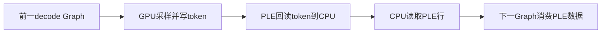

# Qwen3.8 / R9700：9.7秒停顿继续定位

日期：2026-11-06。当前唯一任务是把[方向4收尾](qwen38-r9700-native-fp8-closeout.md)中的长停顿定位到decode Graph内部。FP8候选、模型权重、精度、专家分工和缓存配置保持冻结；方向2策略不恢复。

## 已确认的现象与尚未证明的原因

旧`diagnostic-gate-b`第6个请求第196个token间隔为9701.794ms，后续还出现1～6秒间隔。时间暴露在同步GPU token回读路径；PLE native flush最长约10ms。异步wait-sync也有秒级事件等待，因此不能通过把PLE改成gate就宣布解决。

上轮GPU事件时间线只捕获到约187ms的例子，对应前一个Graph约189ms；这支持部分停顿是前序设备进度延迟，但不能据此给所有9.7秒事件指定同一根因。



回读需要等待前序工作完成，调用耗时长并不等于四字节传输本身慢。本轮重点区分attention/dense、expert fetch、GPU expert计算、CPU结果等待及PLE消费等待。

## 本轮测量办法

在原捕获Graph中加入只写诊断缓冲区的GPU时间戳kernel，按层记录attention、MoE准备、fetch、expert计算、join和层结束；不修改原计算或删除依赖。只在请求结束后回读时间戳，不逐token同步。标记会改变调度，因此这些运行只用于诊断，不进入正式性能统计。

采用HIP `wall_clock64()`及设备返回的固定频率，避免把变化的shader频率当成时钟。设备报告100000kHz；三个简单Graph replay的时钟结果约2.75～2.90ms，与GPU Event约2.77～2.92ms吻合，序号0/1/2验证通过。[AMD定时函数说明](https://rocm.docs.amd.com/projects/HIP/en/develop/how-to/hip_cpp_language_extensions.html)

证据位于[本轮目录](../../../.freetoken-zihao/rdna4-fp8-stall-deep-20261106/)。使用物理GPU4 / PCI83，已重新预约并通过ROCm10.1 foundation核验；应用镜像和候选SHA沿用上一轮。

## 执行记录

- 旧9.7秒事件窗口的host pressure及进程事件已提取。该窗口无新增KFD PID，IO pressure avg10为0，memory avg10最高1.52；这些主机指标不能单独解释或排除GPU停顿。
- 上轮普通权限无法读取系统内核日志，`sudo -n`也要求密码；当时不能据此声称“没有发生reset”。本轮用户授权sudo只读后已补取日志，结果见末尾。
- 诊断GPU时钟helper编译并通过smoke。SDK仅有版本化运行库，编译容器内临时补链接名后完成链接；运行时镜像与库字节未改变。
- 首次诊断在模型初始化前创建GPU缓冲，触发Engine的“初始化前CUDA不得已启动”断言；该次未加载模型、无请求，失败记录保留。已将缓冲创建移动到正常设备绑定之后、Graph捕获之前。`stages-b1-v2`随后因TVM FFI尝试写不可写的默认cache而退出，无请求；通过显式`TVM_FFI_CACHE_DIR=/cache/tvm-ffi`修正实验启动环境，未修改模型代码。
- `stages-b1-v3`完成11个固定历史请求，共2805个decode Graph、628个标记，行序号和时间戳单调性全部通过。诊断Graph中位数24.157ms，31个Graph超过100ms，最长8904.302ms。所有结果仅用于诊断。

## 第一轮设备定位结果

| Graph序号 | 总时长 ms | 主要延迟区间 | 区间时长 ms |
|---|---:|---|---:|
| 1067 | 8904.302 | L03 full attention（QSA） | 8875.236 |
| 1030 | 6357.939 | L47层结束 → model.end | 6331.672 |
| 1036 | 5620.741 | L39 attention结束 → MoE入口（HC） | 5589.345 |
| 219 | 3382.442 | L05 GDN | 3350.644 |
| 180 | 2258.284 | L32层入口 → attention入口（HC） | 2229.880 |
| 141 | 1252.307 | L13 CPU结果join | 1206.231 |

同一进程内，秒级停顿分散在不同层和不同调用链，既包括GPU计算区间，也包括CPU结果等待区间。**这不能证明具体FP8 kernel变慢，也尚不能证明外部干扰或驱动故障。** CPU压力avg10最高8.22、memory最高0.84、IO最高3.77，仅保留为关联线索。

下一步在每个标记后紧邻添加第二个相同GPU时间戳kernel，中间无模型算术、搬运或握手操作。若这样的空区间也出现秒级间隔，才能进一步把问题收窄到Graph节点派发/设备进度，排除该区间的模型计算量。此控制实验仍会改变调度，不作为性能验收或修复。


## 空区间及纯Graph控制

- `heartbeat-b1`因PCI83被其他算子测试占用，preflight拒绝启动，没有加载模型。保留占用记录，未停止外部进程。
- `heartbeat-b2`等待卡空闲后完成11个请求、2805个Graph、1255个标记。1758735个紧邻标记的空区间，中位0.00240ms、最大0.07616ms；本轮Graph最大194.027ms，未再次复现秒级事件。**阴性结果不能排除派发问题，也不能证明增加标记修复了问题。**
- `null-graph`完全不导入FreeToken、不加载模型、没有FP8计算、CPU专家或PLE，运行60.28秒、27136个Graph，每图512个连续时间戳kernel。最大空区间4.72604ms，最大Graph6.01524ms，无>10ms空区间。本轮负载和图结构显著不同，不能据此排除仅大模型负载触发的驱动/内存问题。

## 队列驱逐计数：下一层定位

主机加载的amdgpu模块版本7.1.9.31600000，内核7.0.0-38-generic；已核对`/sys/module/amdgpu/srcversion`与`modinfo`相同。安装的对应源码位于`/usr/src/amdgpu-7.1.9-2407772.24.04/amd/`。

源码`amdkfd/kfd_process.c`的`kfd_procfs_stats_show`表明`stats_23051/evicted_ms`只读取主机atomic计数，`counters_23051/{faults,page_in,page_out}`也只读取主机变量；这些不是需要查询硬件的CU occupancy/SMI读数。`kfd_device_queue_manager.c`在队列恢复时累计驱逐耗时。因此新诊断`eviction-b1`每秒读取自有engine的上述计数，并与token/host-span/设备标记对齐，不改变FP8候选或专家策略。

模块`queue_preemption_timeout_ms=9000`已记录，但数值接近9秒不构成触发证据；源码还存在不同的MES路径。没有修改任何模块参数，不把减小超时当作解决方案。


## 与token停顿及host等待的一一对齐

`stages-b1-v3`请求5包含唯一一次约8.9秒的长间隔：

| 观测位置 | 时间 |
|---|---:|
| 输出token间隔，零基索引47 | 8906.705ms |
| 同请求第47个decode Graph，global sequence 1067 | 8904.302ms |
| Graph内L03 QSA区间 | 8875.236ms |
| PLE token回读Event等待，与token间隔重叠 | 8903.080ms |
| 上述Event等待的线程CPU时间 | 8052.896ms |

设备Graph局部序号与token间隔索引均为47；CPU等待完整落在该token间隔内。因此该案例已经不能仅解释为“CPU收到完成通知晚”，设备Graph自身的时长同样增长。原9.7秒gate案例没有这些设备内标记，不能把本次8.9秒案例无条件指定为它的唯一根因。[对齐数据](../../../.freetoken-zihao/rdna4-fp8-stall-deep-20261106/stages-b1-v3-longest-alignment.json)

相同区间的通常耗时：L03 QSA中位0.31140ms，L39 attention结束到MoE入口的HC中位0.05304ms，模型末尾中位1.08788ms；本轮各自最大8875.236/5589.345/6331.672ms。Graph中间记录的是区间墙钟时间，包含依赖/派发/设备被暂停的可能性，**不能把区间最大值称为该kernel的纯计算耗时**。

## 复核结果与尚缺证据

`eviction-b1`恢复第一轮628标记方式，完成2805个Graph；中位24.191ms、最大69.972ms，无>100ms Graph。170次自有进程的主机计数采样中，`evicted_ms=0`、`faults=0`、`page_out=0`。这次未复现秒级停顿，因此它只说明该次正常运行没有这些计数事件，不能反推第一轮故障时也没有驱逐或fault。

安装源码还确认`vram_<gpuid>`是`atomic64_read(pdd->vram_usage)`，无需访问GPU硬件。`host-audit-b1`增加逐秒读取所有KFD进程的本卡主机显存分配计数，补足旧监控仅pre/post检查常驻占用的缺口。仍不会读取CU occupancy、SDMA activity、SMI或硬件寄存器；计数为0也不能排除采样间的短暂活动和非KFD图形客户端。

截至上轮，缺少故障窗口的内核日志/调度证据，普通权限无法读取journal kernel、dmesg或`/var/log/kern.log`。本轮用户已授权sudo只读查询并取得以下窗口日志；最终仍缺故障样本的进程级驱逐归属证据：

- 原9.7秒事件：北京时间2026-11-06 14:35:40–14:36:40（UTC 06:35:40–06:36:40）。
- 本轮秒级Graph事件：北京时间15:27:30–15:29:15（UTC 07:27:30–07:29:15）。

本轮通过sudo只读执行的日志查询之一（输出保存为普通用户的实验文件）：

```sh
journalctl -k --utc --since '2026-11-06 07:27:30 UTC' --until '2026-11-06 07:29:15 UTC' --no-pager
```

重点核对MES、queue eviction/restore、GPUVM fault、ring timeout、reset相关记录及PCI83；没有相关错误日志也不能排除正常队列调度争用。目的在于确定应修改的层次，不以9秒超时参数的相近数值替代因果证据。


`host-audit-b1`已完成11个请求、2805个Graph，中位24.126ms、最大84.933ms，无>100ms Graph。175个监控周期内，自有engine计数采样167次，`evicted_ms`及`faults`均为0，未采到外部KFD进程在PCI83分配>1MiB显存。本轮仍未复现秒级事件。[主机计数分析](../../../.freetoken-zihao/rdna4-fp8-stall-deep-20261106/host-audit-b1-counter-analysis.json)

## 本轮结论

1. 新捕获的8.9秒案例已经定位到设备Graph内，token间隔、Graph时长和CPU回读等待对应；不能把回读API耗时直接解释为PLE磁盘或几个字节的搬运成本。
2. 长停顿分散在QSA、GDN、HC、模型末尾和CPU结果join等不同区间，当前没有固定某个FP8算子的证据。Graph区间墙钟不等于kernel纯计算时间。
3. 增加空标记、纯Graph、恢复原标记并读取队列计数、持续主机显存计数的后续运行均未再次复现秒级事件。保留所有阴性结果，不能认定驱动无问题，也不能视为修复。
4. **最终触发点尚未确定。** 新取得的内核日志提供userptr恢复告警，但缺少该告警的进程/PCI归属以及故障样本的自有队列驱逐计数，详见下节。现有数据不足以指定某个外部任务、MES超时、驱逐或FP8实现为唯一原因。
5. FP8候选保持冻结并默认关闭，正式稳定性验收结论不变。方向2不恢复；本轮没有改模型、kernel、专家分工、KV或队列配置，也没有新增性能采用结论。

本轮四次整模型诊断共11220个decode Graph；另有27136个纯时间戳控制Graph。所有诊断均排除出正式吞吐/精度验收，没有提交或推送代码。实验已结束，GPU预约和源码冻结校验见[完成记录](../../../.freetoken-zihao/rdna4-fp8-stall-deep-20261106/completion.json)。


## sudo只读核对：主机内存映射恢复线索（2026-11-06）

用户明确授权读取sudo内容，同时禁止修改驱动和底层。本轮提权仅用于认证和`journalctl`查询；没有加载/卸载模块、写sysfs/sysctl、调整队列超时、启用内核追踪或启动新GPU实验。仅将读取结果与分析写入普通用户实验目录及本文。原始日志及机器分析见[只读核对目录](../../../.freetoken-zihao/rdna4-fp8-stall-deep-20261106/kernel-log-readonly-20261106/analysis.json)。

### 实际日志与时间关系

| 北京时间 | 内核记录 | 与故障的关系 |
|---|---|---|
| 14:36:04.720 | `amdgpu_amdkfd_restore_userptr_worker`的CPU超10ms累计计数8195 | 位于原请求6的连续异常窗口；比9.7秒间隔结束晚5.654秒，落在随后索引208的773.108ms token间隔内 |
| 14:38:02.711 | 同函数累计计数16387 | 117.991秒内计数增长8192；这时已晚于该轮模型退出，不能直接指定为该模型进程 |
| 15:27:30–15:29:15 | 完整窗口仅13条Docker虚拟网卡消息 | 8.9秒Graph停顿的精确窗口没有记录到GPU fault、reset、MES超时或ring timeout；不等于证明设备完全没有调度问题 |
| 15:32:12.143 | PCI83 GPUVM page fault，PID1172829 | 该PID不是FreeToken engine；发生在`stages-b1-v3`已结束、`heartbeat-b1`仍被占用检查阻止启动期间，不能归到FP8模型 |

这个warning统计同一工作函数跨进程的CPU超阈值次数，并按指数退避打印。**8195不是GPU错误次数、驱逐次数或一次回调耗时9秒的证明。** 相同告警早在11月3日、5日也出现过；日志没有提供对应用户进程PID或PCI地址。其语义已核对[Linux v7.0 workqueue实现](https://github.com/torvalds/linux/blob/v7.0/kernel/workqueue.c#L1218)。

### 为什么这条线索能解释设备Graph暂停

对应已安装的amdgpu7.1.9源码给出了明确机制：主机注册内存的MMU映射失效时，`amdgpu_amdkfd_evict_userptr()`调用`kgd2kfd_quiesce_mm()`，按该内存所属进程暂停GPU队列；`amdgpu_amdkfd_restore_userptr_worker()`重新取得主机页、验证GPU页表，成功后才调用`kgd2kfd_resume_mm()`恢复队列。如果并发失效或验证未成功，会延后重试。因此这条路径具有让同一个Graph在不同算子区间停顿的能力。

源码位置为`/usr/src/amdgpu-7.1.9-2407772.24.04/amd/`下：

- `amdgpu/amdgpu_amdkfd_gpuvm.c:2876`：userptr失效及暂停；`:3249`：恢复worker与重试。
- `amdkfd/kfd_device.c:1229`：按`mm`查所属进程并驱逐队列；`:1249`：恢复。
- `amdkfd/kfd_device_queue_manager.c:1654`：恢复时累计`evict_duration_counter`。

**当前结论是“有机制、有时间关联的候选原因”，还没有完成进程归因。** 不能从这个全机warning推断FreeToken正在恢复自身70GiB专家bank，也不能认定某个外部任务导致全部停顿。新8.9秒案例没有同时记录自有`evicted_ms`；后来的两次计数运行未复现故障，计数为0不能反推故障时状态。另需注意`counters_*/faults`是在SVM恢复路径递增，不能替代完整GPUVM fault日志。

### 后续唯一验证点

不调整底层。若之后自然再次出现同类停顿，沿用已准备的只读主机计数采样，将**同一FreeToken PID、PCI83的`evicted_ms`增量**与GPU分段时间和CPU回读等待对齐。若实际故障及恢复窗口内该计数无对应增长，就降低userptr驱逐解释的优先级；若增长能解释长停顿，再在用户态主机注册内存的生命周期和失效来源中定位。该工作属于方向4故障归因，不恢复方向2策略调优。

只读核对结束后，8项模块参数、模块srcversion、此前记录的驱动源码SHA、原11文件及FP8候选SHA均未改变。[只读完成校验](../../../.freetoken-zihao/rdna4-fp8-stall-deep-20261106/kernel-log-readonly-20261106/completion.json)


## 最新：已捕获本进程的队列驱逐型停顿

继续只读归因后，无GPU标记gate路径捕获到同PID的3.239秒回读等待与3.210秒驱逐窗口，覆盖99.08%；另有多次同类对齐。已确认本次复现主要由自身SVM/USERPTR队列暂停/恢复导致，正在查映射失效的发起点。原9.7秒没有同时采到这些事件，不补造历史样本的唯一归因。[进程归因报告](qwen38-r9700-stall-attribution.md)
