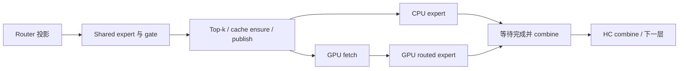

# Qwen3.8 Flash Next / R9700：调度、KV、架构与 100 tok/s 的系统研究

日期：2026-11-06。研究对象是 **单请求、batch=1、单卡 TP=1、非投机 decode**；100 tok/s 对应 10 ms/token。本文审计已有实验、读取实际 checkpoint header 与源码、核对论文和厂商资料，并重新计算流量账本。本轮没有新增 GPU 性能实验，没有修改推理代码。

执行范围更新：用户最新决定当前只推进方向4的稳定性收尾；方向2冻结、停止投入、不自动恢复，见[冻结文档](../../../doc/qwen38_direction2_frozen_20261106.md)。本文的新增量化、TP=2和QSA FP8 KV为后续备选，研究建议不等于已经启动任务。当前任务见[验收计划](qwen38-r9700-hybrid-native-fp8-next.md)。

## 1. 可以据以决策的结论

1. **当前可重复的正常速度约 42–43 tok/s；最有希望的独立候选约 44.10 tok/s。** 后者是 packed FP8 转换的自然生成 A/B，仍有全量 ABBA 稳定性缺口，不能写成默认方案已经 ready。距离目标还需移除 **12.68 ms/token，即 55.90% 当前时间**。
2. **主要问题是每 token 的权重流量，以及逐层异构执行的关键路径；没有证据说明算力峰值不足。** 当前主稠密矩阵每 token 读取约 **5.745 GB**，其中 **2.841 GB 仍为 BF16**。按实际专家分工，GPU 逻辑权重读取约 **7.005 GB/token**。这些是逻辑字节，不是 DRAM counter。
3. **当前精度和执行分布下，仅靠消除调度损失不能承诺单卡 100 tok/s。** 对已记录的路由，给片上缓存非常宽松的容量扣减、忽略新 fetch 的显存读写、忽略 KV/GDN/activation 后，权重流式读取的条件下限仍为 **10.33–10.58 ms/token**。这不是模型永久不可能达到 100 的证明；量化、分工或设备数改变后要重算。
4. **Qwen3.8 的 FP8 KV 不是当前短上下文提速主线。** 48 层中只有 12 层 QSA，选择预算约 2048 tokens；另外 36 层 GDN 保存定长递归状态。当前 100 tok/s 工作树使用 BF16 QSA KV，旧的普通 attention FP8 KV 分支不能视为已接入此后端。
5. **当前只完成方向4稳定性验收；方向2已冻结。** 减少BF16权重流量和真正TP=2是后续结构性空间，本阶段不启动；两实例吞吐不能替代单请求速度。MTP仍按用户要求暂不单独推进。

## 2. 证据范围与可复核方法

当前研究分支 `perf/qwen38-flash-next-4bit-100tps-20261105`，HEAD `cf32a5364303d71ece7979a6c69857c475555eeb`。运行基线包含原有 11 个本地修改；冻结 tree 为 `763b1fca8d2a98ac5929b92131af8cc777021d41`。这些结果**不是纯 upstream main 的性能保证**。

方向 2/4 的实现分别保留在独立 hybrid/native-FP8 工作树，尚未默认合入此基线；具体候选文件 SHA 见[最终源码清单](../../../.freetoken-zihao/rdna4-hybrid-native-fp8-20261106/final-candidate-source.json)。

模型锁定 `nvidia/Qwen3.8-Flash-Next-NVFP4@fc694b54fb0174e0913e6adf86691ef85a4ead47`，并使用已经保存的 selective dense FP8 派生权重。激活 BF16，KV BF16，GPU routed expert W4A16，CPU NVFP4 路径 W4A8。31 CPU workers、7610 expert slots、8256 KV tokens、8192 请求长度上限、shared scheduler stream、固定 max-fetch=1、PLE disk、embedding host、MTP off。ROCm 10.1 / HIP 7.16.26385、Torch 2.14.0+rocm10.1.0、Triton 3.8.0。

本轮机器可读产物在仓库外：

- [账本与输入 SHA256](../../../.freetoken-zihao/rdna4-systematic-research-20261106/ledger.json)。
- [CPU-only 重算脚本](../../../.freetoken-zihao/rdna4-systematic-research-20261106/build_ledger.py)：读取 11 个 safetensors header，交叉核对 449 个历史运行时 dense 调用、121 个量化源矩阵和真实路由计数；不加载模型到 GPU。
- [源码/PCIe 身份](../../../.freetoken-zihao/rdna4-systematic-research-20261106/identity.json)、[CPU 拓扑](../../../.freetoken-zihao/rdna4-systematic-research-20261106/lscpu.txt)。
- 本文的实验入口： [总账](qwen38-r9700-100tps.md)、[七步研究](qwen38-r9700-seven-step-plan.md)、[方向 2/4 完整验收](qwen38-r9700-hybrid-native-fp8-next.md)。

**证据等级：**「实测」指已有原始运行；「源码/配置事实」指冻结代码和权重；「推导」指写明假设的算术；「待验证」不作收益承诺。不同模型、dtype、路由、GPU、调度或 profiling 状态的结果不能拼成同一张当前耗时饼图。本文没有给当前 44 tok/s 杜撰一份逐层 trace。

## 3. 实际模型有多大，每层做什么

官方模型卡标示主模型约 125B、激活约 6B，另有 51B n-gram embedding 和 4B MTP；NVFP4 主要覆盖 routed experts，其他主模型层保持 BF16。名称中的 NVFP4 **不代表整模型都是 4 bit**。[NVIDIA 模型卡](https://huggingface.co/nvidia/Qwen3.8-Flash-Next-NVFP4)

下表由锁定的本地 `config.json`、header 和 [模型源码](../../python/freetoken/models/qwen4_exp/model.py) 交叉核验：

| 部件 | 配置 / 每 token 调用 | 对性能的含义 |
|---|---|---|
| 主干 | 48 decoder 层，hidden=2560 | 自回归时层与层有依赖，不能让 48 层任意并行 |
| GDN | 36 层；16 个 K heads、48 个 V heads，Dk=Dv=128 | 无随长度线性增长的完整 KV；有大投影和递归 state |
| QSA | 12 层，0-based 层号 3,7,…,47；24 Q heads、2 KV heads、D=256 | GQA=12；不是此前 GQA4/8 attention 的同一验收形状 |
| QSA indexer | 4 Q heads、1 K head、D=128；每 4 token 压缩；预算 2048 | 扫 compressed index，再读取选中的完整 K/V |
| HC | 每层 attention/MLP 各一个，末尾再一个，共 97 个 block、194 次投影 | 4 个 residual streams；lowrank=320；每 token 约 1.303 GB BF16 主权重 |
| Routed MoE | 每层 512 experts、top-10、I=640 | 共 24576 experts；每 token 480 次专家选择，96 个 gate/up、down 计算 kernel |
| Shared expert | 每层一个 I=640，合并 gate/up 后共 96 次投影 | 不受 routed cache hit 影响，每个 token 都执行 |
| Router | 48 次 `[512,2560]` 投影，再选 top-10 | 必须保留唯一 expert ID 和选择语义 |
| PLE | 一处注入，16 个 n-gram heads，每个取 160 维 | 巨大表是容量/随机访问问题，并非每 token 顺序读取 51 GB |
| lm_head | `[248320,2560]`，每 decode token 一次 | FP8 后仍约 637 MB；embedding host 不会消除这一矩阵 |

HC 的运行时 down 矩阵是 `[336,10240]`，包含 12 行 padding；up 是 `[10240,320]`。末尾 mixer down 为 `[320,10240]`。不能把 lowrank=320 当成整段投影只有很少字节。[HC 实现](../../python/freetoken/models/qwen4_exp/hc.py)

单 expert 主权重有 `3×2560×640=4,915,200` 参数。24576 个 routed experts 合计约 **120.796B** 参数；每 token 只选择其中约 **2.359B** 参数。加上主稠密投影，运行时矩阵乘等价约 **6.680B 参数/token、13.361 GFLOP/token**（乘加算 2，包含 padding 和 lm_head，不含解量化、softmax、归约等）。扣除 padding 和 lm_head 后约 6.03B，和模型卡的约 6B 激活口径相符。不能套用之前 Qwen3.6-A3B 的成本。

## 4. 每 token 的字节账本

以下均为十进制 GB；只统计主矩阵至少读取一次的逻辑 payload 和已知 scale。包含 HC padding，不包含额外重复读取、activation、norm、conv、CPU 同步等。48 个 fused shared gate 另有 245760 bytes，体积很小。原始 checkpoint 的 773 个 BF16 二维权重与运行时合并/padding 后的账本已对账。

| 主矩阵族 | 当前主要 dtype | 运行时次数 | GB/token | 字节/640 GB/s，ms |
|---|---|---:|---:|---:|
| GDN 输入 qkvz + a/b | qkvz FP8，a/b BF16 | 36 组，量化后分成两条投影 | 1.5300 | 2.391 |
| 48 层 attention output | FP8 | 48 | 0.7555 | 1.180 |
| lm_head | FP8 | 1 | 0.6367 | 0.995 |
| HC | BF16 | 194 | 1.3029 | 2.036 |
| QSA q/k/v + output gate 投影 | BF16 | 12 个合并投影 | 0.8179 | 1.278 |
| Shared expert | BF16 | 96 | 0.4719 | 0.737 |
| Router | BF16 | 48 | 0.1258 | 0.197 |
| PLE key/value 投影 | BF16 | 2 | 0.0655 | 0.102 |
| QSA index projection | BF16 | 12 | 0.0393 | 0.061 |
| **主稠密合计** | 混合 | 原 449 次，GDN 拆分后约 485 次 | **5.7455** | **8.977** |

已做量化的 121 个源矩阵合并为 85 个 FP8 运行时矩阵，存储 **5.8012→2.9045 GB**，节省 **2.8968 GB**。其余主稠密 BF16 仍有 **2.8410 GB/token**。这解释了为什么“已用 NVFP4 + FP8”仍不能按全 4 bit 模型计算带宽需求。[转换 manifest](../../../.freetoken-zihao/qwen38-flash-next-4bit-100tps-20261105/execution-5steps/derived-dense-fp8/conversion-manifest.json)

### 4.1 专家缓存、主机和 GPU 不能重复记账

实际 NVFP4 runtime slot：packed weights 2457600 bytes，group scale 307200 bytes，展开的 FP32 global scale 15360 bytes，共 **2780160 bytes/expert**。不是精确的 0.5 byte/parameter；包括 scale 后约 0.5656 byte/parameter。[Bank layout](../../python/freetoken/layers/quantization/moe/nvfp4.py)

自然生成 A/B 之后独立 stats 请求记录相同分工，每 token 平均：

| 指标 | 数值 |
|---|---:|
| 选择 / cache hit / miss | 480 / 427.765 / 52.235 experts |
| miss 中 fetch 到 GPU / 直接 CPU 执行 | 25.255 / 26.980 experts |
| GPU 实际执行 | 453.020 experts |
| GPU 专家逻辑读取 | 1.2595 GB/token |
| GPU 主矩阵 + 专家逻辑读取 | **7.0049 GB/token** |
| host 专家读取：fetch + CPU | 145.22 MB/token |
| 其中 PCIe fetch payload | 70.21 MB/token |

这个 stats 请求不参与测速，不能冒充每个测速请求的逐 token 计数；它提供同配置、同类输入的流量样本。[原始统计](../../../.freetoken-zihao/rdna4-hybrid-native-fp8-20261106/runs/fp8-natural-a/moe-stats-pid399099-req17.json)

另外四条真实 prompt 轨迹的 CPU experts/token 为 **34.8–78.4**，明显高于此请求的 27.0；miss 为 **62.0–109.9**。说明 CPU/PCIe 瓶颈高度依赖 workload，不能拿一个长重复 prompt 的 tok/s 代表所有代码和数学任务。[路由回放](../../../.freetoken-zihao/rdna4-hybrid-native-fp8-20261106/hybrid-replay-results.json)

7610 slots 占 **19.704 GiB**，只覆盖总专家数约 **31.0%**，但上述请求命中率约 **89.1%**：局部性确实发挥作用。全专家 runtime banks 需要 **63.633 GiB**，还没加 5.351 GiB 主稠密权重、state、KV、workspace。**双 32 GiB 卡也不能据此声称全模型全专家都能驻留**；只扣主稠密的理想容量上限约 22651 slots，实际还要更少。PLE 大表继续留在主机/磁盘。

## 5. RDNA4 的物理限制与算力口径

R9700 官方规格为 64 CU、gfx1201、32 GiB、640 GB/s、FP32 vector 47.8 TFLOPS、FP8 dense matrix 383 TFLOPS。1531 TOPS 对应 **INT4 structured sparsity**，不能作为 NVFP4 M=1 解码的有效算力。[AMD 规格](https://www.amd.com/en/products/graphics/workstations/radeon-ai-pro/ai-9000-series/amd-radeon-ai-pro-r9700.html)

缓存为 **64 MiB Infinity Cache、8 MiB L2**，支持 wave32/64；本地 Torch 的 `multi_processor_count=32` 不能解释成只用了半张 64-CU 卡。ROCm 表中 `N/A` 是 Graphics L1 一列，不是没有 Infinity Cache。[ROCm GPU 规格](https://rocm.docs.amd.com/en/docs-10.1.0/reference/gpu-specs.html)

### 5.1 为什么“算力没吃满”不等于应改 WMMA

大矩阵 batch1 GEMV 的权重复用低。仅计主乘加，BF16、FP8、NVFP4+scale 的算术强度约 **1、2、3.54 FLOP/byte**。FP32 峰值与内存峰值之比约 **74.7 FLOP/byte**；这些 workload 远在低算术强度一侧。

13.36 GFLOP/token 即使跑到 100 tok/s，也只有约 1.34 TFLOP/s 的有用矩阵运算量。这个数量级远小于向量峰值，但不等于硬件计数器显示只用 2.8% ALU：解包、转换、归约、访存、调度都还要执行。低算术强度也不排除小 kernel 被指令/依赖延迟限制。

RDNA4 公布的 4-bit WMMA 类型是 IU4；NVFP4 是 E2M1 加 group scale，不能把 packed bytes 直接交给 INT4 指令等价计算。W8A16 的 BF16 激活也不能无损改成 FP8 WMMA 所需的输入。batch1 填充一个 16×16 tile 不会自动产生 16 个独立 token 的权重复用。[AMD WMMA 类型](https://gpuopen.com/learn/accelerating_generative_ai_on_amd_radeon_gpus/)、[布局与算例](https://gpuopen.com/learn/wmma-guide-amd-rdna-4-gpus-part-1/)

本轮方向 4 的正确做法是保留输入/归约边界，改用 `v_cvt_pk_f32_fp8`。三个形状的冷工作集逻辑带宽约 507–618 GB/s，85 个矩阵合计 **5.35→5.14 ms**。同样字节在 640 GB/s 下约 4.54 ms：即便按这个理想流式预算，这条链剩余空间也只是约 **0.60 ms**，不能承担还差的 12.68 ms。该比较是冷微测预算，不是整模型关键路径上限。[局部结果](../../../.freetoken-zihao/rdna4-hybrid-native-fp8-20261106/fp8-local-summary.json)

### 5.2 带宽到底有没有打满

已有同卡 1 GiB 顺序读微测达到 **635.64 GB/s**，证明大块读可以接近标称；它来自此前 Qwen3.6 实验环境，不代表当前完整模型。当前 Qwen3.8 没有有效的完整 DRAM bytes counter：已知流量正控中 GL2/FETCH 计数仍为 0，SQ waves 正常。GFX busy、UMC activity、逻辑字节/耗时均不能替代真实 DRAM 利用率。[带宽测量记录](../../../doc/fp8_kv_qwen36_bandwidth_20261104.md)

举例：7.005 GB / 22.675 ms ≈ 309 GB/s，只是全步**逻辑权重吞吐**；不能据此写“显存带宽利用率 48%”。有 SRAM 命中、重复加载、fetch 写入、CPU 等待和未统计流量。当前可以确认部分流式 kernel 已较接近各自带宽预算；不能确认全步处于持续 DRAM 饱和。

### 5.3 主机侧与 NVIDIA 对比

本轮只读 sysfs 确认 PCI03 为 **32 GT/s ×16，PCIe 5.0**，NUMA node 3。双路 EPYC 9334；当前 31 workers 在 socket 0，既有内存策略跨 node 0–7 interleave，包含另一 socket。这给 NUMA 重新校准提供了具体理由，尚不是已证实的性能损失归因。

历史实测 CPU STREAM 约 61.8–71.0 GB/s、CPU NVFP4 MoE 约 26.6–34.2 GB/s、gather 单独约 40.6–43.9 GB/s；同时运行时 CPU/gather 分别降到约 17.5–29.2 / 18.4–31.4 GB/s。不同时间、affinity 和工作集不能混成一个稳定 roof。PCIe 理论编码 payload 约 63 GB/s，不是应用可用带宽保证。[原始 bandwidth profiles](../../../.freetoken-zihao/qwen38-flash-next-4bit-100tps-20261105/execution-5steps/bandwidth-31-before.json)、[另一次 profile](../../../.freetoken-zihao/rdna4-seven-step-20261105/bandwidth.json)

同样 70.21 MB/token fetch，按上述生产路径有效带宽会消耗约 **1.6–3.8 ms** 的传输阶段时间；能否隐藏由每层依赖决定。不能把 64 个物理 CPU 核全加上就假定翻倍：实际预算是 31 workers，CPU 少量专家固定成本和跨 socket 内存同样重要。

4090/5090 标称显存带宽分别为 **1008/1792 GB/s**，是 R9700 的 **1.575/2.8 倍**。对约 7 GB/token 流式权重，仅显存带宽预算就完全不同。NVIDIA 上达到某个速度，不意味着 AMD 只差一个环境变量；也不意味着 AMD 多 stream 一定更慢。[NVIDIA 官方规格](https://www.nvidia.com/en-us/geforce/graphics-cards/compare/)

## 6. FreeToken 理论与当前调度的对应关系

论文将 cache miss 分成 GPU fetch 与 CPU 执行，用实测 PCIe 带宽 `B_P`、CPU expert 有效带宽 `B_H` 估计 `q≈m·B_P/B_H`，并利用缓存未来复用。论文的主测试模型和 NVIDIA 平台不同于此处 Qwen3.8/R9700，不能直接外推 tok/s。[FreeToken 论文，§3.2、§4、§5，v1](https://arxiv.org/html/2608.16157v1)

当前源码已经有 global LRU、测量 profile、整数分工、graph-resident CPU executor。使用并发校准时，`fetch_fraction` 是 `pcie_ov/(pcie_ov+cpu_ov)`；而本轮稳定基线显式固定 fetch=1，不能把它称为论文自动策略的最优实现。[策略代码](../../python/freetoken/moe/bench_profile.py)、[整数决策](../../python/freetoken/moe/offload_kernels.py)

依据本地代码和实验，真正需要修正的成本模型应包含：

```text
T_moe ≈ T_route/ensure + T_publish
        + max(T_cpu(m-f), T_fetch(f) + T_gpu_experts)
        + T_join/combine

T_token = Σ层(前序 HC/attention/shared 等依赖 + 该层异构关键路径)
          + PLE/最终 mixer/lm_head/调度尾部
```

不能把所有 GPU kernels、CPU 时间、PCIe 时间直接相加，也不能把整模型的 CPU/GPU 各自总时间取一次 max：可重叠的窗口受每层 publish/join 限制。wait 事件延迟可能是等待 CPU 结果，也可能包含运行时队列问题；不能一律标为“无效握手开销”。



这是当前 [Qwen4 MoE](../../python/freetoken/models/qwen4_exp/moe.py) / [hybrid decode](../../python/freetoken/layers/moe.py) 的顺序。单 GPU stream 中，host workers 仍可与 GPU 并行；“shared stream 更快”不等于关掉 CPU expert。当前日志 `handshake=kernel`，`decode_submit/decode_sync` 仍在执行。[CPU executor](../../python/freetoken/moe/cpu_executor.py)

### 6.1 两类同步问题必须区分

| 层次 | 已有证据 | 尚不能声称 |
|---|---|---|
| Scheduler 与 engine 跨 stream | 同条件 22.9719→34.6579 tok/s，固定 token/路由核验通过 | 所有 AMD 多 stream 都慢，或剩余 12 ms 都是同一问题 |
| CPU expert publish/done/join | 当前 hybrid 已启用；只把 miss 的一部分交给 CPU | 高 GPU busy 等于有效算力；任何 wait 都能删除 |
| 秒级异常停顿 | 完整 ABBA 有 2–9 秒异常，部分与 KFD/sysfs 读取或外部 GPU 进程启动相关 | 已找到唯一 HIP bug；所有坏样本都可作为“外部噪声”剔除 |

旧 Qwen3.6 实验曾在 Torch Graph 上复现 pending cross-stream wait 退化，C++ replay 也复现；同库纯 HIP 自建 Graph 和部分 dense 玩具却不复现。这是运行时上下文/依赖相关证据，不能推导普遍架构定律。[最小复现和反例](../../../doc/qwen36_stream_wait_rootcause_20261104.md)

`GPU_MAX_HW_QUEUES=1` 限制 HIP 每进程每设备使用的普通硬件队列数；它不等于程序只有一个 stream，也不会删除依赖。当前采用 shared scheduler/engine stream、该变量 unset；queue=1 曾使 TTFT 退化，不能机械全局启用。[HIP 官方说明](https://rocm.docs.amd.com/en/latest/reference/environment-variables/)

### 6.2 为什么最新 hybrid 策略没有通过

真实冷 expert bank 表明 miss=1/2 时跳过 fetch 有即时好处，但无条件跳过增加未来 miss。基于 reuse age 的小范围策略仅带来约 1–1.8% 模型改善。CPU W4A8 / GPU W4A16 分工变化后，长窗口数学样本 active segment KL 约 **0.00611**，超过既定 0.001 gate；安静运行的 2048 长度 p95 还回退约 6.69%。策略继续默认关闭。

第一批短测试在策略尚未触发时全部 bitwise，因此不能充当有效精度验收。这次教训直接约束后续实验：必须记录触发次数、CPU 分配变化及首个差异位置，不能只看整个样本平均数。[完整诊断](../../../.freetoken-zihao/rdna4-hybrid-native-fp8-20261106/hybrid-quality-diagnosis.json)

真实冷表的完整 routed chain 中，miss=1 时 fetch0/fetch1 约 93/163 µs，miss=2 时约 178/219 µs；这包括 reset、发布、搬运、专家计算和合并，不是纯 CPU kernel 时间。它解释了即时跳过 fetch 的诱因，却不包含未来 token 因缓存未填充付出的代价；必须结合 trace replay，而非逐次贪心选最小值。

## 7. KV cache：容量收益和 decode 收益分开

当前 [QSA pool](../../python/freetoken/kvcache/qsa_pool.py) 用 BF16 保存完整 K/V 和 compressed index；[QSA attend](../../python/freetoken/kernel/triton/qsa/attend.py) 没有旧 FP8 KV 的 scale/dequant 入口。过去 `step5-fp8-*` 结果指 **dense 权重量化**，不能据文件名解释为当前 QSA 已用 FP8 KV。

完整 BF16 K/V 容量：`12 layers × 2(K,V) × 2 KV heads × 256 × 2 bytes = 24576 bytes/context-token`。compressed index 另约 `12×128×2/4=768 bytes/token`，还有 ring、页表、rope 元数据等。

QSA 实际读取预算为 `min(L,2048+L%4)` tokens；末尾未闭合的 group 最多补 3 个。它保留完整 KV，读取时选择子集，因此 **容量随 L 增长，但 selected KV 读取不一直随 L 增长**。[选择逻辑](../../python/freetoken/attention/qsa_sparse.py)

| 当前有效上下文 L | BF16 完整 K/V 容量 | compressed index | 每步 selected K/V 逻辑读取 | 假设 FP8 K/V 的容量节省，未扣 scale |
|---:|---:|---:|---:|---:|
| 512 | 12 MiB | 0.375 MiB | 12 MiB | 6 MiB |
| 2048 | 48 MiB | 1.5 MiB | 48 MiB | 24 MiB |
| 8192 | 192 MiB | 6 MiB | 48 MiB | 96 MiB |
| 32768 | 768 MiB | 24 MiB | 48 MiB | 384 MiB |
| 262144 | 6 GiB | 192 MiB | 48 MiB | 3 GiB |

后两档是配置推导，当前 8K 实验没有验收这些长度。表的 L 是当前有效长度，不是只算 prompt；生成会增加 L。FP8 若让 48 MiB selected KV 减半，在 640 GB/s 流式口径仅省约 **0.039 ms/token**，不含转换和索引开销，不能承诺实际节省。8K 容量理论节省只约等于 **36 个专家 slots**，和 7610 个 slots 相比很小；262K 下容量价值才显著上升。

36 层 FP32 GDN recurrent state 为 `36×48×128×128×4` = **108 MiB/request**；一次完整读写为 216 MiB/token，另外还有 conv/PLE state。它不是 KV，FP8 KV 不会自动压缩它。直接量化递归 state 还会引入跨 token 累积误差，应单独研究。[State pool](../../python/freetoken/kvcache/linear_state_pool.py)

历史 Qwen3.6 的 32K full-attention 测到 **1.175→0.753 ms**，只减少整步约 24 ms 中的 0.422 ms：这解释了当时 attention 更快却 decode 变化小。Qwen3.8 还多了 QSA 选择限制，更不能把这个改善直接搬过来。[此前 FP8 KV 测量](../../../doc/fp8_kv_qwen36_bandwidth_20261104.md)

因此 FP8 KV 的合理定位是：普通 full-attention/长上下文的带宽与容量功能；QSA 后端要独立补存取、scale、prefix/扩缩容/长地址、索引不变和长上下文质量验收。它仍值得完成 ready，但不能作为当前 batch1 短上下文 100 tok/s 的主要依据。

## 8. 历史成果如何使用

| 研究项 | 有效结论 | 当前决定 |
|---|---|---|
| Shared scheduler stream | 同条件吞吐 +50.87%，已排除关闭 CPU expert 的解释 | 保留；不要重复计算为未来空间 |
| Selective dense FP8 | 减少 2.897 GB 主权重；历史正常约 35–36→41–43 tok/s | 保留实验基线；量化质量仍只有有限筛选，非完整任务 benchmark 认证 |
| Native packed FP8 | 冷微测 85 GEMV 时间 -4.0%；自然 42.879→44.101，4352 个 token ID 相同 | 最值得收尾；全部 ABBA 仍未过稳定性，默认关闭 |
| HC / shared / router 快 kernel | 局部存在收益；model 精度或稳定收益 gate 未通过 | 不能把局部百分比乘到当前 tok/s；保留 oracle、BF16 舍入边界研究 |
| 更多 expert slots | 8378 对 7610 筛选约 +1%；8192→8193 改变 metadata 扫描分支 | 没有支持大收益；不能只按省下 GiB 预测 hit-rate |
| 提前 publish 重叠 shared | 部分局部省约 17 µs，其他分工退化 | 不默认采用；只在暴露 CPU 尾巴的层可能获益 |
| cache hint / tile | 小收益、无全模型采纳；部分 hint 未改变 ISA | 不再把“加 hint”当结构性方案 |
| MTP | draft 权重/状态已有探索，未完成目标性能验收 | 用户选择暂不单独推进 |

当前 native 自然生成的 95% CI 是同一启动内请求配对得到的，并不能充分覆盖重启/机器状态差异；不能拿很窄的请求 CI 抵消失败的 ABBA。微测约省 0.22 ms、自然生成约省 0.65 ms 的差额也尚未在同版本 trace 中闭环归因，可能涉及缓存/运行条件；不能凭它宣称额外隐藏了多少同步。[自然 A/B](../../../.freetoken-zihao/rdna4-hybrid-native-fp8-20261106/fp8-natural-summary.json)、[完整 ABBA](../../../.freetoken-zihao/rdna4-hybrid-native-fp8-20261106/fp8-perf-summary.json)

历史 BF16 trace 中 HC 3.45–3.65 ms、shared 1.60–1.69 ms、router 0.56–0.63 ms、QSA input 1.48–1.49 ms 支持优化排序，但它们不是当前 native 候选的组成时间。尤其 QSA input 已约 549 GB/s 逻辑带宽，单纯换 tile 的余量比减少权重字节小。[原始 dense attribution](../../../.freetoken-zihao/qwen38-flash-next-4bit-100tps-20261105/profile-hybrid/deeper/dense-attribution.json)

## 9. 距离 100 tok/s 的物理预算

### 9.1 实测差距

| 输入长度分组 | 当前自然候选 tok/s | ms/token | 达到 100 所需速度倍数 | 必须移除的时间 |
|---:|---:|---:|---:|---:|
| 512 | 44.1013 | 22.6751 | 2.2675× | 12.6751 ms，55.90% |
| 2048 | 43.9422 | 22.7571 | 2.2757× | 12.7571 ms，56.06% |

### 9.2 条件下限，不混同硬件实测

对自然 stats 的 427.765 个 GPU cache-hit experts，采用故意偏乐观的假设：保持当前量化/路由/图结构；主矩阵及命中专家各读取一次；不计 fresh fetch 的任何显存代价；不计 KV/state/临时数据；扣除全部 HC 零 padding；每 token 允许 **128 MiB** 权重由片上缓存供给，超过已知主要数据 cache 总量；显存一直达到 640 GB/s。没有新增跨 token persistent 权重保留或压缩机制。

```text
D_min = 5,745,453,056 − 23,592,960
        + 427.7647059 × (2,457,600 + 307,200)
        − 128 × 2^20
      = 6.770326 GB/token

T_weights_min = D_min / 640 GB/s = 10.5786 ms/token
```

四条独立路由按同一方法得到 10.3295–10.5364 ms。即便这个偏乐观、漏掉很多真实成本的模型也已超出 10 ms。它支持“**当前配置的 100 目标必须改变字节量/执行分布**”，不支持“R9700 永久不可能跑这个模型到 100”。该推导依赖 streaming 和当前 kernel 访问方式；不是 DRAM counter 或跨所有 prompt 的普适证明。

旧文的 `7.08 GB / 640 = 11.06 ms` 对应 **480 experts 全在 GPU** 的逻辑情景。本文重算为 7.07993 GB，明确它不是当前 hybrid 的严格 DRAM 下限；当前样本约 7.00492 GB，也仍不能直接当 DRAM bytes。

### 9.3 哪些改变有足够的量级

| 改变 | 可复算的量级 | 局限 |
|---|---|---|
| HC BF16→FP8 | payload 少约 0.651 GB/token，640 口径约 1.018 ms | 新量化，scale 和质量需验收；不是实测加速 |
| QSA input BF16→FP8 | 少约 0.409 GB，约 0.639 ms | norm/rope 前后的误差可影响检索与输出 |
| Shared expert BF16→FP8 | 少约 0.236 GB，约 0.369 ms | 每层累积误差；CPU/GPU reference 要固定 |
| 三者全部成功 | 少约 1.296 GB，流式预算约 2.025 ms | 仅此也远不足 12.675 ms；会释放约 1.21 GiB 容量，但 cache 收益不能预加 |
| 改善当前 FP8 转换/归约 | 已证明 +2.85% 自然生成候选；冷链剩余理想余量约 0.60 ms | 不能反复承诺同一收益 |
| 真正 TP=2 | 约 7.08 GB 均分在两卡，理想 1280 GB/s 对应约 5.53 ms | 仅无通信、无复制、无 CPU 等待的情景，不是预测 tok/s |

作为设计预算而非观测：若单卡有效流式带宽取 550 GB/s，并为不可隐藏的非权重成本保留 2–3 ms，要达到 10 ms，主权重流量应控制在约 **3.85–4.40 GB/token**。当前约 7 GB 需要再减少约 **37–45%**。这意味着可能需要更广的低比特 dense 量化及融合，而非只补 FP8 转换。是否能保持质量尚无证据。

TP=2 也有明确工程门槛：[当前 loader 明确只支持 TP=1](../../python/freetoken/models/qwen4_exp/weight.py)。必须真正切分 dense、HC/GDN、expert、lm_head，并核验 QSA/KV 与状态布局。若只做 layer pipeline，单请求各层仍串行；若只分专家，5.745 GB dense 仍集中在一张卡，都不能套用 1280 GB/s。

若 TP 每 token 需要 96–200 次同步，单次集体通信延迟 10 µs 就会消耗 0.96–2.0 ms，20 µs 则为 1.92–4.0 ms；这是待测情景，不是当前次数或延迟。先测实际两卡 P2P/小消息和依赖，再决定布局。两卡增加专家驻留、减少 CPU miss 可能有额外好处，但也要重新做分工质量验收。

## 10. 下一步方向与停止条件

当前仅执行方向4稳定性收尾；方向2冻结且不自动恢复。以下是本轮研究提出的后续候选路线与条件；除方向4相关的稳定性/关键路径诊断外，不在当前阶段启动。

| 顺序 | 要回答的问题 | 最小实验与交付 | 继续/停止条件 |
|---|---|---|---|
| P0 | 当前 22.7 ms 中，哪些时间真正暴露在关键路径上？ | 冻结 native A/B；至少 3 组独立重启反向对照、每配置至少 6 个请求；覆盖代码/数学/长回答。低扰动记录 engine graph、各层 publish/done/join、gather、PLE、请求输出；生成同一版本的 wall/设备区间并集/CPU 计数账本 | 不删除坏样本；先区分机器级停顿和常态。若 profiler 失效，用稀疏 event 围住阶段并做带/不带测量 A/A；不继续报“已打满带宽” |
| P1 | 保留 BF16 激活，哪些 BF16 权重最适合进一步压缩？ | 分别做 QSA input、shared、HC 的 W8A16 真实激活敏感性；从 QSA/shared 开始，HC 单独定位 down/up 及舍入。每族独立 artifact/模型质量，不混合首次 A/B | 沿用已有 top1/KL gate，再补独立 held-out NLL/任务质量；校准集与验收集分离。通过后才组合；若三族总节省只约 2 ms，不宣称达到 100 |
| P2 | Hybrid 还能否在不改变可接受质量的前提下减少 CPU 尾巴？ | 先用慢而可信的 CPU W4A16/高精度诊断参考区分 W4A8 量化误差与归约误差；真实 0/1/2/…miss 冷表；NUMA local/socket/all-node 对照；有 reuse horizon 的 trace replay | 必须触发策略并分别报告 active-window 质量；完整 routed chain 和模型 p95 通过才启用。若仍只约 1%，不继续挤占结构性路线 |
| P3 | 单卡路线是否仍有达到 10 ms 的预算？ | 在 P0/P1 后重算流量和不可隐藏成本。需要时研究 dense 更低比特，但明确新质量风险；同时做 TP=2 的源码设计与两卡通信预算 | 如果保留必要质量后仍无法进入 10 ms 预算，明确将目标转为真实两卡 TP，或重新讨论目标；不无限承诺靠 tile 达到 100 |
| P4 | FP8 KV 如何达到功能 ready？ | QSA 单独接入与验收；GQA12/D256、索引选择保持、scale/prefix/状态扩缩容/长地址、长上下文质量；容量和性能分列 | 不把 Qwen3.6 验收当 Qwen3.8 验收；短请求无退化，长上下文给出有效容量收益；不给 100 tok/s 虚增收益 |

纯算术不变的方向 4，目标仍是已通过局部测试的 bitwise/ordered routes；改变精度或设备分工的方案使用预先冻结的质量标准，不能事后放宽。现有 top1≥99%、KL≤0.001 是筛选门槛，不是任务质量保证；NLL 与任务退化容差需在数据划分后、看候选结果前确定。

最终验收必须同时报告：单请求 decode、TTFT、p95、完整坏样本、实际有效上下文、precision、专家 miss/CPU/fetch、源码/权重/镜像身份。100 tok/s 应是同一真实 workload 下的可重复结果，而不是最短 kernel、最优单次请求或两实例聚合吞吐。

## 11. 本轮研究完成记录

- 已核对官方 FreeToken 论文 v1、AMD RDNA4/ROCm/WMMA 资料、NVIDIA 模型和 GPU 规格；引用均为一手来源。
- 已用 checkpoint header 独立校验运行时主矩阵字节、量化差额、padding 和 fused shared gate 差额；重放分析现有路由统计，未把逻辑 bytes 冒充 DRAM counters。
- 已区分当前 Qwen3.8 与旧 Qwen3.6，区分 FP8 权重与 FP8 KV，区分正常性能与稳定性未验收候选。
- 本轮没有新增 GPU 性能数字。所有新数值均是可复算的账本/条件预算；原有推理代码及实验分支保留。
