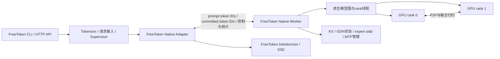

# Qwen3.8 Flash Next：Radiance 完整执行栈迁入 FreeToken 的实现计划

> 仓库归档副本。历史执行状态按当时记录保留，以最终验收结论为准；原工作区的模型、日志、实验产物与容器镜像另行保留，未包含在源码仓库中。

日期：2026-11-17。状态：**N0–N9实施、本地融合与验收完成；逐阶段历史见第12节，最终结果见文末及配套报告。**

本计划接续上一阶段交付与差距审计（原工作区引用：`qwen38_tp2_speed_first_operator_reassessment_20261117.md`）。旧阶段W1只完成row-FP8 dense可选支持，没有完成Radiance式快速执行路径。旧A/A、数值失败和微基准均保留，不将它们改写为本计划的验收结果。

## 0. 用户授权、目标与完成定义

本轮用户明确要求：整套迁移、融合进FreeToken、接受精度损失、追求极致速度，并已确认**允许转换expert，采用Radiance已验证的配套格式**。此前“expert必须保持原NVFP4”仅适用于旧阶段，不再限制本轮新后端。

目标工作负载：Radeon AI PRO R9700/gfx1201、ROCm 10.1、TP2、batch/concurrency=1、Qwen3.8 Flash Next、text-only；覆盖512/2K/8K/32K输入。100 tok/s为业务验收目标，不是由旧日志推导出的保证。

交付同时包含三件事：

1. **完整模型执行路径**：权重/激活格式、GDN/QSA/MoE/HC/PLE/head、实际TP分片、融合通信、原生重放和专家驻留共同接入FreeToken。
2. **可使用的FreeToken后端**：FreeToken CLI、HTTP API、请求生命周期、流式输出和停止语义可用，计算由其管理的原生worker完成；无需另启一个Radiance HTTP服务。
3. **完整性能报告**：同一IQR模型下原生Radiance与FreeToken新后端的对照、MTP0与MTP3分别计量、实际KV dtype/驻留状态明确；100未达时保留差距，不以功能通过代替速度达标。

FP8 KV仍是项目需求，本计划安排独立必做实现阶段。第一条同路径对照允许沿用Radiance已测INT8 KV；INT8结果不能替代FP8 KV结果。TP1用于控制和回退，TP2是主要速度目标；多用户并发、视觉、音频、TP4不是本轮前置范围。

## 1. 核心架构决定：完整原生执行后端

### 1.1 选择与原因

新增FreeToken内部执行后端，暂名`radiance-native`。迁入Radiance的模型图、kernel/plugin解析、AQL/recorded-pass执行、TP融合、采样和驻留管理；FreeToken继续承担API与请求接入。**一个受FreeToken supervisor管理的原生计算worker持有所选两张卡，worker内部按rank使用线程。**

这一选择有直接源码依据：Radiance的`core/CMakeLists.txt`将core构建为静态库，并要求最终可执行文件导出`hipLaunchKernel`、copy/event等HIP符号，使plugin绑定其AQL队列实现；它不是可随意混进PyTorch进程的普通HIP扩展。当前`rad::Engine`公开入口以`start()/serve()`为主，没有现成、稳定的Python`step()` SDK。

因此第一项工程任务是抽取**无HTTP的headless执行入口**，编译成FreeToken发布物中的`freetoken-native-worker`。新worker不import Torch、不初始化Torch CUDA/NCCL、不创建旧FreeToken expert/KV池；AQL符号限定在worker地址空间。CPU API/适配进程可以使用现有FreeToken模块，但不持有GPU计算上下文。

这保留原生快路径的队列和融合依赖，避免再把kernel逐个接回`_ColumnSlice/_RowGather`、Python逐层launch和完整logits gather。原PyTorch后端继续作为显式选择的旧路径，运行中不自动切换后端。

### 1.2 责任边界



| 所有者 | 必须负责的内容 |
|---|---|
| FreeToken API/CPU层 | 鉴别模型与backend、模板/分词、请求ID、准入和超时、abort、detokenize、reasoning/tool parser、SSE、HTTP usage/timings、supervisor与错误传播。 |
| 原生worker | GPU批次编排、position/序列状态、完整forward、采样/MTP接受、KV与GDN状态、prefix快照、专家mover、AQL队列、P2P。 |
| 二者边界 | 只交换控制、小整数token数组和必要统计；每个step不传完整hidden/logits/专家张量。 |

这里**不保留旧Python Scheduler对GPU page/slot的所有权**，否则会产生两套cache和两套调度。旧Scheduler I/O消息语义在adapter层映射；新后端的step scheduler采用迁入的原生实现。后端切换发生在启动前，不能让同一请求混用两套状态。

## 2. 怎样解决上轮指出的三个问题

| 问题 | 本轮实施方案 | 可核验的完成证据 |
|---|---|---|
| 移植了BF16算子，却没有运行Radiance实际量化快路径 | 使用完整IQR-V4配方及配套激活量化、整数dot4/WMMA、prefill/decode分派；迁入相关kernel集合与格式reader。 | 每个逻辑op的实际kernel、dtype、量化group、shape、scale布局、执行site和code-object SHA可导出；不以FP8标签判断算术相同。 |
| TP2仍完整计算再切片，MoE仍串行gather | 迁入原生GDN/QSA/shared/routed专家分片，以及块末归约、专家汇总和HC写回融合；保留原生rank图与P2P依赖。 | 物理权重分片与实际N/K对应；旧`_ColumnSlice/_RowGather`不进入新后端；逐pass列明collective序号、payload和融合点。 |
| 局部算子收益很小，投入与100 tok/s目标不匹配 | 以整个原生模型pass和FreeToken集成损耗为第一评价单位；迁入动态驻留、原生预取收益门、chained launch、紧凑采样和MTP。 | 同模型同设置下接近原生速度；每步耗时、有效专家驻留、传输、GPU gap、接受token/验证轮和API损耗有完整账本。 |

embedding SUM省约12µs、旧BN/SK网格约省0.23ms的结果留作历史。它们不再成为本轮首要工作包。单kernel快若干倍不能充当完整模型提速倍数。

## 3. 模型与源码：先采用已验证配套物，保留血缘

### 3.1 主模型选择

优先复用本机已有成品：

- 真实文件：`/models/qwen3.8-next-flash-iqr-v4.rad`。
- 本地别名：`/home/zihaomu/zihaomu_workspace/radiance_workspace/models/qwen3.8-next-flash-iqr-v4.rad`，已只读检查为上述文件的软链接。
- 文件大小：121,678,372,864 B；历史资格SHA为`25aff8c950f4b823bc8b77c8184ed48827cb47058ffce08ae2c83b12e021fea0`。本次没有重读整份大文件验证SHA，N0须核对一次并保存结果。
- 模型来源：`StillDeadcode/qwen3.8-next-flash-iqr-v4`，revision `679c943216e5a33da5f458b5da378586219e874b`。

**此成品不是从当前FreeToken NVFP4 revision `fc694b54…`重新转换出来的。** 本轮先以它作为运行模型和同权重移植oracle，原NVFP4模型保留为历史质量/产品对照。最终报告必须同时记录架构、模型revision、recipe和文件SHA，不能把跨checkpoint变化全部归因于引擎。

Radiance recipe说明其GPTQ使用了未公开的Hessian/校准数据，不能承诺从NVFP4直接重建同一IQR文件。未来若要求由`fc694b54…`重新派生，应另设校准/反量化再量化任务，记录二次量化误差与新模型身份；不将这项不确定重建作为先迁入已有快路径的前置条件。

只读挂载或复用软链接，不复制另一份约113GiB模型。旧NVFP4与W1派生物不在本计划中删除，也不建立额外备份。

### 3.2 配方按整体保留

| 模块 | 首版采用的配套形式 |
|---|---|
| Routed gate/up | IQR-V4的4-bit trellis及128维旋转、对应scale与激活量化。 |
| Routed down | recipe规定的4-bit codebook/scale/旋转布局；不能假定与gate/up编码完全相同。 |
| Protected experts | recipe规定的10个BF16保护专家，初版原样保留。 |
| GDN/attention主输入 | recipe规定的5-bit trellis等布局和对应量化计算。 |
| 其他主干/shared/PLE投影 | 配套rotated int8及group/scale布局。 |
| HC、head、PLE大表 | 分别沿用recipe的E4M3/int8/定标表格式与算子融合。 |
| MTP | 保留成品中的配套MTP权重与3/4-bit等布局，不接回旧DFlash2慢验证链。 |

small gate、norm、router及保护权重按原配方保留合适精度。接受精度损失不等于把所有小张量强制降比特；首次移植先复现已验证的完整配方。

### 3.3 源版本必须重新冻结

旧测速资格记录的Radiance commit为`2a2b756371c26f2768b8d129a098df275ace2c73`；本次只读核查当前checkout HEAD为`d461ad6b07041b4b202d27a0f12879a24edc402c`。**两者不能当作同一版本。**

N0优先从旧已测commit建立独立donor源快照，核查实际overlay、依赖、plugin和二进制身份。若旧构建不能完整复原，冻结可构建的当前版本并重新建立原生对照R；旧236.69 tok/s仅作为历史线索，不纳入新速度比。

FreeToken接收基线：`worktrees/qwen38-tp2-20261106`，HEAD `cf32a536…`加已应用W1和既有overlay。实施时冻结当前全部相关文件SHA/dirty patch；建议新隔离目录`worktrees/qwen38-radiance-native-20261117`。不调用会覆盖新改动的旧809文件overlay准备器。

## 4. 迁移清单与代码落点

下列新增路径/API/CLI均为**拟实现设计**，不是当前已有接口。

| 工作面 | Radiance来源 | FreeToken侧落点/改动 |
|---|---|---|
| 构建、ABI、headless入口 | `core/CMakeLists.txt`、`core/engine*.{h,cpp}`、`core/gen/`、`abi/` | 新增`python/freetoken/kernel/csrc/radiance_native/`，含`worker_main.cpp`、`headless_bridge.{h,cpp}`、版本化protocol头；新增native CMake目标与明确source清单。 |
| 模型、量化格式与分片 | `arch/qwen4exp_fp8/`、`arch/common/rad_block_*.h`、`core/format/`、`libquant/` | 在上述目录下vendor所需源码；新增CPU metadata inspector与模型descriptor；`.rad`不传入现有HF safetensors/FTW reader。 |
| 算术kernel | `libr4d/`及相关plugin实现，GDN/QSA/MoE/HC/PLE/head依赖 | 构建FreeToken自己的受版本约束plugin/code-object包，按完整依赖导入，不只复制BF16 GEMM两个文件。 |
| AQL、replay、TP | `core/device/`、`core/runtime/`、`core/build/`、`runtime/rank_barrier.*`、one-shot collective与HC写回 | native worker独占队列/peer scratch/epoch；不通过Torch CUDA Graph再次包装一层原生pass。 |
| 专家与内存 | `core/place/`、`core/mem/`、`runtime/{residency,tierexec,stager,xprefetch,wtab}*`、table share | 迁入placement、heat/mover、预算与arena借用；模型计算与权重tier分开记录。 |
| KV、prefix、MTP、sampling | `core/sched/`、`core/sample/`、`core/engine_draft*`、`arch/common/rad_block_mtp_hc.h` | native统一拥有KV/GDN状态、rollback、候选merge和接受/提交；向FreeToken输出已提交token。 |
| 服务适配 | 对齐FreeToken现有消息语义 | 修改`server/{args,launch,supervisor,model_meta}.py`；新增`engine/native_backend.py`及独立adapter；扩展已有`message/{backend,tokenizer}.py`与stats/accounting。 |

先形成必要源码闭包及NOTICE，不将所有其他模型、dashboard、控制向量数据和自定义server prompt一并复制。两项目源码主LICENSE均为Apache-2.0；保留来源LICENSE/NOTICE、文件SHA、修改清单和所需第三方许可。原生资源打包后不得依赖开发机Radiance源码的绝对路径。

### 4.1 Headless入口不是调用`serve()`开另一个服务

需要从原生请求接入/step loop中抽出可复用的无HTTP入口；原生参考server与新worker调用同一计算循环，避免维护两份算法。

原生worker拟提供以下进程协议：

```text
inspect(model) -> ModelDescriptor / capabilities / tokenizer identity / weight formats
load(config, selected GPU UUIDs) -> ready + actual kernel/memory manifest
generate(request_id, input_token_ids, sampling, limits) -> admitted
poll() -> committed_tokens / finish / stats / fatal_error
cancel(request_id, generation_epoch) -> cancelled after safe step boundary
shutdown() -> drained / closed
```

`inspect`只能读取metadata，不能隐式创建GPU上下文。协议带version、长度边界、request epoch和错误码；先实现有界Unix域二进制IPC，复用现有ZMQ消息的语义。共享内存ring只在IPC被测为显著成本时引入，避免先造一套复杂通信设施。

`UserMsg`中的CPU int32 prompt、`AbortBackendMsg`以及`DetokenizeMsg.next_tokens`是现有可复用语义。一次MTP提交可以有多个token；`PromptAdmittedMsg`只发一次。全词表logits只在独立诊断请求中可导出，正常路径不回传。

协议中的token、position和epoch使用明确位宽；时间戳使用同namespace的`CLOCK_MONOTONIC`并标单位。FreeToken→adapter→worker可能有两段IPC，N7须测量它们，不能将其称为零开销。以每次提交事件发送小token数组，避免逐层RPC和忙轮询；schema不传GPU指针给Python。native的内存统计带`native_committed/allocator_high_water`等种类，不能直接冒充Torch reserved。

Native backend在`server/launch.py`初始化旧Torch Scheduler之前分支，不spawn旧每GPU一个PyTorch计算进程。worker内部仍有两个native rank线程，设备只允许选定卡对。任何fatal GPU故障终止本worker，FreeToken传播明确错误，不悄悄回退成旧R0w继续服务。

配置分流必须早于旧`EngineConfig`的HF自动解析、GPU分配和Torch分布式初始化；拟新增`NativeConfig/NativeModelDescriptor`，保存完整GPU UUID向量与原生预算。adapter复用消息schema，不调用需要`tp_cpu_group`的旧`SchedulerIOMixin`构造函数。`.rad`的全局metadata标签不能代替逐tensor编码，最终kernel选择以weight planes和实际resolver清单为准。

拟实现的使用入口如下，**这些新参数当前尚不可执行**，设备选择届时由资源runner注入：

```bash
ft serve --model /models/qwen3.8-next-flash-iqr-v4.rad \
  --execution-backend radiance-native --tensor-parallel-size 2 \
  --max-running-requests 1 --max-seq-len-override 34816 \
  --native-preset flashnext-speed --native-mtp-depth 3 \
  --native-kv-cache-dtype i8
```

`native-mtp-depth=0/3`分别测量；N8完成后才允许`native-kv-cache-dtype=fp8`。这些选项必须映射到实际native配置并出现在启动manifest，不能只在CLI接受后忽略。原`.rad`所在父目录只读挂入容器；只挂软链接别名目录却未挂入`/models`会使链接失效，runner必须使用可解析的规范路径。

## 5. 模型图与TP结构的硬性要求

### 5.1 GDN与QSA

- GDN按Q/K/V/Z各语义段分片；当前逻辑full段为`[2048,2048,6144,6144]`，TP2每rank目标`[1024,1024,3072,3072]`，b/a及state按本rank head分配。
- 这些是逻辑几何，物理IQR planes/旋转/scale按donor编码决定，不能将现row-FP8布局直接当作IQR布局。
- GDN输出采用本地输入K贡献并归约，避免先恢复完整6144输入再复制整次投影。HC按donor设计保留复制，不额外为了分片HC制造小collective。
- QSA包含indexer/选择、dense↔sparse阈值、page resolve、partial tail page、QK norm/RoPE/gate、KV store及输出投影；不能只移植attention GEMM。
- 必须覆盖prefill与decode两套分派，包含M=1/2/4与长prefill整块/尾块；不能用M1快的BF16 kernel无条件替换大M路径。

### 5.2 MoE与通信融合

```text
新后端目标：
local gate/up -> local activation -> local-K down
             -> local expert weighted sum + cross-rank SUM + HC write
```

IQR的128维块不能机械平分640为320/320。迁入donor的专家奇偶384/256、256/384分工与实际ownership span；shared expert的边界同样依metadata/配方核查。scale、旋转、可变有效K、padding和protected BF16分支必须一起迁移。旧NVFP4 M1的88项通过记录不能当成新IQR路径已验收。

迁入`ar_hc_write`、`ar_gather_hc_write`及配套P2P协议；后者的gather是本地专家结果汇总，不等于跨卡all_gather。中间完整activation gather与full-hidden拼接不进入主路径；词表端交换本地候选后merge，避免正常greedy采样gather整份logits。

每个pass导出实际collective清单。以旧193个model gather点位作为消除对象；不预先伪造新图一定为98/99次，按MTP、实际融合选择与fallback逐项计数。任何保留gather都必须有明确理由和payload。

### 5.3 执行与可观测性

保留recorded pass、AQL队列顺序、chained launch和同一次pass内的设备端依赖。只有经过同输入动态重放、延迟同伴和故障检查后才启用对应路径。

交付`resolved-ops.jsonl`：layer/rank/op、实际kernel/site、输入输出dtype/shape、N/K、本地权重bytes、quant/scale格式、融合内容、replay形状与code-object SHA。受保护BF16与必要小精度算子明确列入允许集合；未支持关键op不能静默落到CPU/libref/Torch完整矩阵路径。

首条parity路径使用exact wire；之后将donor的wht6大消息模式作为独立速度preset验收。小行数decode走exact不代表整个含prefill请求exact。wire、阈值及prefill近似状态必须写入结果，用户接受精度损失不免除rank同步与内存安全。

## 6. 专家驻留、PLE与内存策略

本轮目标是充分使用双卡显存。固定6144slots只保留为归因配置，速度preset采用按byte自动预算：

```text
expert可用预算 = 实测可用VRAM
               - static weights - KV/GDN/MTP最低需求
               - prefill/workspace/queues/staging - 明确headroom
               + 当前可安全借用的arena/KV空闲部分
```

初始对齐donor的约23.30GiB/rank专家预算作为诊断参照；实际值随B1/上下文和shape改变，不硬编码为必须分配的数字。报告真实resident expert bytes、units、H2D、host-read、MISS与prefetch useful/wasted，分别列冷/热状态。不同格式的slot不能直接等量比较。

迁入动态heat/slab/mover和arena借用。保留原生低收益prefetch休眠机制；研究prefetch开关时只改这一项，不能同时关闭heat/resident slab并误判其作用。prefill扩容前需安全收回借用块，不能在in-flight pass中重排地址。

PLE n-gram表优先采用donor的锁页主存共享/read-in-place路径，比较disk模式为独立配置。48GiB量级主机表只保留一份共享数据，不让两个rank进程各复制整表；这也是采用单native worker的重要原因。GPU计算site与权重驻留host是不同字段，不能把host tier写成CPU expert运算。

N0/N5须核算cgroup memory.current、RSS、锁页表、host pool、mmap活页与暂存；现有192GiB作业上限是否足够必须实证，不自动提高系统memlock或动别的服务。R/F整模型作业顺序运行，避免同时保留两份大host池。

记录native allocator完整生命周期high-water（包括内部释放/重建），另存外部设备显存采样最大值；采样最大值不冒充真实瞬时物理峰值。不能复用旧Torch内部reset之后的计数来签署全流程峰值。

## 7. MTP、FP8 KV与API完整性

### 7.1 MTP是整套速度路径的一部分

先完成MTP0，确定单轮成本；随后迁入成品配套MTP3、draft/verify选择、接受数、KV/GDN状态提交和拒绝回滚。不要把已优化主干送回旧高成本验证链。

逐请求记录proposed、accepted、verify rounds、每轮提交数、最终completion tokens和时间。业务速度按**最终接受/提交的输出token**计算，不把草稿数当产出。末轮截断、EOS、stop string和取消时不得多提交token或留下错误state。

### 7.2 FP8 KV单独实现，列为本计划必做项

本次核查的Qwen `probe()`未设置`kv_fp8_ok`；ABI明确该能力须由插件声明。因此不能因为原生框架有`--kv-cache-dtype fp8`就声称Qwen已支持。

首条parity使用已测INT8 KV。FP8阶段定义E4M3存储、scale粒度、饱和/零值/尾页与布局版本，覆盖下列链路：

1. norm/RoPE/gate后的KV量化写入及请求append；
2. paged decode、prefill与QSA选择/resolve/稀疏读；
3. MTP多行verify、拒绝rollback、prefix快照/恢复与evict/restore；
4. TP各rank的本地head、scale索引、32K边界与缓存重建。

对全部需要的kernel arm做能力声明与真实输入验证后才设置Qwen probe能力。最终性能表必须分别列INT8/FP8 KV；用户指定FP8 KV时，以FP8组合结果判断是否达标，不能用INT8成绩代填。最快preset的KV选择由实测决定，保留明确可选项。

N8的同源R-FP8参考也属于本轮新增实现，不能称作历史Radiance已验证的Qwen FP8 KV。R/F同代码对照用于测集成损耗；新KV数值正确性仍须独立量化/反量化参考或独立已验收实现验证，避免两端共享同一bug而相互证明。

### 7.3 FreeToken服务语义

新metadata importer提供模型架构/上下文、词表实际/补齐大小、special/EOG token、chat template、采样与后端能力。先对中文/英文/代码/特殊token的分词逐项核对；IQR container与原HF tokenizer不一致时导出匹配sidecar，不能只复用相同模型名称。

FreeToken保留正常chat/completion API、SSE、reasoning/tool解析、usage和错误类型。tokenize/detokenize与native sampler的EOS/stop责任要唯一；API abort在安全step边界释放状态。首次交付显式限制单模型、单路文本；不支持的media/LoRA/cache-rebuild参数必须提前报清楚，不能默默忽略。

终止决定由native统一处理：EOS、max_tokens、stop token/string及matched-stop元数据；FreeToken detokenizer沿用partial-stop holdback与最终显示裁剪，避免再独立提交另一套生成计数。客户端断开/abort才转为带epoch的Cancel；native确认后释放本请求状态，迟到事件不能污染复用的request ID。普通聊天、reasoning和tool-call的token usage均按实际提交计数核对。

native KV/expert统计通过独立backend schema暴露给supervisor，不能假冒旧Torch页池对象或把未采集数值写0。冷/热、prefix hit与MTP计数必须可查询。

## 8. 实施顺序与逐阶段完成条件

| 阶段 | 具体工作 | 必须交付与完成条件 | 当前状态 |
|---|---|---|---|
| N0 冻结与接口设计 | 冻结两源树/dirty overlay、模型/recipe、环境与设备规则；确定headless抽取和source闭包。 | donor/接收manifest、native build spec、协议v1、模型血缘、资源/许可清单。 | 完成：747源/23项delta、模型全SHA、ROCm10.1/ABI/协议/许可冻结；Git漏6源码例外已修正。 |
| N1 Headless与原生worker | 新增无HTTP入口、native CMake目标、metadata inspector及退出/错误通道；隔离HIP符号。 | 构建成功；inspect无需GPU；原生worker原样执行模型，不启动Radiance HTTP监听；CPU协议/启动失败可见。 | 完成：独立构建、无GPU inspector、headless TP1/TP2与实际接受树默认入口通过。 |
| N2 完整图bring-up | 导入IQR/model plugin/kernel集合、实际TP分片和native replay，先exact wire/MTP0/INT8 KV。 | TP1/TP2真实请求、长prefill和32K完成；resolved-op/分片/融合manifest；没有旧dense wrapper或静默关键fallback。 | 完成：I8/FP8、TP1/TP2、32K实际请求；两rank op几何/device bands与TP声明核对，无旧Torch dense wrapper进入新路径。 |
| N3 FreeToken请求接入 | backend factory、adapter、消息与detokenizer、supervisor/abort、usage/timing。 | 用FreeToken CLI/API完成14条正常任务；进程/内存所有者唯一；模型相同条件下与原生oracle对照。 | 完成：最终镜像API21及stream/stop/abort/tool/reasoning/多输出上限，接受树默认3条通过。 |
| N4 跨卡与融合资格 | 动态pass、rank延迟、bucket切换、紧凑采样、HC/本地MoE汇总+SUM、peer异常。 | 两rank一致、无死锁/旧epoch/越界；实际通信表；局部参考和整模型可用性通过。 | 完成：延迟rank/UID0/epoch/cancel与实际P2P融合账本；最终自有worker失效1.89秒503退出，未注入硬件fault。 |
| N5 驻留与执行调度对齐 | 开启完整auto预算、shared PLE表、heat/slab、原生预取门、chained replay。 | 显存/host/搬运账本、冷/热与预取状态；保存R/F功能运行的绝对计时观测，不当作已通过ABBA或净收益声明。 | 完成：auto/固定budget控制、驻留与heat/mover/prefetch账本；owner生命周期峰值207CPU门通过，physical VRAM单列采样。useful/wasted归因为unknown。 |
| N6 MTP与速度preset | 完整MTP3/接受/rollback、max-token截断、近似wire单独配置；保证API流式正确。 | MTP0/3同条件结果与输出审阅，模型轮数/接受数闭合；100tok/s目标按实际模式单列。 | 完成：MTP0与3实测、提交/截断/rollback语义通过；可选轮数账本CPU3/API MTP3×21/MTP0×3闭合，默认关闭，不把host时间称纯GPU时间。 |
| N7 同路径速度资格 | 用下节协议比较R、F、旧FreeToken产品配置，按完整pass定位集成损耗。 | 稳定控制、原始全部请求、R/F保留率、TTFT/wall、整机profile归因与未解释残差。 | 完成主资格：三R A/A、ABBA、四对全部通过；2K/32K保留96.88%/99.91%。最终32闭合单控制210.07/198.84；其他配置独立表齐全，原metadata控制失败保留。 |
| N8 Qwen FP8 KV | 实现并验证7.2节完整链路，INT8/FP8及MTP组合分开计量。 | 真实QSA prefill/decode/32K/rollback通过，能力声明真实；FP8组合有独立速度和质量表。 | 完成：FP8局部10组194项、完整prefix84/独立cold28及每rank实际host恢复3.68GiB；INT8/FP8和MTP0/3/WHT6独立成绩已列。 |
| N9 本地融合交付 | 打包native worker/plugins、FreeToken启动入口与文档、fallback、依赖/NOTICE、CPU/API回归。 | 从干净安装路径加载，脱离donor源码目录可运行；完整清单、可审阅patch、知识库与资源清理。 | 完成：23＋747本地融合、1374文件核对，最终镜像747源码/13payload核对及接受树CPU677/默认入口通过；runtime一份，自有GPU/预约清理，未commit/push/PR。 |

依赖顺序：N0→N1→N2→N3；N4资格化实际通信，N5对齐运行时；N6依赖MTP0功能和状态正确；N7签署速度；N8增加FP8 KV组合；N9收尾。工程可以先移入完整计算闭包再逐项核查，不将每个小kernel的3%局部提速当作下一份源码能否导入的门槛。

每完成一项立即更新本表与第12节，记录artifact路径、源码/模型SHA、命令、测试实际数量、失败、下一项和清理。功能、性能、目标速度三种状态分别标记。

## 9. 性能与质量验收协议

### 9.1 三种比较回答三种问题

| 对象 | 比较目的 |
|---|---|
| R：同源构建的原生Radiance参考 | 建立当前卡对、同一IQR文件、相同设置下真实能达到的速度，不借历史236.69填表。 |
| F：FreeToken native后端 | 与R使用同一配方、kernel/code-object集合、TP/wire、KV、MTP和内存预算，衡量集成损耗。 |
| L：旧FreeToken R0w/W1 | 作为用户产品路径变化对照；不同权重格式的差额称“整体策略变化”，不宣称同权重引擎净收益。 |

R/F是本轮性能资格的主对照。旧R0w的A/A失败不阻止新后端实现与正常请求可用性；新R的控制仍须独立资格化。GPU有限时先完成代码/CPU工作，不等待一张历史指定卡；运行时使用当前空闲且已预约的卡对。

### 9.2 固定工作负载与数据口径

- batch/concurrency=1；四组真实输入长度512/2048/8192/32768，分别生成256 token。执行前重编码核查，包含模板的实际长度另记。
- context cap初定34816，覆盖32K与正常chat模板/最长输出，R/F保持一致；prefill chunk初定2048。实际KV容量含MTP余量并按native页尺寸取整，不能沿用33024却又请求32,858+1024。
- 性能组temperature=0，固定输出长度，prefix命中关闭；正常EOS质量组与性能组分开。保留冷启动首请求；固定3次预热再3次计量，不无限预热。
- 同一模式预先固定执行顺序；记录每次请求heat、resident、prefetch和内存状态。计量中发生慢→快转折时保留整组并标注，不能只截快段。
- MTP0与MTP3、exact与近似wire、INT8与FP8 KV均为独立配置；不跨配置拼数字。
- 报告服务首→末提交token的decode速度、完整HTTP wall有效输出速度、TTFT、请求wall及尾延迟；SSE chunk间隔不冒充逐token ITL。
- 正常计时没有每步CPU logits hash、强制sync或profile hook；质量dump和trace单独运行，先核查扰动。

### 9.3 资格门与极致速度目标

1. 新R做三次独立无诊断控制，逐case启动中位max/min≤1.05后进入正式R/F筛查；固定状态只执行预定批次。失败保留数据，完成必要功能工作，诊断新机制，不随机换卡/加启动直到通过。
2. R/F/B式命名避免混淆：以R为A、F为B，ABBA仅筛查；随后独立四对AB、BA、BA、AB确认。相同内存byte预算用于集成对照，auto最大容量作为另张产品表。
3. **集成保留率目标**：每个case F/R几何平均≥0.95，TTFT/wall中位回退≤10%；原始样本与控制漂移同时报告。未到0.95优先查IPC/额外同步、队列/图、算子fallback、内存预算等可指认差异，不返回小GEMV tile搜索。
4. **绝对目标**：TP2/B1在标准2K和32K case追求≥100个最终输出token/s；MTP0和MTP3必须各有实测。仅MTP3过100时明确“带MTP达到”，不签署MTP0逐token100。所有四case和冷/热结果均公开，不能用短提示替代32K。
5. 历史236.69 tok/s来自不同max-seqs/预算、短提示和MTP3，不能承诺复现。若当前原生R也未到目标，F接近R表示移植有效，100目标仍未完成，下一项做原生整pass预算与新机制优化。
6. 100tok/s对应10ms/最终输出token；MTP0用整pass关键路径预算，MTP3另报verify-round时长与每轮接受数。对未测分项不预填已节省毫秒，不把所有rank或重叠kernel相加为wall。

未达到原生保留率时，profile顺序固定为：端到端API/IPC→native整pass→dense/MoE/通信/搬运/采样包络→最大差项的kernel，优先解释R/F之间实际新增的工作。若R/F都慢，检查同一IQR模型的预算、热状态与实际kernel/site，而不是先归因FreeToken Python。新AQL路径的trace须重新验证dispatch/replay覆盖、跨rank时钟和扰动；旧PyTorch Graph采集资格不自动继承。完整模型里的未解释等待不能由累计KFD计数扣除。

### 9.4 精度损失与正确性边界

用户可用性合同取代旧KL≤0.001/逐字一致的统一否决。原BF16、旧NVFP4与新IQR输出可以不同，KL/top1仅作诊断；不因旧KL反例就停止所有新格式实现。

同一IQR文件、相同计算设置的R/F对照仍要检查token/状态语义，排除适配bug。优先复用已冻结14条正常EOS任务，覆盖中英、代码、数学、JSON、翻译、长检索；旧24 raw continuation保留为机械压力回归，不当作24条可用回答。补9条长输出压力与32K真实请求，人工查看退化/循环/空白/明显任务错误。

kernel局部参考使用相同量化权重的独立反量化/CPU参考或冻结原生输出，覆盖奇偶专家、protected专家、scale/旋转边界、动态M与tail。不能用同一个待测kernel生成oracle；小fixture与整模型分别标状态。

不可接受项：NaN/Inf传播、错误token ID、rank分叉、死锁、越界/UAF、Graph/queue生命周期错误、MTP错误提交/rollback、取消污染下一请求、长prefill失效。数值近似与这些工程错误不是同一类许可。

CPU/API检查优先扩展已有`tests/server/test_supervisor.py`、`test_message_wire.py`、`test_generation_accounting.py`及相关scheduler/rollback用例；临时实验harness置artifact目录。遵循仓库对新增永久测试文件/fixture/helper的规则，不为每个实现细节复制测试。

## 10. 环境、资源与构建纪律

ROCm固定10.1，gfx1201，HIP组件7.16。旧FreeToken应用image为`sha256:6cf7ba2162685f0282ebbe3b3f98dfbb9c06af0663809bef5d72b508ef26c962`；旧Radiance应用image为`sha256:81ecc42c4215f48f19da0afd96deff692ee6da6799c907a3172d5dbc967d4298`，共同foundation记录为`sha256:a79c374ab2bc93c0e4358da6c7bda5cb84cf1308e8aff74fc99fc95c511cbd03`。新native构建需要新的image/build资格与实际digest，不能沿用旧资格标签冒充未变。

N0记录compiler、C++ ABI、HIP/HSA库路径/SHA、plugin ABI、目标架构、构建命令、source+patch与实际映射库。native worker加载其锁定ROCm库，不从Torch库路径偶然解析AQL shim；Torch frontend不创建GPU计算上下文。

未来GPU运行继续用TLP资源保护/适配后的Runtime controller：预约≤3600秒/块，重新核对PCI/UUID/ordinal和native HSA agent映射，物理GPU3及unfiltered HIP3保持排除。只清理本run的进程/容器/lease，不停止别人服务，不改驱动、模块、sysfs/sysctl、全局队列或NUMA/THP策略。

observer必须适配**一个native PID持有两张GPU**：rank→thread→GPU由worker导出，不能套用“TP2必须出现两个GPU PID”的旧断言。KFD进程/设备计数按真实归属记录，不按rank复制或加成wall；front/adapter进程不得为监控而创建额外Torch GPU上下文。nativeworker的ROCm路径单独构造，不继承会改变符号解析的Torch preload设置。

native枚举到的agents须在建队列/分配显存前与预约UUID/PCI核对，不能只相信HIP ordinal在直接HSA路径中含义相同。不同可见性mask不得混用两个ordinal空间后又默认指向原卡。

现有`tlp optimize`注册候选不是本native迁移，不能直接套其旧源码overlay或假定它能运行新worker。N0为新backend建立runner，支持原生descriptor、selected GPUs、deadline、输出、资源observer与own-only清理。没有GPU时推进源/构建/CPU协议和文档，不伪称性能门完成。

## 11. 交付与合入清单

- [x] 原生source闭包、ABI/环境锁、模型SHA与来源完整；可独立构建。
- [x] IQR配套GDN/QSA/MoE/shared/HC/PLE/head及prefill/decode/MTP分派全部解析到预期实现。
- [x] 实际N/K分片、原生P2P/融合、候选采样和recorded/chained执行接入；无旧完整dense wrapper混入快路径。
- [x] FreeToken启动/metadata/消息/stream/usage/abort/supervisor可用；不依赖外部Radiance HTTP服务或开发机源码路径。
- [x] KV/GDN/expert/prefix/MTP的所有者唯一，预算、搬运、resident与生命周期峰值可追溯。
- [x] 正常EOS、长输出、32K、动态pass、peer异常、取消/关闭与rollback已实际通过。
- [x] MTP0/3分别有正常路径速度；同模型R/F保留率及绝对100目标分开签署。
- [x] Qwen FP8 KV完整链路与MTP组合验证完成；INT8/FP8成绩独立列出。
- [x] FreeToken原后端回归通过；native后端错误有明确能力/失败信息。
- [x] 依赖、LICENSE/NOTICE、构建/使用文档、实际命令、源patch、原始日志及知识库更新齐全；自有GPU资源清理。

本轮计划只授权本地实现与可审阅交付，不自动提交Git、push或创建PR。最终“完成”须分别给出功能、原生速度保留率、100目标、FP8 KV四项结论，不能以“所有文件都复制了”签署。

用户已于后续消息授权实施，N0–N9的当前状态以本表和第12节追加记录为准。本文件中的计划、目标和拟新增API均不能作已完成实现或性能结果使用。

## 12. 执行记录与下一session入口

**实施前原始交接记录（当前进度见本节后续追加及第8节）**：已读取FreeToken接入/消息、Radiance engine/build/AQL、Qwen probe、recipe及历史资格；确认existing IQR文件、版本差异、未公开校准资料和FP8 KV缺口。没有新GPU任务、编译、权重转换或生产源码改动。

下一session从N0开始：读本文件和父workspace/FreeToken贡献说明，核查当前目标树未被其他工作改变，创建新隔离实现，先产出`source-manifest.json`、`model-identity.json`、`native-build-lock.json`与`protocol-v1.md`。随后完成N1 headless最小入口，再把完整图接到FreeToken；不要重新从单次embedding SUM或BF16 full GEMM移植开始。

建议artifact根为`.freetoken-zihao/radiance-native-<新run-id>/`。阶段日志至少保留：

```text
identity/source/model/build manifests
resolved-ops.jsonl / tp-layout.json / collective-ledger.json
memory-ledger.json / residency-and-prefetch.jsonl
quality-results.json + 原始请求/答案 + 独立参考
R/F/L performance.jsonl + HTTP timings + CPU/资源observer
trace能力/扰动资格 + 原生trace（确有采集时）
decision.json / patch / cleanup.json
```

每一阶段在第8节表中填“未开始/进行中/功能通过/性能通过或失败”，并在本节追加完成时间、证据链接、失败原因和下一动作。

## 13. 设计依据与本次可直接核对的来源

- 上一阶段第12节：实际差距（原工作区引用：`qwen38_tp2_speed_first_operator_reassessment_20261117.md`）。
- FreeToken/Radiance TP2数据流对照（原工作区引用：`multi_gpu/radiance-freetoken-tp2-research-20261116.md`）。
- Radiance历史资格、模型SHA和MTP口径（原工作区引用：`../../radiance_workspace/artifacts/flash-next-qualification.json`）。
- IQR-V4完整recipe与校准说明（原工作区引用：`../../radiance_workspace/artifacts/flash-next-README.md`）。
- [当前native core构建及HIP符号要求](../../python/freetoken/kernel/csrc/radiance_native/core/CMakeLists.txt)。
- [当前原生Engine公开/私有边界](../../python/freetoken/kernel/csrc/radiance_native/core/engine.h)。
- [当前Qwen模型plugin与probe](../../python/freetoken/kernel/csrc/radiance_native/arch/qwen4exp_fp8/qwen4exp_fp8.cpp)。
- [FP8 KV能力字段](../../python/freetoken/kernel/csrc/radiance_native/abi/rad_builder.h)。
- [FreeToken worker启动入口](../../python/freetoken/server/launch.py)。
- [FreeToken输入消息](../../python/freetoken/message/backend.py)与[提交/分词消息](../../python/freetoken/message/tokenizer.py)。

当前源码链接会随研发变化；N0必须保存冻结版本与SHA，链接可读不等于已取得构建、性能或质量资格。

### 实施启动：2026-11-17，run `radiance-native-20261117-01`

用户已明确要求按本计划持续实施。已创建隔离工作树 `worktrees/qwen38-radiance-native-20261117`，保存当前接受基线的dirty overlay；从历史已测提交 `2a2b7563` 导入必要源码闭包（Qwen架构、core、RDNA4/CPU/量化kernel、ABI及第三方依赖），保留LICENSE/NOTICE。当前donor HEAD与该提交仅README差异。完整模型SHA核验及构建/协议锁定进行中；此刻无新GPU实验。证据：`.freetoken-zihao/radiance-native-20261117-01/source-manifest.json`、`donor-files.json`、`accepted-overlay-files.json`。

### N0完成 / N1构建：2026-11-17

完整模型SHA为`25aff8c950f4b823bc8b77c8184ed48827cb47058ffce08ae2c83b12e021fea0`，121678372864字节，核验期间stat稳定；耗时162.02秒。源/overlay、donor逐文件SHA、三个image身份、native构建spec及协议v1已冻结。已在ROCm10.1 Radiance项目image内重新编译worker、同源原生参考、qwen4exp/RDNA4/AVX/quant插件；没有挂载GPU设备的容器已完成metadata inspector。N1功能资格仍待CPU协议/退出检查，N2实际GPU尚未运行。FreeToken提前分流、NativeConfig与adapter源码已写入隔离树，尚不可称API验证通过。

证据目录：`.freetoken-zihao/radiance-native-20261117-01`：`model-identity.json`、`native-build-lock.json`、`protocol-v1.md`、`configure.{stdout,stderr}.log`、`build.{stdout,stderr}.log`、`inspect.json`。

### N1 CPU通过 / N2首次启动拒绝

CPU服务回归52项通过，7条不同正常任务prompt的FreeToken HF tokenizer与原生`.rad` tokenizer在完整渲染prompt上ID逐个一致。原生参考`--check`已接受生成配置；第一次错误将`radiance-home`放在model作用域，已改为server作用域并保留`config-check-01.*`。

`n2-tp2-smoke-01`：取得物理0/2双锁、foundation身份通过；native实际PCI/设备数量核对、P2P/chain初始化通过，随后PLE io_uring因默认seccomp被拒，未完成模型加载、无生成请求。自有容器/预约已清理；下一次使用原Radiance所需的容器级`seccomp=unconfined`，不修改主机策略。该启动不计为功能/性能通过。证据：`cpu-server-01.log`、`cpu-tokenizer-parity.json`、`n2-tp2-smoke-01/{foundation.json,worker/native.stderr.log,exit.json,cleanup.json}`。

### N2第二次启动 / 计数更正

`n2-tp2-smoke-02`已使用原生所需seccomp参数，但新加的父进程失联保护把容器PID1误判为孤儿，worker在进入模型初始化前退出。已改为设置PDEATHSIG前后比较父PID是否变化，并补全启动退出码/原生日志传播；本次0生成请求，自有资源已释放。此为有明确修复的实现失败，不是性能重测。CPU tokenizer记录为7个不同prompt（原旧14请求来自两配置合计），此前文案14条已更正；`cpu-tokenizer-parity.json`和`n1-cpu-validation.json`保持实际7条。

### N2第三次启动：已加载，harness输入类型修正

`n2-tp2-smoke-03`：真实TP2完整加载并发出READY，报告2043 ops、99787 weight views，P2P与原生chain可用，PLE由auto实际解析为RAM。生成前临时harness误把新版HF `apply_chat_template`返回的BatchEncoding当token ID列表，Python struct拒绝；无请求送到native scheduler，正常SHUTDOWN及自有资源释放完成。已将harness改为渲染文本后显式encode（与已通过的CPU tokenizer方法相同）。同时新增关机后resolver/TP权重/原生内存manifest输出，避免以静态导入清单代替实际解析证据。此刻仍无生成速度。

### N2 TP2真实生成通过：`n2-tp2-smoke-04`

6个MTP0/INT8/exact正常请求通过：输入23/20/27/540/2076/32830，输出4/35/18/60/60/4；均正常EOS。数学及32K返回323，中文与代码可用。admission恰一次、prompt长度/最终token计数/状态校验通过；无hook功能运行，不作正式速度结论。单PID双rank实际thread/PCI、resolver、每权重逻辑/物理分片与内存账本已导出。修复了native sink在admission前尚未发布完整prompt统计的问题；原生参考与worker共用此处逻辑。

下一项为FreeToken API/stream/abort及TP1控制；API、adapter和tokenizer进程将屏蔽GPU，只向独立C++ worker恢复预约的GPU向量，防止Python导入意外持有GPU上下文。证据：`n2-tp2-summary.json`，`n2-tp2-smoke-04/{results.json,passed.json,worker/native-manifest.json,worker/resolved-ops-rank*.json,worker/tp-weights-rank*.jsonl,observer.jsonl,cleanup.json}`。

### N3首轮API及EOS适配修复

`n3-api-smoke-01`通过FreeToken实际CLI/HTTP完成数学、中文、代码3请求，prompt/completion usage与timings返回，模型root正确指向IQR文件，native cache元数据可查询，资源已释放。检查发现正文仍含`<|im_end|>`：初版把EOS作为普通未终止DetokenizeMsg发送，随后空终止消息无法触发旧detokenizer末token裁剪，故此轮只算基础API连通，不算最终输出质量通过。已改为从native READY取得EOG ID，仅将终止EOG与最终消息一起提交，普通token不额外延迟，completion计数仍包含它；忽略EOS时保持原语义。同时将fatal的保留标识明确为(uid=0,epoch=0)，避免与FreeToken合法首请求uid=0冲突。下一轮重跑真实API并扩展stream/stop/abort/长输入。

### N3扩展API第二轮：正常请求14与stream通过，stop修复进入协议v2

`n3-api-quality-02`通过7个不同prompt×2共14个正常请求，含两次32830输入，EOS不再进入正文；usage正确，正常stream结束恰一次。随后stop测试发现完整停止串所在的最后一批tokens作为非终止消息先发出，旧detokenizer无法撤回已发出的完整停止串，故本轮整体gate失败，abort尚未执行。已引入版本化协议v2的`FINAL_TOKENS`（相同二进制token body），匹配停止串的批次留到FINISH一起提交；普通token不增加GPU步延迟。保留v1定义和前轮失败记录；下一轮不删慢样本或失败。证据：`n3-api-quality-02/{responses.json,stream.json,server.log,cleanup.json}`、`n3-api-02-review.json`、`protocol-v2.md`。

### N2 TP1通过 / N3 v2功能通过

`n2-tp1-control-01`通过6条真实正常EOS请求，输入含32830；采用原Radiance TP1所需43000MiB总host pool（TP2为12288MiB，故这组功能数据不作同预算扩展效率结论）。时钟namespace核对通过，native退出码0、无强制停止。TP1/TP2的完整模型路径均已实际生成，独立R/F性能资格仍待执行。

`n3-api-quality-03`：14正常请求（7prompt×2）+完整stream+stop（返回HELLO、不含_STOP）+断开连接取消及下一请求恢复均通过。未把这组质量计时当固定长度性能。关机发现supervisor重复终止信号可能打断adapter的native manifest收尾；已将adapter停止处理设为幂等、native worker独立进程组、记录退出码/是否强制停止，下一轮一并复核。协议/服务CPU回归92项通过。证据：`n2-tp1-summary.json`、`n3-api-quality-03/{responses.json,stream.json,stop-response.json,after-abort.json,passed.json,cleanup.json}`、`cpu-server-02.log`。

### N4合同通过 / N6 MTP3功能通过，补齐收尾与统计

`n4-native-contracts-01`通过：rank1首pass人为延迟20ms后正确生成；同uid跨epoch复用、过期cancel忽略、真实cancel后恢复均通过；空prompt/负ID/超词表ID三种拒绝后仍可生成。native退出0、未强杀，时钟/独占观测与资源释放通过。原生recorded replay和audit已实际发生。导出发现旧`ar_calls`只计独立all_reduce，不覆盖`ar_hc_write/ar_gather_hc_write`，因此旧ledger值1不代表模型只有一次通信；已补recording时的分类计数，replay热路径不逐op遍历，下一轮验证实际表。

`n6-mtp3-api-quality-01`通过14正常请求、stream、stop、abort后恢复，14响应均返回draft计数；MTP0/3输出存在差异，按用户可用性合同保留，不以同字要求否决。固定输出长度性能未测。API退出仍会让容器在adapter完成manifest前结束，源码核对确认HTTP lifespan只发终止而未等待native子进程；已加入native后端专用异步join，并将原生manifest挪到rank线程join后导出，避免读可变tape。新增独立native内存/搬运快照沿现有消息链上传，精确allocator peak仍为null，不冒充Torch reserved。下一轮增加真实14个不同任务的覆盖、MTP输出上限1/2/3/4/5/7/17和完整退出资格。

### N5/N6扩展结果与MTP提交计数修复

`n5n6-api-full-01`通过14个不同prompt的21次正常生成，补JSON、翻译、严格指令、分类、Unicode、代码及12037-token长检索；实际tool call与reasoning解析通过，stream/stop/abort后恢复仍通过。退出完整：native-exit返回0且forced=false，两rank resolver/权重/collective/memory文件均完整；HTTP lifespan等待修复生效。

输出上限1/2通过，max_tokens=3时completion精确为3，但旧原生`n_draft_accepted`报告3，包含长度截断丢弃的draft；本轮gate因此失败，4/5/7/17未执行。修复为native提交处给每个SinkToken标记是否accepted draft，worker只累计真正传出的token标记；保留sampler原始接受计数为另一个字段，既不裁剪报告数字，也不把未提交draft当有效输出。模型计算/原有KV rollback逻辑不因计数修复改变，prefix状态仍在N8单独资格。

新的recorded-pass表已实证主模型verify pass(4token)：1个独立SUM +48个ar_hc_write +48个ar_gather_hc_write，采样的collective按其所属pass/外围另记，不把这97个声明成完整系统所有通信次数。旧legacy ar计数只算独立SUM的边界已标清。原始证据：`n5n6-full-01-review.json`与`n5n6-api-full-01/worker/collective-ledger-rank*.json`。

### N6计数回归与N7/N8实现进行中

`native11-committed-draft-flags`已编译并冻结源码，`n5n6-api-full-02`正执行全部API及输出上限回归，尚未签署通过。N7新增独立原生HTTP参考入口，复用同一个Engine且不经过fleet broker，避免参考端与FreeToken端因不同显存授权产生伪接入差距。N8开始补Qwen GQA12/page4的E4M3 KV分派及融合QK/RoPE/store路径；本次新增FP8源码尚未编译/数值验证，对外仍保留未资格状态。

### N3/N5/N6完整功能回归通过：`n5n6-api-full-02`

21正常生成（14不同任务）、stream/stop/abort后恢复、tool/reasoning、max_tokens=1/2/3/4/5/7/17全部通过；各上限completion精确，accepted draft只统计真正提交的token且不超过N-1。live native快照含两rank owner/pool/heat/搬运字段，allocator peak明确为null。native退出0、无强杀，两rank manifest完整，预约已释放。功能资格不等同速度资格。证据：`n5n6-full-02-review.json`、`n5n6-api-full-02/{passed.json,limit-responses.json,cache-status.json,cleanup.json}`。

### N8局部门首轮：构建闭包修正

`n8-fp8-numeric-01`在预约前被现有Runtime拒绝（只接受双卡lease），无GPU任务；`n8-fp8-numeric-02`取得双卡预约、selftest仅用一张卡，旧kv_store的3项检查通过，但新增fused行缺失而失败。原因是本轮显式构建worker/selftest没有依赖运行时dlopen的libr4d/Qwen plugin，测试加载了旧plugin；不是新融合数值已失败或已通过。已将构建目标改为完整worker/reference/libr4d/qwen4exp_fp8/selftest/libref闭包，保留旧二进制manifest和失败日志，重新编译后使用新run ID验证。

### N8独立局部数值门通过：`n8-fp8-numeric-03`

完整plugin重建后，8组58项检查全部通过，无skip：FP8 store、融合QK/RoPE/store的字节一致、streamed mirror/ring及负slot、GQA12/page4 prefill与decode独立CPU数值参考（含32767尾页）、gate/quant与Hadamard epilogue融合一致。当前可以进入Qwen整模型FP8长请求、MTP及prefix状态资格；局部门不代替整模型。已补CMake的dlopen依赖，今后构建worker会同步重建其plugin。新原生HTTP参考与worker同源同owner预算；性能组固定每卡32000MiB，输入512/2048/8192/32768已通过HF/native逐ID一致并冻结。

### N4故障传播与前端等待收尾

`n4-worker-fatal-01`只向已核验祖先关系/命令/starttime的自有native子进程发SIGKILL，活动请求26.73秒收到500、服务退出，未注入driver/peer硬件故障。定位为前端等待旧drain窗口，新增native专用路径在supervisor判定失败时立即唤醒等待请求；`n4-worker-fatal-02`将等待降至1.52秒，服务自行退出、无悬挂。发现既有GenerationError默认映射400，已将新增backend_unavailable错误映射503；最终状态码后续门复核。CPU定向68项通过（含跨线程唤醒及legacy不变参数化），证据`cpu-server-04.log`。

### CPU服务全回归及独立runtime打包准备

CPU无GPU容器内`tests/server`全套673项通过、1个上游弃用warning。新增`python -m freetoken.native.build`可仅从FreeToken内置源码构建并stage独立worker/plugins/许可/SHA manifest；无需donor checkout、不复制权重。已补native专用使用文档，后续将用隐藏源worktree/build目录的独立runtime image实际运行API，不能用stage成功代替该资格。证据`cpu-server-all-01.log`。

### FP8整模型/压力结果与prefix测试边界更正

`n8-api-fatal-01`通过FP8/MTP3的21正常请求、stream/stop/abort、tool/reasoning及所有输出上限；最终故障状态码门失败：raw completion旧分支丢弃error_code导致400，已透传并补4项分类/stream回归，CPU全套现677项通过。没有把该run整体标pass。

`n8-tp2-prefix-stress-01`完成7条正常及9条各768-token长输出，native正常退出；随后512-input prefix检查因错误要求必须命中而失败，实际输出与基线逐ID一致。日志明确exact checkpoint interval=2048、tail按cold chunk起点恢复，512应miss。后续按512应miss及2049/8K/32K应恢复设置检查，并加入截断后携带已生成token的续写与独立prefix-off冷计算对照；不通过修改数学来迎合错误fixture。

### N8 TP1 FP8控制通过 / N5主机账本补齐

`n8-tp1-fp8-control-01`通过7条正常请求（含32830输入）、MTP0/FP8，native正常退出0、无强杀，host pool按TP1配置43000MiB。仍不是TP1/TP2同配置性能比较。

N5账本审计发现原host_pinned_budget只覆盖配置pool，未覆盖47.68GiB共享ngram表/状态snapshot，因此新增明确scope和process-wide rad_dev_alloc分类live bytes/count，保留allocator peak=null及direct plugin hipMalloc盲区；后续新构建验证此字段。N7正式prompt改用新版本`perf-inputs-v2.json`：从实际HF chat template关闭thinking、冻结512/2048/8192/32768完整token IDs，并与native tokenizer逐ID核对。v1仅保留作历史/状态压力；两版均尚无正式性能结果，不将thinking片段速度冒充关闭thinking的内容输出速度。

### N8 8K prefix差异已复现，非连续页表数值门通过

`n8-prefix-cold-01`：512按策略miss且相同，2049恢复2048 token且相同；8192恢复6144 token后输出从第4个token不同，门失败，未进入后续cold phase。独立新worker、prefix关闭的`n8-prefix-cold-diagnostic-01`连续3次8192输出逐ID相同，并全部匹配原initial、不匹配恢复结果，已排除该控制下的普通输出随机波动。下一项使用同源INT8/MTP3控制，区分新FP8和公共prefix/MTP状态问题。prefix不标通过，也不进入正式速度preset。

`n8-fp8-pages-numeric-03`用冻结后同一selftest binary通过10组194项检查，包含FP8/I8的反向非连续page表、尾页与独立CPU oracle，无skip且独占观测通过。前两次扩展门未升级为资格：01启动早于selftest编译完成，binary manifest不匹配；02在观察到未能证明归属的短命PID后按guard中止。runner随后补充严格的own-container cgroup及starttime二次归属证明，不放行其他cgroup、不修改系统/driver/外部TLP源码。全部日志保留。

### N8 prefix定位：排除容量、回放和host tier必要性

新worker仅重复8K时，I8/MTP3、FP8/MTP0、FP8/MTP3均逐ID一致；差异需要此前512/2049及截断续写历史。相同历史下，将checkpoint槽增至32、完全关闭recorded replay、关闭prefix host tier，均未消除8K恢复差异。no-replay运行无checkpoint淘汰，计数drops_to_host=11471只是关联，no-host控制已否定其为必要触发条件。下一组使用同一历史逐项切换I8/MTP3、FP8/MTP0和I8/MTP0；不将简单fresh-repeat控制误称为已排除公共状态恢复。证据：`n8-prefix-slots32-01`、`n8-prefix-no-replay-01`、`n8-prefix-no-host-01`及各factor目录。prefix继续禁止进入速度preset。

### N8 公共路径范围确认 / 逐步诊断遭共卡中止

`n8-prefix-history-factors-01`在同一请求历史下测试：I8/MTP3在2049恢复后第50个输出token不同；FP8/MTP0及I8/MTP0均在8K恢复后不同。三组均关闭host tier，正常退出并释放资源，说明差异不专属于FP8、MTP或host搬运。输出仍为连贯文本，但状态正确性门未签署，不能据此宣称恢复正确。

`n8-prefix-step-geometry-01`加载期间，另一容器的PID1202122进入物理GPU0，独占guard中止（无生成）；保留resource-violation与全部日志。自动清理后复查本任务容器已消失；cleanup原始记录中短暂remaining_owned_containers不重写，补充post-cleanup-proof。06:15 UTC快照仅物理GPU2空闲，0有外部profile，其他可用卡均占用，SMI3和unfiltered HIP3继续排除。等待可用卡对期间继续审计公共快照/分块实现。

### 单卡资源控制补齐

外部TLP Runtime的构造器仅接受两张卡；本任务新增artifact级SingleDeviceRuntime初始化器，仅允许一张空卡，并继承原预约/heartbeat、10秒空闲、foundation身份核验、deadline和own-only清理，未修改外部TLP源码。`n8-prefix-tp1-geometry-01`在物理GPU2运行TP1/FP8/MTP3同历史及逐步日志控制，host pool43000MiB；这组功能定位数据不用于TP1/TP2同预算性能比较。原TP2 runner及性能cohort继续要求双卡。

### N8 同序列TP1复现，分块边界已核对

`n8-prefix-tp1-geometry-01`正常完成30请求并退出；2049/8192恢复输出均有差异，排除双rank为必要条件。`n8-prefix-step-geometry-02`取得重新空闲的0/2，正常完成相同30请求；8K仍复现。逐步日志与`prefill-geometry.json`显示：初始8K为0/2048/4096/6144上的四个2048-token chunk，恢复为6144上的一个2048-token chunk；2049初始为2048+1，恢复为2048上的1。末段分块改变假设在这些实测中不成立。

native23新增两项默认关闭的checkpoint诊断：TEST_CHECKPOINT_ROWS仅将state pitched copy换为逐layer的一维异步copy（不加host同步）；DEBUG_CHECKPOINT_VERIFY使用独立逐row读回与快照逐字节比较。先测前者隔离2D copy路径，必要时启用后者检查状态内容与恢复，不在正式速度中开启。没有修改正常数学或accepted树。构建已完成，源码冻结于`build-sources/native23-checkpoint-copy-diagnostics`。

### N8 快照字节一致，继续验证paged KV及同历史无prefix控制

`n8-prefix-checkpoint-rows-01`逐layer一维异步copy未消除8K差异。`n8-prefix-checkpoint-audit-01`200项独立逐row读回均逐字节一致，140项restore哈希均等于此前save哈希，仍复现8K差异；据此排除这些实测中的快照复制损坏或保存后被改写。

native24加入默认关闭的paged-prefix诊断：按逻辑页对每个trunk layer取指纹，保存与恢复比较；使用rank0逻辑表及每rank自身物理池，排除尚未写入的drafter layer。下一组同时补更严格的同历史prefix-off控制：此前fresh-worker三次cold-repeat没有覆盖混合请求历史，不能用它排除共享驻留/临时状态问题。全部诊断独立于正式性能配置。

### N8 直接证据与第一项生产修复

`n8-history-pages-01/prefix-off`同历史30请求的512/2049/8192重复均逐ID一致。`page-audit`在2049恢复首次直接检出：rank0 `kv_attn` 512个逻辑页×12个trunk layer中，第一个指纹起即不同；同一checkpoint的GDN/PLE等快照此前已通过独立字节校验。诊断按设计拒绝继续，不能将其视为普通质量请求通过。

源码`PrefixCache::insert`会保留同token哈希的旧页。512-token短prefill发布的页与2048-token chunk的量化舍入可不同，后续更长请求重新计算并保存GDN快照，却复用旧页，形成不同计算形状的KV/快照拼接。第一项单因素修复：exact hybrid且无window snapshot时，只发布已完成cold-grid chunk覆盖的prompt前缀，不发布短prefill或decode尾巴；512不再播种后续2K缓存，2049仍可发布2048。先独立验证此修改，未同时改变checkpoint保留或数学kernel。

### N8 native25局部有效但不足，native26完整chunk键

`n8-prefix-grid-page-audit-01`中，native25使2049全部trunk层的KV/QSA页与快照一致，但8192恢复仍从首个attention页指纹不同，故该run未通过。原因范围进一步收敛：2K和8K prompt前2016个token相同、完整2048-token chunk内容不同；只按已完成chunk截发布长度，仍会用逐4-token内容键共享同一chunk的前半段。完整chunk中其余token改变MoE分桶/数值路径是一种解释；已直接证实的是这些页与新快照不再字节一致，不把推测当独立数值归因结论。

native26保留4-token物理entry与tier布局，但在每个cold chunk起点将完整chunk内容混入链式键；lookup/insert/restore/trim统一使用该链，checkpoint通过同一实现构建键，避免两套哈希漂移。exact模式不再接受off-grid共享head拆分，nearest路径保持原逻辑。第一项发布限制保留；下轮用相同页/状态字节校验及正常输出验证，不放宽精度门。

### native27 CPU回归通过 / 切换GPU5/7

`cpu-native-mem-01`新增4项缓存键检查均通过，但整套回归因缺少test-only `radtest_rows.so`有23项失败；没有将其标整体通过。补齐隔离测试插件后，`cpu-native-mem-02`在未挂载GPU设备、HIP/ROCR隐藏全部GPU的ROCm10.1容器中，205项全部通过，无失败/跳过：含原上游201项内存/prefix/tier性质检查及4项artifact级新增namespace检查。测试源来自冻结donor提交，生产树未新增测试文件；二进制/源与archive SHA已记录。native27同时使configure重置namespace并在engine manifest暴露实际prefix_key_namespace。

`n8-prefix-chunk-page-audit-01`加载期间被外部Radiance PID1304459进入0/2打断，无有效生成资格；本任务容器已清理并补post-cleanup-proof。用户指示改找其他空卡。06:38:38 UTC新发现物理5/7无进程显存占用，已启动`n8-prefix-chunk-page-audit-02`的新预约/10秒空闲/foundation核验，使用native27继续同一诊断。正式性能仍未执行。

### N8 完整chunk键首轮GPU字节门通过

`n8-prefix-chunk-page-audit-02`在独占物理5/7、native27下正常完成30请求：512 miss且一致；2049命中2048、8192命中6144且重复输出逐ID一致。两rank、两paged组的trunk所有页指纹均与保存快照时一致，GDN/PLE等字节检查也通过，native退出0且无强停。此前相同历史在native24/25失败，完整chunk键消除了该复现；尚未以此代替32K、独立cold及host恢复资格。

native28只追加shutdown后的KV tier实际bytes_in/out与policy promoted/failure计数，避免将metadata hit或drops单独当作已执行restore。随后运行完整四长度、六种截断携带续写与28条独立prefix-off冷参考，再做WHT6正常质量控制；未进行正式性能或100tok/s签署。

### N8完整状态资格运行 / MG079入库

`n8-full-prefix-wht6-01`的availability等待中观察到5/7再次被评估任务占用；06:43:49 UTC随后达到10秒持续空闲并取得新预约，已进入真实工作负载。工作负载为native28的完整prefix/cold两worker阶段，再单独WHT6正常EOS质量阶段；三者不当性能结果。新runner v2仅补只读频率/温度/PCI链路遥测及独立post-cleanup-proof，供尚未启动的N7稳定性解释使用，不修改外部TLP guard。

MG079保存混合历史prefix负控制、字节反证、native25不足与native27待资格状态；本地知识库校验通过79记录/350项证据。误调用的外部TLP导入库校验（27条历史记录）与本地库不同，已单独标scope，不改外部库、不把其结果当本地失败或成功。native28 runtime stage已更新并构建独立镜像候选05，安装态GPU验收待后续。

### N8 完整prefix/冷参考84请求通过

`n8-full-prefix-wht6-01/full-prefix`完成56条warm/截断续写与28条独立prefix-off参考，共84请求，全部逐ID一致；输入512/2049/8192/32768，max_tokens=1/3/4/5/7/17及携带完整已输出ID的续写均覆盖。两个worker退出0且无强停。host tier1GiB下，每rank实际restore_in_bytes=3956179968（约3.68GiB），leader promoted/host_hits=132084、failures=0；不是仅靠metadata hit推断搬运覆盖。模型下新缓存键通过，WHT6正常质量阶段仍在同一预约执行。

CLI `flashnext-speed`候选默认改为MTP3/FP8 KV/exact；显式MTP0/INT8控制保持可选，NativeConfig内部控制默认不变。接收树服务CPU全回归`cpu-server-all-03.log`为677通过/1上游warning。运行时C++仍为native28，仅Python CLI/文档变更冻结于native29；独立镜像06已构建，SHA `1941dcf5e3626ef2a1f0ba3d62b4adbaaed87e82a9b9dfda6ef39c79c7a4c3dc`，安装态GPU门待做。

### N8 WHT6正常质量通过 / N9 独立安装态通过

`n8-full-prefix-wht6-01`整体正常结束：完整prefix84请求及独立WHT6/FP8/MTP3的7条正常EOS任务（含32K）通过，三个worker均正常退出。WHT6尚无速度资格，当前默认wire保持exact。

`n9-installed-api-fatal-01`使用独立镜像06，将接收树与A/build用只读空tmpfs隐藏；默认worker/plugins从`/opt/freetoken/python/freetoken/native/runtime`加载，实际maps无build/worktrees/donor路径，安装manifest逐文件SHA核对通过。21正常生成、stream/stop/断连取消与恢复、tool/reasoning、max_tokens=1/2/3/4/5/7/17、model root/native stats通过。仅向已核验PID/starttime/祖先关系的自有worker注入SIGKILL：活动raw completion在2.6398秒内HTTP503，supervisor退出-15，无请求挂起；未注入driver/硬件错误。

N7先执行FP8/MTP3/exact（随后MTP0分开），冻结GPU5/7、每卡32000MiB、输入v2与全部源码/二进制/runner/workload/model stat；三次R A/A通过才进入ABBA，再四对平衡确认。尚无正式速度数字。

N7 `n7-fp8-mtp3-exact-01-aa-1-r` 完成24请求（12预热/12计量），MTP3/fp8；2K/32K decode中位 211.61/198.61 tok/s。此为单启动样本，尚未签署保留率。

N7 `n7-fp8-mtp3-exact-01-aa-2-r` 完成24请求（12预热/12计量），MTP3/fp8；2K/32K decode中位 211.41/198.77 tok/s。此为单启动样本，尚未签署保留率。

N7 `n7-fp8-mtp3-exact-01-aa-3-r` 完成24请求（12预热/12计量），MTP3/fp8；2K/32K decode中位 211.61/198.76 tok/s。此为单启动样本，尚未签署保留率。

N7 `n7-fp8-mtp3-exact-01-screen-1-r` 完成24请求（12预热/12计量），MTP3/fp8；2K/32K decode中位 211.41/198.78 tok/s。此为单启动样本，尚未签署保留率。

N7 `n7-fp8-mtp3-exact-01-screen-2-f` 完成24请求（12预热/12计量），MTP3/fp8；2K/32K decode中位 210.52/198.64 tok/s。此为单启动样本，尚未签署保留率。

N7 `n7-fp8-mtp3-exact-01-screen-3-f` 完成24请求（12预热/12计量），MTP3/fp8；2K/32K decode中位 209.66/198.8 tok/s。此为单启动样本，尚未签署保留率。

N7 `n7-fp8-mtp3-exact-01-screen-4-r` 完成24请求（12预热/12计量），MTP3/fp8；2K/32K decode中位 211.21/198.57 tok/s。此为单启动样本，尚未签署保留率。

N7 `n7-fp8-mtp3-exact-01-formal-1-r` 完成24请求（12预热/12计量），MTP3/fp8；2K/32K decode中位 211.19/198.49 tok/s。此为单启动样本，尚未签署保留率。

N7 `n7-fp8-mtp3-exact-01-formal-2-f` 完成24请求（12预热/12计量），MTP3/fp8；2K/32K decode中位 210.6/198.61 tok/s。此为单启动样本，尚未签署保留率。

### N7 ABBA通过 / 计量账本补齐项已隔离准备

FP8/MTP3/exact的三启动R A/A通过（最高case中位max/min约1.00143）。ABBA四case均通过：速度保留率99.42%–100.07%，TTFT中位增幅最高5.34%，wall增幅最高2.14%；正式四对确认继续执行，暂不签署最终保留率。功能与当前筛查单启动样本已整理到`doc/qwen38_tp2_radiance_full_stack_speed_report_20261117.md`。

复核9.2节发现当前per-request native snapshot已含mover搬运/晋升，但未暴露已有原子HeatStats与prefetch计数。已只在artifact准备`pending-native-expert-telemetry.patch`，尚未修改正在测的源码/二进制。该补齐只在请求结束后序列化原子快照，不改GPU数学、cache决策或每步测量；本cohort结束后应用，并用新source的匹配pair及安装态API独立确认开销，再测MTP0。路由驻留计数是加权histogram观测，logical stream_bytes不冒充实测PCIe流量，resident hit比例不冒充整个resident-set容量。

### 剩余配置测量范围预登记

正式速度签署对象明确为本次交付默认preset：MTP3/FP8/exact/每卡32000MiB，继续完成既定三R A/A、ABBA和四对确认，阈值不变。MTP0与MTP3均有同条件实测；MTP0采用独立R/F单启动控制（每case3预热+3计量），不另宣称已完成四对原生保留率资格。INT8的MTP0/3、WHT6、auto预算及旧R0w/W1也作为独立控制表报告。这样保留9.2/9.3所需各配置实际结果，同时把完整adoption资格集中在实际默认配置；若任一对照要替换为更快默认，必须单独走完整资格，不能用单启动替代。该范围在任何剩余控制数据产生前冻结于`remaining-controls-protocol.json`。

N7 `n7-fp8-mtp3-exact-01-formal-3-f` 完成24请求（12预热/12计量），MTP3/fp8；2K/32K decode中位 209.81/198.11 tok/s。此为单启动样本，尚未签署保留率。

N7 `n7-fp8-mtp3-exact-01-formal-4-r` 完成24请求（12预热/12计量），MTP3/fp8；2K/32K decode中位 208.95/198.88 tok/s。此为单启动样本，尚未签署保留率。

### 生命周期峰值补齐预登记

第6节要求的native生命周期high-water此前为unknown。已在artifact单独准备`pending-native-lifetime-peak.patch`，仍未修改当前cohort源码：在现有owner分配/elastic backing账本锁内保留每卡及同时总量峰值，释放与重建不reset；不新增每步探针或GPU同步。其范围明确排除plugin直接hipMalloc，物理VRAM仍单列采样值。计划与原子heat/prefetch metadata一同在当前cohort结束后构建，并由独立CPU生命周期控制、最终GPU peak>=live检查及既定metadata-delta pair验证；不补写旧性能组不存在的字段。

配置口径澄清：CLI默认数学preset是MTP3/FP8/exact，GPU byte预算默认0（自动）；32000MiB是主R/F公平对照的固定预算。auto预算会另外实测，不能将固定预算的正式资格直接赋给auto。

N7 `n7-fp8-mtp3-exact-01-formal-5-f` 完成24请求（12预热/12计量），MTP3/fp8；2K/32K decode中位 210.08/198.89 tok/s。此为单启动样本，尚未签署保留率。

N7 `n7-fp8-mtp3-exact-01-formal-6-r` 完成24请求（12预热/12计量），MTP3/fp8；2K/32K decode中位 211.88/198.99 tok/s。此为单启动样本，尚未签署保留率。

N7 `n7-fp8-mtp3-exact-01-formal-7-r` 完成24请求（12预热/12计量），MTP3/fp8；2K/32K decode中位 210.14/198.78 tok/s。此为单启动样本，尚未签署保留率。

N7 `n7-fp8-mtp3-exact-01-formal-8-f` 完成24请求（12预热/12计量），MTP3/fp8；2K/32K decode中位 186.49/198.79 tok/s。此为单启动样本，尚未签署保留率。

N7 `n7-fp8-mtp3-exact-01` 四对独立平衡确认完成：{"cases": {"512": {"paired_speed_ratios": [1.0068359152895419, 0.9943691029896625, 0.9993518691788227, 0.9996979738912215], "speed_retention_geomean": 1.0000538598016144, "wall_ratio_median": 1.0053524929517395, "ttft_ratio_median": 1.0602262078168598, "output_text_sets_equal": [true, true, true, true], "performance_gate_passed": true}, "2048": {"paired_speed_ratios": [0.9972338559152657, 1.0040995906851664, 0.9915150885984751, 0.8874355072361306], "speed_retention_geomean": 0.9688409420960397, "wall_ratio_median": 1.0111902259976118, "ttft_ratio_median": 1.039471126789928, "output_text_sets_equal": [true, true, true, true], "performance_gate_passed": true}, "8192": {"paired_speed_ratios": [1.0012267789433218, 0.9978875199126515, 1.000846583112048, 1.0003027367092217], "speed_retention_geomean": 1.0000650592163924, "wall_ratio_median": 1.0222720237908702, "ttft_ratio_median": 1.040318800261232, "output_text_sets_equal": [true, true, true, true], "performance_gate_passed": true}, "32768": {"paired_speed_ratios": [1.000599992777235, 0.9961193314510995, 0.9994926355011441, 1.000045782516762], "speed_retention_geomean": 0.9990629101407283, "wall_ratio_median": 1.0173851840383836, "ttft_ratio_median": 1.0225463827867927, "output_text_sets_equal": [true, true, true, true], "performance_gate_passed": true}}, "performance_gate_passed": true}

### 原生速度主cohort已闭合 / 最终metadata delta构建

三R A/A、ABBA与四对独立确认完整结束并通过，原始decision保留。随后才应用预登记的3文件ledger补丁：只读原子heat/prefetch与published tier placement，owner分配账本保留生命周期峰值。GPU数学/分片/wire/执行图不变；NOTICE和使用文档同步。当前冻结为`native30-final-expert-lifetime-ledger`，编译、CPU207项与独立匹配delta pair待完成；不将该版本直接冒称整个旧cohort重跑。

### 最终ledger构建及CPU独立门通过

`native30-final-expert-lifetime-ledger`构建完成，所有6个plugin（含测试home中的libref）与主cohort逐文件SHA一致；GPU kernel/code-object payload未改。独立无GPU内存/prefix/tier回归`cpu-native-mem-03`共207项通过、0失败，新增两项覆盖释放后较小重建及elastic commit/decommit/release的历史峰值不被reset。最终runtime stage与镜像07构建完成：`sha256:9409c3674e4e15538044c66c8321950cdad2eb4e1869fc44721d04c48a16bb32`；CPU inspector实际声明Qwen FP8 KV能力。匹配R/F delta与8个后续配置控制继续使用新冻结源，未新增GPU数学机制。

独立控制 `n7-final-telemetry-r-01` 完成24请求；2K/32K decode中位 178.73/198.89 tok/s；这是一启动配置控制，不赋予独立正式保留率资格。

### 最终metadata控制异常与单因素后续

新R的2K三计量178.73/210.08/176.81tok/s，慢样本附近本进程KFD累计等待增长约211/229ms；旧正式F boot8已出现177.09/209.33/186.49。只记录关联，绝不从延迟扣减。新R snapshot从函数时间戳至HTTP解析完成上界0.71–2.06ms，所有请求device allocation累计数恒20；仍不能只凭这些排除持久状态影响。当前F同组约210tok/s，待完整结束，原预登记delta门不会修改。

新后续只检验一个假设：额外native stats查询造成持久2K慢化。`stats-ablation-protocol.json`在数据前冻结R采集ON/OFF/OFF/ON四启动，全部四长度/相同历史/3warm＋3测；仅artifact workload跳过统计HTTP请求，native30源码/binary不变。最多四启动一次，所有慢样本保留。独立MTP0/INT8/wire/旧路径仍需完成；不将元数据门异常重写为通过。

独立控制 `n7-final-telemetry-f-01` 完成24请求；2K/32K decode中位 210.39/198.78 tok/s；这是一启动配置控制，不赋予独立正式保留率资格。

最终metadata delta未过预定门，保留所有样本，先诊断差项。

统计采集单因素 `n7-stats-ablation-1-on-01` 完成24请求；2K/32K decode 211.99/198.97tok/s，全部样本保留。

统计采集单因素 `n7-stats-ablation-2-off-01` 完成24请求；2K/32K decode 210.26/198.85tok/s，全部样本保留。

统计采集单因素 `n7-stats-ablation-3-off-01` 完成24请求；2K/32K decode 211.77/198.68tok/s，全部样本保留。

统计采集单因素 `n7-stats-ablation-4-on-01` 完成24请求；2K/32K decode 211.65/198.9tok/s，全部样本保留。

统计采集单因素四启动闭合：{"passed": true, "cases": {"512": {"on_off_speed_ratios": [0.9996339476498369, 0.9992376339245344], "speed_retention_geomean": 0.999435771143031, "median_wall_ratio": 1.0007884118697994, "median_ttft_ratio": 0.9920904530350517, "gate_passed": true}, "2048": {"on_off_speed_ratios": [1.008230282692928, 0.9994666107919158], "speed_retention_geomean": 1.0038388832581033, "median_wall_ratio": 0.996871620739529, "median_ttft_ratio": 1.0014880561833999, "gate_passed": true}, "8192": {"on_off_speed_ratios": [0.9182724670907142, 1.0002761145093104], "speed_retention_geomean": 0.9583976290884584, "median_wall_ratio": 1.0249153463958602, "median_ttft_ratio": 1.0015266544105657, "gate_passed": true}, "32768": {"on_off_speed_ratios": [1.0005636808144562, 1.0010727726856257], "speed_retention_geomean": 1.00081819437971, "median_wall_ratio": 0.9834689956142841, "median_ttft_ratio": 0.9838349420963972, "gate_passed": true}}, "all_samples_retained": true, "scope": "Bounded two balanced pairs for the extra stats-query mechanism; not a replacement full model integration cohort."}

### 统计机制单因素结束，转入MTP0等独立配置

四启动一次闭合，ON/OFF几何保留率99.94%/100.38%/95.84%/100.08%，TTFT/wall均过预登记门；首ON8K慢组仍计入，不宣称统计零扰动。原metadata-delta的R_new/old2K稳定性失败不改写。native30实际F/旧F全部≥97.98%，同pair F/R、TTFT/wall本身均通过；结合kernel二进制未改和207项CPU，将metadata作为独立小delta交付，主28/29完整速度资格与30验证范围明确分开。

`remaining-controls-02`继续预登记的七个独立配置启动：MTP0 FP8的R/F、MTP0/3 INT8、WHT6、auto预算和旧R0w/W1。它们不作为替换默认preset的正式保留率资格，也不将原失败控制重写为pass。

独立控制 `n7-mtp0-fp8-r-01` 完成24请求；2K/32K decode中位 116.83/121.8 tok/s；这是一启动配置控制，不赋予独立正式保留率资格。

独立控制 `n7-mtp0-fp8-f-01` 完成24请求；2K/32K decode中位 124.88/121.55 tok/s；这是一启动配置控制，不赋予独立正式保留率资格。

独立控制 `n7-mtp0-i8-f-01` 完成24请求；2K/32K decode中位 125.55/122.55 tok/s；这是一启动配置控制，不赋予独立正式保留率资格。

独立控制 `n7-mtp3-i8-f-01` 完成24请求；2K/32K decode中位 226.25/220.69 tok/s；这是一启动配置控制，不赋予独立正式保留率资格。

独立控制 `n7-mtp3-wht6-f-01` 完成24请求；2K/32K decode中位 218.63/212.64 tok/s；这是一启动配置控制，不赋予独立正式保留率资格。

独立控制 `n7-mtp3-auto-f-01` 完成24请求；2K/32K decode中位 211.18/198.84 tok/s；这是一启动配置控制，不赋予独立正式保留率资格。

独立控制 `n7-legacy-product-01` 未完成，保留失败和已有样本；停止后续依赖检查，先解释失败。

### 旧产品控制准备期失败及修正

`n7-legacy-product-01`在任何模型启动/请求前，被容器UID与接受树owner不同触发的Git safe.directory检查拒绝，0生成、0性能样本；自有资源已清理。仅在新artifact helper的单次git命令中指定已核验接受树的safe.directory，不改全局Git配置。以新ID `n7-legacy-product-02`继续原预登记工作负载/参数，旧失败保留。

### 独立配置控制全部完成

七个配置共168请求完成，原始预热/慢样本及旧L准备期失败保留；L使用修正后的新ID`n7-legacy-product-02`。各label、完整四长度中位及清理证据见`remaining-controls-02/passed.json`，所有配置同一native30 source/binary冻结，旧L接受树独立SHA不变。它们属于独立配置观测，未将任何更快INT8/WHT6选项晋级为已走完整四对的新默认。下一项仅Git源码可见性修正、最终镜像API与本地接受树融合。

### Git交付可见性已修正

全部性能配置控制结束后，只修改接收树`.gitignore`，对native core/build源码添加两条例外。747个native文件现在全部Git可见，六个此前被遮住的文件与主29/metadata30冻结SHA及当前内容逐项相同；已由独立native manifest覆盖的旧实验记录不改写。最终交付冻结为`native31-source-visibility-delivery`：Python/native源码及runtime与30逐字节相同，新增差异仅Git忽略策略；镜像07的Python/runtime payload继续适用。

### 轮数诊断账本实现（正常性能默认关闭）

Git可见性修正后应用native32：`FREETOKEN_NATIVE_ROUND_LEDGER=1`才记录真实Sink producer时间戳分组及add_drafts完成回调，normal/performance不启用。每组produced/accepted-draft计数与IPC发送数分开，不从N−A猜verify总数、不把采样器接受数当最终输出。复用已有host时间戳，不加GPU sync或新的每步clock读取；诊断vector用独立锁保护错误路径快照。其间隔含draft/verify/调度/等待，未提交的issued-ahead pass仍明确在计数外。待独立CPU、安装态API诊断、MTP0控制及最终无诊断控制验收。

### 最终安装态无诊断24请求闭合；仅补API

第一final-traceoff启动被外部PID1884978进入GPU5打断，0完成请求。随后5/7重新空闲；目前只有这对满足SMI3/unfiltered HIP3排除且空闲，其他允许卡均占用。`n9-final-package-suite-01/perf`已完成24请求、native正常退出且诊断关闭；后续API阶段被外部PID1909701/1909702分别进入7/5打断。`suite-perf-closed-phase-audit.json`将性能完成时间与持续clean observer截止时间逐项比较，通过闭合单启动资格；root suite的resource failure保留，API未冒充通过。当前只以独立ID补API，不重复已完成性能。

### 接受树本地融合完成（待路径回归）

重新核对原HEAD/23项初始dirty-overlay SHA及新native目录不存在后，将23项集成文件＋747项native闭包应用到`worktrees/qwen38-tp2-20261106`；候选与目标逐文件SHA全部相同。runtime从实验树移动到接受树，仅保留一份，A/runtime链接已同步。原有其他dirty文件保留，没有commit/push/PR。`adoption-result.json`记录全过程；接受树CPU回归与默认安装路径3条真实API待最后执行。

### 最终收尾与本地交付完成

接受树为`worktrees/qwen38-tp2-20261106`，HEAD保持cf32a536；23项集成＋747 native逐SHA一致，1374个Python目录树文件与接收树一致，runtime移动后仅一份。CPU服务最终677通过，内存207、FP8局部194、prefix84/独立cold28、可选轮数CPU3及安装态MTP3×21、接受树MTP0×3/默认MTP3×3全部通过。

最终镜像08 `sha256:7b13fbfcc5e34db3dcef739db9deb6c82e0c9eef56036eb450893bc9db3921bb`；最终代码无诊断闭合控制2K210.07/32K198.84tok/s，主完整cohort28/29的四对保留率96.88%/99.91%单独保留。源码/几何/device bands一致的结构审计与GPU plugin SHA相同，未将新版本单启动冒称新15启动资格。MTP0/FP8独立控制124.88/121.55，decode100目标明确达到；32K整HTTP仍约45–46tok/s。

原metadata-delta附加R稳定性失败为false不变，统计查询四启动通过；外部共卡中止不算性能成功。最后接受树MTP0诊断及默认MTP3入口均由实际接受树worker映射完成、正常退出。容器/active预约均清理，仅移除6个自有中间镜像，未停止其他服务/改驱动。许可、全部命令/patch/日志、单份payload及复现入口见`delivery-manifest.json`、`final-cleanup.json`和完整报告。

本计划的四项交付结论：功能完成；主模型同源95%保留率通过（按版本范围）；TP2/B1 FP8 decode100达到；FP8完整链路完成。轮数诊断仅覆盖host提交与完成回调，未提交issued-ahead/纯GPU每层时间、瞬时物理峰值和硬件fault仍按报告标unknown；这些字段不填0、不以累计KFD扣延迟。未commit/push/创建PR。

### 最终知识库证据校验

本地知识库已登记最终交付MG083；`research.py verify`结果为passed=true，83条记录、383项证据全部通过。完整机器结果位于`.freetoken-zihao/radiance-native-20261117-01/kb-verify-final.json`。该校验覆盖历史失败及最新交付证据，不改写失败记录。
