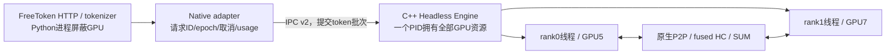

# Qwen3.8 Flash Next：FreeToken 原生 TP2 整栈迁移报告（2026-11-17）

> 仓库归档副本。历史执行状态按当时记录保留，以最终验收结论为准；原工作区的模型、日志、实验产物与容器镜像另行保留，未包含在源码仓库中。

**状态：本地融合与验收完成。已交付TP2原生后端、FP8 KV、MTP0/3、prefix恢复和诊断流程；主正式速度资格与最终版本控制按版本分别列出。**

本报告对应 [实施计划](qwen38_tp2_radiance_full_stack_speed_plan_20261117.md)。执行日志与冻结源位于 `.freetoken-zihao/radiance-native-20261117-01`。所有速度结论区分独立控制、筛查和正式确认；最终交付记录见`delivery-manifest.json`。

## 1. 模型与运行范围

模型文本主干48层，按3个GDN线性注意力层＋1个QSA层重复，共36 GDN、12 QSA。hidden size2560，HC为4条残差流、低秩320；QSA有24个query heads、2个KV heads、head_dim256，indexer budget2048、compress ratio4。每层512个routed experts、每token选10个，另有1个shared expert，expert intermediate640。PLE位于layer2，词表248320。MTP使用配套的一层full-attention head；depth3为串行提案后由主干验证，速度只数最终提交token。

实际采用现有 `/models/qwen3.8-next-flash-iqr-v4.rad`，121678372864字节，SHA256 `25aff8c950f4b823bc8b77c8184ed48827cb47058ffce08ae2c83b12e021fea0`。它来自BF16模型的IQR-V4配方，**不是原NVFP4 expert bank的直接零损转换**。用户已授权使用配套expert格式。原NVFP4目录只为新后端提供HF tokenizer；7条不同正常prompt已与原生tokenizer逐ID一致。未复制或重新量化权重。

单个主干decode token的顺序为：embedding（到layer2叠加PLE）→逐层HC输入混合→GDN或QSA注意力→HC残差写回→下一组HC输入混合→router选top10、routed MoE与shared expert→HC残差写回；48层后经最终归一化、词表投影和采样。QSA读取本地paged KV/index，GDN更新卷积与F32 recurrent state；MTP还要维护配套head状态。

MoE矩阵部分可直接按元数据核算：每expert的gate/up/down共`3×2560×640`个乘加；乘加按2 FLOPs计，top10 routed每层98.304MFLOP、shared每层9.8304MFLOP，48层合计5.19045GFLOP/主干token。这个数只覆盖MoE矩阵，attention、HC、GDN、router、PLE和量化/重排另计；也不把MTP草稿或被拒绝verify行免费折算成最终token。实际各层的毫秒占比需要覆盖新AQL/replay的合格trace，本轮该分布为unknown。

本轮为Radeon AI PRO R9700/gfx1201、ROCm10.1、TP2、batch/concurrency1、text-only。功能资格后切换到当前空闲且预约的物理GPU5/7（PCI `0000:a3:00.0`、`0000:e3:00.0`）；遥测报告两卡PCIe32GT/s×16、NUMA6/5；native启动日志确认两卡可直接peer-to-peer访问，数据通信走原生P2P/融合路径。不停止其他服务，不使用SMI3或unfiltered HIP3。

## 2. 整套融合的执行边界

导入了donor冻结提交 `2a2b756371c26f2768b8d129a098df275ace2c73` 所需的原生闭包：Qwen架构、GDN/QSA、HC、PLE、IQR MoE、shared expert、候选采样、expert mover、KV/GDN状态、MTP、recorded pass与AQL/chained调度。747是导入源码文件数，不能当作747个已测速算子。

实际已issued算子在`resolved-ops-rank*.json`有记录，代表项如下；动态M对应不同arm，表中不按注册kernel总数冒充已测数量。

| 部分 | 实际kernel代表项 | 本次接入内容 |
|---|---|---|
| routed/shared MoE | `moe_gemm_iqr`、`moe_gemm_w4a8i8`、受保护`moe_gemm_bf16` | 配套权重格式、原生分桶/量化与本地专家汇总 |
| HC与通信融合 | `hc_read_e4m3`、`ar_hc_write`、`ar_gather_hc_write` | rank本地分片直接接残差混合和SUM |
| GDN | `gdn_conv_recurrent_update_had_k128_v128_bf16`、`gdn_chunk_scan_k128_v128_c64_bf16` | decode recurrent与prefill chunk分别分派，保留F32 state |
| QSA与FP8 KV | `attn_decode_h256_gqa12_fp8kv`、`attn_prefill_h256_gqa12_fp8kv`、`qk_norm_rope_gate_kv_store_fp8` | 新增FP8 reader/store，配合QSA score/select和paged索引 |
| PLE | `ngram_ids_i32`、`ngram_hint_i32` | host共享表与GPU侧查取/计算 |
| 采样与MTP | `sample_topk_f32`、`sample_merge_topk_f32`、`sample_pick_f32`及spechub | 紧凑候选跨rank汇合、串行draft与主干verify |

本轮签署完整路径同设置R/F速度保留率及实际最终token速度；独立算子的净收益未单独计量。

FreeToken保留服务与tokenizer接口，模型执行由原生Engine统一持有；旧Torch逐GPU模型、dense wrapper和KV/expert池不进入这条路径。实际TP权重span、kernel/site、dispatch/replay与通信账本随每次完整退出保存。采样的4-token主干verify pass有1个独立SUM、48个`ar_hc_write`、48个`ar_gather_hc_write`，该pass的跨卡`all_gather`为0；这里的gather包含本地expert汇总，不能把97次误读为整个服务所有通信。drafter/sampler外围通信另计。

## 3. 迁移中修复的状态一致性问题

混合512/2K/8K请求历史下，旧prefix恢复曾产生不同输出。控制依次排除了checkpoint容量、recorded replay、host tier必要性、TP2必要性以及FP8/MTP专属性。关闭prefix的同历史重复输出一致；200项独立快照字节检查和140项save/restore哈希均一致。

直接页指纹进一步检出：恢复所用attention KV从第一个逻辑页起就与生成GDN/PLE快照时不同。旧缓存按逐4-token内容键保留已有页，完整prefill chunk不同的请求可能共享前半段token，却对应不同的已计算KV。仅限制发布长度修好了2K，8K仍失败。

最终改为：物理entry仍保持4 token，在每个cold chunk起点把完整chunk内容混入键链；lookup、insert、tier与checkpoint共用同一键构造。exact hybrid只发布完整cold-grid prompt前缀，并保持on-grid拆分。这样恢复的paged KV和recurrent snapshot来自同一计算上下文。

验证结果：

- 原生内存/prefix/tier CPU回归205项通过，含4项新增artifact级键空间检查；未新增永久测试文件。
- 修复后GPU的30请求字节门通过，两个rank的attention/QSA trunk页及GDN/PLE状态一致。
- 完整56条warm/截断续写＋28条独立prefix-off参考，共84请求逐ID一致，覆盖512/2049/8192/32768。
- 两rank各实际从host恢复3956179968字节，leader记录132084次promotion、0次tier failure；两个worker正常退出。覆盖的是实际搬运。

## 4. FP8 KV、MTP与服务资格

FP8 KV使用Qwen GQA12/page4的原生prefill/decode分派与融合QK/RoPE/store。10组194项独立局部检查通过，覆盖CPU attention参考、非连续反向页表、32K尾页、store字节一致及streamed mirror/ring。R/F共用新增FP8实现，只用于评估集成损耗；独立局部门与整模型正常任务负责验证新增实现。

FreeToken实际API完成21次正常生成（14个不同任务），覆盖32K、长检索、数学/中文/代码/JSON/翻译/严格指令、tool/reasoning；stream、stop、断连取消与后续恢复、输出上限1/2/3/4/5/7/17通过。MTP accepted draft按真正提交的token标记计数，原sampler接受数单列，长度截断丢弃的draft不计作有效输出。

完整prefix资格后，WHT6/FP8/MTP3另通过7条正常EOS任务，含32K；其速度已完成下表单启动控制，正式四对替代资格未签署。TP1已有INT8与FP8的正常任务控制，不据此宣称同预算TP1/TP2性能扩展率。

首轮独立镜像06 `sha256:1941dcf5e3626ef2a1f0ba3d62b4adbaaed87e82a9b9dfda6ef39c79c7a4c3dc` 在隐藏接收树和build目录后完成安装态API资格，实际worker/plugins映射均来自 `/opt/freetoken/python/freetoken/native/runtime`，逐文件SHA通过。对已核验身份的自有worker注入SIGKILL，活动请求2.64秒内HTTP503，服务退出；未注入driver或设备硬件fault。服务CPU回归677项通过。

## 5. 性能协议与当前结果

R为同源单owner原生HTTP参考，F为FreeToken headless接入。两者同IQR文件、同kernel、每卡32000MiB、context34816、prefill chunk2048、prefix关闭、temperature0、thinking关闭；512/2048/8192/32768输入，每请求256个输出token，每case固定3次预热＋3次计量，保留全部样本。

三个独立R A/A已通过，各case启动中位max/min波动低于0.15%。ABBA只是筛查，随后按AB/BA/BA/AB四对独立启动确认。每case的F/R几何平均须≥95%，TTFT/wall中位回退须≤10%。MTP0与3、KV INT8与FP8、wire exact与WHT6分别计量。

<!-- PERFORMANCE_BEGIN -->
### MTP3 / FP8 / exact：正式四对确认通过

| 输入长度 | R decode tok/s | F decode tok/s | 配对保留率 | F HTTP wall tok/s | F TTFT p50 / p95 ms |
|---|---:|---:|---:|---:|---:|
| 512 | 213.92 | 213.26 | 100.01% | 197.00 | 102.55 / 106.96 |
| 2048 | 211.23 | 209.94 | 96.88% | 173.79 | 257.70 / 260.16 |
| 8192 | 207.55 | 207.40 | 100.01% | 112.08 | 1051.20 / 1196.05 |
| 32768 | 198.83 | 198.64 | 99.91% | 45.53 | 4335.43 / 5042.28 |

每引擎4次独立启动、每case12条计量样本。表中速度是合并样本中位数；保留率按预登记的4对启动中位数之比取几何均值，不能用表中两个总中位数相除代替。三R A/A、ABBA与四对门均通过，全部正式R/F输出文本集相同。

第8次启动F的2K三条计量速度为177.09/209.33/186.49 tok/s，导致该case正式保留率降到96.88%；这些慢样本全部保留，未重跑替换。32K含prefill的完整HTTP约45.53 tok/s，decode约198.65 tok/s。SSE chunk间隔不当作逐token ITL。

该主cohort使用native28 C++/native29 Python；native30增加分配峰值和请求末metadata；native31修正Git可见性；最终native32增加默认关闭的轮数诊断。后两者GPU plugin与主cohort逐字节相同；额外检查与控制见第7/9节。独立配置控制的当前完成状态见下表。
<!-- PERFORMANCE_END -->

<!-- CONTROLS_BEGIN -->
### 独立配置控制（每启动每case3预热＋3计量）

| 路径 / MTP | KV | wire | 每卡预算 MiB | 512 | 2K | 8K | 32K，decode tok/s |
|---|---|---|---|---:|---:|---:|---:|
| R / metadata | FP8 | exact | 32000 | 214.13 | 178.73 | 207.67 | 198.89 |
| F / metadata | FP8 | exact | 32000 | 213.94 | 210.39 | 203.31 | 198.78 |
| F / final32 MTP3 | FP8 | exact | 32000 | 213.88 | 210.07 | 207.84 | 198.84 |
| R / MTP0 | FP8 | exact | 32000 | 125.34 | 116.83 | 124.36 | 121.80 |
| F / MTP0 | FP8 | exact | 32000 | 125.36 | 124.88 | 124.19 | 121.55 |
| F / MTP0 | INT8 | exact | 32000 | 125.98 | 125.55 | 124.77 | 122.55 |
| F / MTP3 | INT8 | exact | 32000 | 246.51 | 226.25 | 216.03 | 220.69 |
| F / MTP3 | FP8 | WHT6 | 32000 | 232.95 | 218.63 | 207.54 | 212.64 |
| F / MTP3 | FP8 | exact | auto | 213.73 | 211.18 | 207.51 | 198.84 |
| L / old R0w-W1 | BF16 | legacy | 6144slots | 18.28 | 18.68 | 21.51 | 18.62 |

这些控制全部保留首请求、预热和计量；不赋予各配置独立四对正式保留率资格。metadata行是native30的匹配控制；final32行是最终镜像08、诊断关闭的闭合单启动控制，主正式表仍为native28/29。auto为CLI默认的动态byte预算，原生公平对照固定32000MiB。旧L使用dense row-FP8＋NVFP4 experts、BF16 KV、6144slots、PLE disk与原CPU affinity策略，属于产品策略对照。

FreeToken MTP0/FP8在2K/32K的独立控制中位为124.88/121.55tok/s，均超过100；默认MTP3主正式中位209.94/198.65tok/s。观测配置比值约1.68×/1.63×，来自不同独立启动，包含MTP额外head/KV及planner状态差异。
<!-- CONTROLS_END -->

## 6. 配置、交付与证据

CLI preset `flashnext-speed`默认MTP3＋FP8 KV＋exact；MTP0/INT8控制仍可显式选择。默认prefix关闭，`--native-prefix-cache --native-prefix-cache-mib 1024`启用已验证的native恢复；它是原生tiered后端，不将其称为旧Torch hybrid已支持TP2。

代码已融合至 **`worktrees/qwen38-tp2-20261106`**。23个集成文件与747项native闭包全部逐文件SHA核对；通用build忽略规则遮住的6个源码已添加Git例外。接受树1374个Python目录树文件与接收树相同，原HEAD/其他dirty改动保留；未commit/push/创建PR。构建入口为`python -m freetoken.native.build`，保留原FreeToken后端作显式旧路径。许可/NOTICE与runtime manifest随payload交付。

核心证据：

- `model-identity.json`、`build-sources/native32-optin-round-ledger/`、`runtime-image-08.id`；主性能版本仍保存native28/29冻结。
- `n8-fp8-pages-numeric-03/passed.json`、`cpu-native-mem-02/result.json`、`cpu-server-all-03.log`。
- `n8-prefix-chunk-page-audit-02/`、`n8-full-prefix-wht6-01/full-prefix/`。
- `n9-installed-api-fatal-01/`：installed manifest/maps、完整API输出、503与清理记录。
- `n7-fp8-mtp3-exact-01/`及各启动目录：协议、源码/二进制SHA、全部请求、资源/时钟/功耗/温度/频率、完整退出账本。
- 知识库MG079–MG083分别保留负控制、状态修复、主性能资格、统计delta/控制失败及最终交付。

主cohort的allocator high-water为unknown；最终native30已增加有范围的owner生命周期峰值（rad_dev_alloc device＋elastic backing，排除plugin直接hipMalloc）。它与进程VmHWM、cgroup峰值和0.5秒采样驱动VRAM分列，不相加冒充完整物理峰值。正式8次启动采样每卡最大31.27–31.35GiB，cgroup memory.peak为64.62–66.08GiB，OOM/oom_kill均为0。相关性遥测不能唯一解释慢样本；未取得CPU调度或完整新AQL GPU关键路径trace。旧NVFP4与IQR配方之间的产品速度差额不能称作同权重kernel净收益。

### 驻留与搬运的实际观测

最终metadata F控制中，每卡expert payload在VRAM约26.32–26.56GiB，约2.28万个units；其余约0.22–0.24万个units在pinned tier。units包含MTP head，payload bytes不含slab空槽/保留和全部pool开销，不能与旧6144-slot参数按个数等价比较。各case尾部的累计加权路由resident比例约98.66%–99.13%；这不是逐token真实MISS率，也不能据此推算PCIe字节。

本控制prefetched/prefetch_bytes均为0，实际staging与H2D计数非零；因此不把本轮收益归因给后台prefetch。保留原生休眠/唤醒决策，未同时关闭heat、slab或mover。useful/wasted预取归因没有可靠计数，API显式null。KV host restore资格来自独立84请求组，不将这里关闭prefix的速度组冒称覆盖了host恢复性能。

## 7. metadata30 的控制与统计机制检查

native30与主cohort全部GPU plugin逐字节相同；207项CPU memory/prefix/tier回归通过。最终匹配pair的FreeToken为2K210.39、32K198.78tok/s，全部case相对旧F保留97.98%–100.24%；同pair的F/R速度、TTFT和wall门本身均通过。然而原预登记附加稳定性门R_new/R_old在2K只有84.84%，所以整个metadata-delta记录仍为false，不能静默改成通过。

新R2K有178.73/210.08/176.81tok/s，旧正式F此前有177.09/209.33/186.49。部分慢请求附近KFD等待计数增长211–229ms；这是粗采样关联，不能扣除或当作驱动根因。新R统计函数至HTTP解析结束上界0.71–2.06ms，device allocation累计数恒20，直接采集开销量级较小，其后已完成一次预登记ON/OFF/OFF/ON检验，全部样本保留；主cohort原正式资格及失败delta历史分开。

统计查询ON/OFF/OFF/ON四启动后续已按预登记门通过：ON/OFF速度保留率512/2K/8K/32K分别99.94%/100.38%/95.84%/100.08%，wall与TTFT门均通过。首ON的8K190.61tok/s慢组完整保留，未换样本；这组结果不支持2K存在持续统计开销回退，对8K只能给出上述有范围保留率，不能宣称零开销。原metadata-delta中的R稳定性失败仍保留为false。最终版本的功能/开销依据为207CPU、kernel/plugin SHA一致、实际F/旧F控制与这组机制单因素；主整栈正式保留率仍归属于native28/29，不冒称native30重做了完整15启动。

## 8. 性能含义与后续边界

整栈迁移同时改变配套量化格式、rank分片/融合、内存驻留与执行调度，并使用MTP；原生速度保留率与旧FreeToken产品速度差分别回答不同问题。新后端的host expert tier由GPU读取/计算，CPU负责调度和驻留管理；它不等于旧Torch TP2 hybrid CPU expert后端已完成适配，也没有证明旧CPU初始化慢化的底层触发点已修复。

当前32K的客户端TTFT约4.34秒、完整wall约5.62秒，TTFT约占77%。在已满足decode100tok/s目标后，提高32K整请求速度的下一项预算主要在prefill及其数据路径；具体分配到计算、staging或等待仍需合格的新AQL/replay trace。没有将累计通信/kernel时间或KFD计数相加、相减来制造关键路径。

### KV/wire控制的解释

INT8＋MTP3单启动控制的2K/32K为226.25/220.69tok/s；FP8匹配控制为210.39/198.78。两种KV的greedy续写文本在四case均不同。以2K为例，INT8提案282、真正接受并输出162；FP8提案303、接受155；32K分别为285/161与315/151。提案/接受数差异与速度差一致，说明MTP工作量发生了变化；不能把这组配置差额解释为FP8 reader kernel本身慢了约10%。

WHT6＋FP8＋MTP3控制为218.63/212.64tok/s，另有7条正常EOS质量通过。INT8和WHT6均保留显式可选项；默认仍是用户FP8要求下、已完整资格的exact组合，替代组合的正式四对保留率未签署。

## 9. 最终版本、安装态与本地交付

最终冻结为`native32-optin-round-ledger`。主GPU plugin逐文件SHA与主性能版本相同；两rank的模型op几何、device kernel bands和TP权重分片/格式声明一致，四case计量输出文本集一致。TP metadata全文件字节比较保留false：差异仅rank0的8行、rank1的4行运行时tier/site，属于动态驻留变化，未把它包装成形式等价证明。详见`final-core-identity-audit.json`。

最终镜像08：`sha256:7b13fbfcc5e34db3dcef739db9deb6c82e0c9eef56036eb450893bc9db3921bb`。

- 隐藏接收树/build后，最终镜像无诊断性能阶段完成24请求：2K/32K为**210.07/198.84tok/s**。该阶段正常退出，结束早于后续API共卡入侵，闭合证据为`suite-perf-closed-phase-audit.json`；它是最终版本单启动控制。
- 独立安装态API21、stream/stop/abort/tool/reasoning/输出上限通过，747个镜像内native源码及13个payload文件逐SHA一致；自有worker SIGKILL后1.89秒HTTP503并退出。输入/输出与原始错误记录均保留。
- 接受树MTP0诊断3条真实请求：verify回调为0、逐时间戳提交组均为1token；默认入口MTP3/FP8/exact另3条真实请求通过，实际maps来自接受树runtime，默认round ledger关闭，均graceful exit0。
- 接受树CPU服务677项通过；原生memory/prefix/tier207项通过；新增轮数账本3项独立CPU检查通过；FP8局部194项及prefix84请求资格保持。

`FREETOKEN_NATIVE_ROUND_LEDGER=1`启用逐请求host提交组、实际完成的draft-verify回调及每次回调后的produced总数。该诊断已在21条MTP3和3条MTP0请求闭合；时间包含draft、verify、调度、等待和探针自身，初始提交、sampler接受、native produced与IPC sent分列。未提交的issued-ahead pass和纯GPU verify时长仍在覆盖外。正式速度及最终无诊断控制均不启用此账本。

调用新路径需要显式`--execution-backend radiance-native`，使用现有IQR `.rad`文件与匹配tokenizer。默认数学组合为MTP3/FP8/exact，显存预算默认auto；复现主公平速度表时显式`--native-gpu-memory-mib 32000`。完整命令与约束见接受树`docs/radiance-native.md`；旧Torch后端继续保留。

## 10. 清理与验收结论

本任务GPU容器和active预约均为0；未停止其他服务、未调整驱动/sysfs/sysctl。外部任务进入造成的三个最终验证中止记录完整保留，不将其当作有效性能样本。最终perf阶段早于后续入侵而闭合，不重复已完成数据。

Runtime从实验树移动到接受树，工作区仅一份payload；本轮没有复制/重新量化模型权重。已删除6个自有中间镜像，保留最终08；修正自有产物权限以便用户管理。原始日志、失败、冻结patch和模型身份保留，任务artifact约5.7GiB，旧L JIT cache约83MiB。

| 验收项 | 结论 |
|---|---|
| 完整执行栈与服务 | 已本地融合；独立镜像和实际接受树入口通过 |
| 同源原生速度保留 | 主28/29三R A/A＋ABBA＋四对通过，四case96.88%–100.01%；最终32另有闭合控制，未冒称重复完整cohort |
| TP2/B1 decode100目标 | FP8：MTP0独立控制2K124.88/32K121.55；MTP3主正式209.94/198.65、最终控制210.07/198.84 |
| FP8 KV | 新增完整reader/store能力，局部194项、整模型/API/32K/MTP/prefix与host restore通过 |
| 限制 | 原metadata-delta R稳定性失败保留false；其他KV/wire/auto为独立控制；完整新AQL层级关键路径、真实瞬时物理峰值、硬件fault及全面质量基准未签署 |

本地知识库最终登记MG083，83条记录、383项证据校验全部通过；机器结果见`kb-verify-final.json`。
